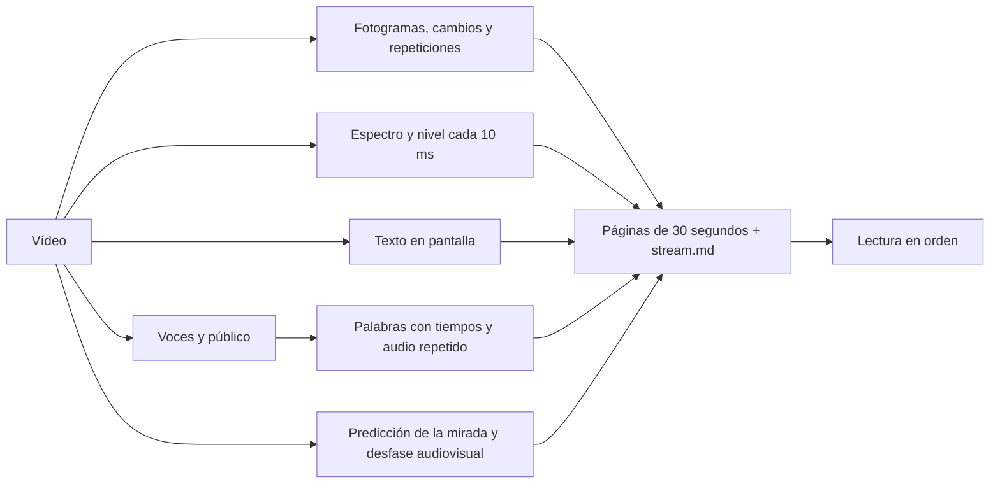

<a href="https://cdn.jsdelivr.net/gh/Dradradre/Reel@e9b9a19225546c9d1658f7309d7abe28f8673212/assets/door-demo.mp4">
<picture>
  <source media="(prefers-reduced-motion: reduce)" srcset="assets/door-at-cutoff.png">
  
</picture>
</a>

**[▶ Escucha A y luego B (18 segundos)](https://cdn.jsdelivr.net/gh/Dradradre/Reel@e9b9a19225546c9d1658f7309d7abe28f8673212/assets/door-demo.mp4)**

[English](README.md) | [한국어](README.ko.md) | [简体中文](README.zh-CN.md) | [繁體中文](README.zh-TW.md) | [日本語](README.ja.md) | **Español**

[Prueba con tu vídeo](#primeros-pasos) | [Resultados](#resultados) | [Guía de lectura en inglés](docs/READING.md)

# Ojos y oídos para un modelo de lenguaje

Dale un vídeo al modelo. Puede seguir viéndolo, acercarse a un detalle o volver a escuchar algo que le llamó la atención. Reel le entrega por MCP las imágenes y el sonido grabado en ese mismo instante. Si fijas `--until 8.5`, incluso al retroceder solo tendrá acceso a los primeros 8,5 segundos.

## Antes de que se abra la puerta

**Los mismos 204 fotogramas con dos grabaciones distintas.** Detuvimos ambos vídeos a los 8,5 segundos, con la puerta todavía cerrada. Estas son las respuestas de GPT, traducidas del inglés.

| A: con llaves en la grabación | B: solo con el sonido ambiente de la habitación |
|---|---|
| «El análisis del audio sugería un breve tintineo o traqueteo, aunque no pude oírlo directamente». | «No pude distinguir qué producía ese tenue sonido de fondo». |

En esta prueba, GPT recibió en Codex las imágenes y la descripción de un modelo local que había escuchado la grabación. El vídeo reproduce los 8,5 segundos de A y los 8,5 de B con la misma ganancia y muestra las respuestas originales. Las llaves suenan en A del segundo 4,0 al 6,73. GPT describió el sonido y dejó abierta la cuestión de qué lo producía. [Respuestas originales](docs/benchmarks/short-listening-turns.json) · [Cómo reproducir la prueba (en coreano)](docs/door-trial.md#재현) · [Grabación de las llaves por Joao_Janz (CC0)](https://freesound.org/people/Joao_Janz/sounds/485110/)

## Pruébalo con un montaje

> Mira este montaje. Busca un tramo en el que la imagen se congele y el sonido siga. Dime cuándo empieza y acaba, y vuelve a reproducirlo.

En el vídeo de prueba, la imagen permanece fija **de 00:38 a 00:41** mientras el audio continúa. Los cuatro fotogramas de abajo corresponden a los segundos 37,5, 38, 40 y 41. Muestran la imagen antes de detenerse, durante la pausa y al recuperar el movimiento.


Una vez visto el tramo, el modelo puede llamar a `observe(start_s=38, end_s=41)` para examinar los fotogramas junto con el audio original. También puedes preguntarle por un subtítulo, un sonido repetido o un movimiento entre dos planos. [Código del vídeo y tiempos de los cambios](examples/make_demo.py) · [Herramientas de reproducción (en inglés)](docs/READING.md#watching-a-little-at-a-time)

## Primeros pasos

Necesitas un Mac con chip de Apple, FFmpeg y Python 3.11 o posterior. Sustituye `film.mp4` por la ruta a tu vídeo.

```bash
git clone https://github.com/Dradradre/Reel.git && cd Reel
python3 -m venv .venv && source .venv/bin/activate
python -m pip install -e '.[mcp]'
reel play film.mp4 --out reels/first-view --until 8.5
```

Cada vez que se detiene, el reproductor muestra la ruta del directorio donde ha guardado ese tramo. Escribe `next` para avanzar o `quit` para salir. Para volver a ver el vídeo desde el principio, utiliza otro directorio de salida.

**Ver el vídeo con un modelo.** Reel entrega el vídeo mediante el protocolo MCP (Model Context Protocol). Si ya has iniciado sesión en Codex CLI, registra el servidor local desde el entorno virtual activo y abre un chat nuevo.

```bash
codex mcp add reel -- "$(command -v reel)" mcp "$PWD/film.mp4" --until 8.5 --image-client
```

> Mira el vídeo con Reel. ¿Qué has visto y qué has oído?

Para otros clientes MCP, usa `reel mcp /absolute/path/to/film.mp4 --until 8.5` como comando del servidor stdio. Los clientes que admiten audio pueden recibir un WAV con los canales originales. Los que leen imágenes y texto reciben los fotogramas y mediciones como el nivel y el espectro. Hay modelos locales opcionales que describen el sonido y transcriben las palabras con sus tiempos. El modelo que escucha la forma de onda ocupa unos 39 GB. [Opciones de reproducción](#opciones-de-reproducción)

## Imagen y sonido en la misma escala de tiempo

| Durante la reproducción | Qué puede hacer el modelo |
|---|---|
| Avanzar | Llamar a `view(turn=1)` y después a `view(turn=2)`. Cada llamada da acceso al siguiente tramo. |
| Acercarse | Indicar un instante y un rectángulo con `look` para leer un letrero o ver qué lleva alguien en la mano con los píxeles originales. |
| Repetir | Tras llegar al segundo 6, llamar a `observe(start_s=4, end_s=6)` para examinar esos dos segundos de imágenes junto con su grabación. |

Reel también puede distribuir el vídeo en páginas de 30 segundos que se leen de izquierda a derecha. Una línea vertical en cualquier instante une la imagen, el movimiento, el sonido y las palabras de ese momento. Cada fotograma contribuye a la curva de cambios de imagen y cada 10 milisegundos de audio a la del nivel sonoro. [Abrir la primera página a tamaño completo](assets/reel_page_1.png) · [Ver los 30 segundos siguientes](assets/reel_page_2.png)

[](assets/reel_page_1.png)

<details>
<summary>Cómo leer las filas</summary>

| Etiqueta en la página o el reproductor | Qué muestra |
|---|---|
| `frames over time`, `change` | Qué se veía en cada instante y cuánto cambió el color entre fotogramas. Permite ver destellos, cortes a negro e imágenes congeladas. |
| `motion point`, `follow` | Cuántas veces y en qué dirección se cruza un punto, o cómo se desplaza de un fotograma al siguiente un detalle seleccionado. |
| `subject`, `on screen` | Dónde aparece el sujeto, qué zona podría atraer la mirada y qué texto había en pantalla. |
| `seen again` | El verde indica que dos imágenes de vista previa coinciden píxel por píxel. El azul señala una composición parecida en un momento anterior. |
| `sound`, `level`, `L level`, `R level` | El espectro en una escala fija de −80 a 0 dBFS y los niveles de cada canal. Se puede seguir un fundido o una subida repentina. |
| `sounds like`, `heard again` | Posibles fuentes y fragmentos anteriores para comparar una repetición, un eco o dos sonidos parecidos. |
| `1 early`, `2 early` | A qué canal llegó antes una forma de onda parecida. Los niveles pueden ser iguales aunque haya un pequeño desfase. |
| `film time`, `pixel change`, `ch peak`, `ch bands Hz` | El movimiento, los picos de cada canal y sus bandas de frecuencia, alineados para ver cuándo coinciden. |
| `joint`, `in sync?` | Cómo encaja el sonido con un movimiento visible, como el de los labios, un paso o un golpe. |
| `crowd stem`, `said` | Una estimación del sonido del público junto a la mezcla original. Para citar palabras, se consultan las que coinciden en dos transcripciones. |

[Guía completa de las filas (en inglés)](docs/READING.md)

</details>

## Resultados

| Prueba | Resultado de GPT en Codex local |
|---|---|
| Preguntas visuales en instantes concretos de los 644 vídeos de OVO-Bench | **66,08 puntos** en la media oficial de las tres modalidades. GPT acertó 2.002 de 3.035 preguntas utilizando solo imágenes anteriores a cada pregunta. [Puntuación y método](docs/benchmarks/ovo-full.json) |
| Recuerdo libre de imágenes y sonidos en 12 vídeos desconocidos | **78,8 % en imagen y 43,8 % en sonido**, tomando las descripciones humanas como referencia. Con el mismo peso para ambos se obtuvo un 61,3 % (intervalo del 95 %: 43,3–91,1 %). [Respuestas y cálculo](docs/benchmarks/track-recall.json) |

La prueba de recuerdo mide hasta qué punto una descripción permite distinguir su vídeo de los demás. En una escena de una fiesta, tres de las cuatro personas que escucharon la grabación mencionaron que se oía cantar. GPT recordó aplausos y voces, pero pasó por alto el canto. [Análisis por vídeo (en coreano)](docs/perception-check.md#화면과-녹음을-바꿔-끼운-뒤의-자유-회상)

<details>
<summary>Pruebas a ciegas, fallos y falsas alarmas</summary>

Se introdujeron errores de montaje en una selección de 26 vídeos de distintos géneros y se dejó intacto uno por ronda. El modelo desconocía la solución. En la quinta ronda, con el código ya fijado, encontró 12 de los 17 errores. Detectó los tres cortes a negro y los tres ecos, pero se le escapó la única imagen congelada. También confundió un zumbido en una retransmisión de ajedrez con una subida repentina de volumen. [Rondas anteriores y observaciones (en inglés)](README.md#does-it-work)

</details>

## Opciones de reproducción

Para activar la descripción local del sonido y el reconocimiento del habla, ejecuta estos comandos en el entorno virtual activo.

```bash
python -m pip install -e '.[speech]'
reel setup --speech --describe-sounds
```

Por defecto, el reproductor de terminal solo espera al reconocimiento del habla cuando se lo pides. Con `--speech` espera en cada tramo. En una prueba con 32 fragmentos, la mediana en el Mac utilizado fue de 9,5 segundos por solicitud de reconocimiento. [Condiciones de la medición (en coreano)](docs/listening-check.md#같은-사진에서-화자가-설명하는-곳이-달라질-때)

<details>
<summary>Escuchar solo el audio, generar páginas o examinar un instante</summary>

El ejemplo de generación de páginas usa un vídeo en inglés. Cambia `--lang en` según el idioma que se hable en tu vídeo.

```bash
reel play film.mp4 --out reels/sound-only --until 8.5 --tracks sound
reel watch film.mp4 --out reels/pages --until 8.5 --lang en
reel frame reels/pages --at 5
reel listen reels/pages --t0 4 --t1 7
reel observe reels/pages --t0 4 --t1 4.5
```

Abre sesiones nuevas con el mismo archivo y selecciona `--tracks picture`, `--tracks sound` o la opción predeterminada `--tracks both` para comparar qué se percibe al ver, al escuchar o al hacer ambas cosas. Las tres opciones conservan los tiempos y el punto de corte originales.

`reel watch` genera las páginas para leerlas en orden. Con `reel frame` se recupera la imagen de un instante concreto. `reel observe` empareja cada fotograma del intervalo con las muestras de audio que sonaron mientras se mostraba. Ejecuta `reel doctor` para ver qué funciones tienes disponibles. [Todos los comandos y modelos opcionales (en inglés)](README.md#playback-options)

</details>

<details>
<summary>Qué formato recibe el cliente</summary>

Si el cliente admite vídeo, puede llamar a `view_media(turn=1, continuous_seconds=5)` y leer los fragmentos devueltos en orden. Conservan los tiempos de la imagen y los canales grabados. Con `--image-client`, la llamada habitual a `view` devuelve las imágenes y las descripciones locales disponibles. El WAV se puede pedir por separado. Para inspeccionar las mediciones sin interpretaciones del sonido, usa `sound_estimates=false`.

</details>

<details>
<summary>Cómo se construye una página de 30 segundos</summary>



</details>

Durante la reproducción, `audio.attacks` indica cuándo sube bruscamente la energía de cada canal. Un solo tintineo puede producir varias marcas. En 56 grabaciones de prueba, Reel localizó 359 de los 431 inicios de nota anotados por personas con un margen de 50 ms. Las subidas de nivel por banda permitían localizar 215. [Mediciones por grabación](docs/benchmarks/attack-timing.json)

Con `reel setup --identify-sounds`, Reel compara las fuentes propuestas con la grabación usando PE-AV y CLAP. En 99 grabaciones, PE-AV acertó 94 veces y CLAP 85. Al retirar la opción correcta, los dos coincidieron en otra fuente 40 veces. En otras 49 grabaciones, comprobar también las fuentes fuera de la lista redujo esos errores de 16 a 0. Con la opción correcta presente, conservó 21 de los 39 aciertos compartidos. [Prueba con la fuente omitida](docs/benchmarks/source-outside-choices.json). [Resultados por grabación](docs/benchmarks/source-identity-agreement.json)

## Límites

Aunque se distinga cuándo ha sonado algo, puede ser difícil identificar una fuente que está fuera de campo. Es fácil perder palabras entre el ruido del público o pasar por alto una imagen congelada en un plano casi inmóvil. Una voz en off, música sobre un paisaje o un montaje rápido ofrecen pocas pistas para juzgar la sincronía. La posición de la mirada es una predicción del modelo. [Más ejemplos (en inglés)](README.md#limits)

## Créditos

Joao_Janz publicó la grabación de las llaves bajo CC0. Las páginas de ejemplo usan «Crypto», de Kevin MacLeod (CC BY 4.0), y una narración creada con `say` de macOS. Reel utiliza Whisper para reconocer el habla, Demucs para separar pistas, UNISAL para estimar dónde se dirige la mirada y Synchformer para medir el desfase entre imagen y sonido. Los pesos de cada modelo, los conjuntos de datos y los vídeos originales tienen sus propias licencias. [Autores, fuentes y licencias (en inglés)](README.md#credits)

<details>
<summary>Modelos y datos citados en esta página</summary>

- Descripción del audio — [Qwen3-Omni](https://huggingface.co/Qwen/Qwen3-Omni-30B-A3B-Instruct)
- Sincronía audiovisual — [Synchformer](https://github.com/v-iashin/Synchformer)
- Preguntas visuales en instantes concretos — [OVO-Bench](https://github.com/JoeLeelyf/OVO-Bench#license)
- Descripciones humanas de imagen y sonido — [AVCaps](https://huggingface.co/datasets/TUT-ARG/AVCaps)

</details>

## Licencia

[MIT](LICENSE)
