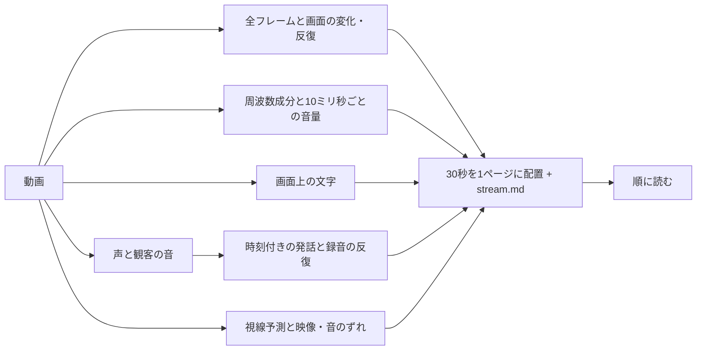

<a href="https://cdn.jsdelivr.net/gh/Dradradre/Reel@e9b9a19225546c9d1658f7309d7abe28f8673212/assets/door-demo.mp4">
<picture>
  <source media="(prefers-reduced-motion: reduce)" srcset="assets/door-at-cutoff.png">
  
</picture>
</a>

**[▶ A と B を順に聴く（18秒）](https://cdn.jsdelivr.net/gh/Dradradre/Reel@e9b9a19225546c9d1658f7309d7abe28f8673212/assets/door-demo.mp4)**

[English](README.md) | [한국어](README.ko.md) | [简体中文](README.zh-CN.md) | [繁體中文](README.zh-TW.md) | **日本語** | [Español](README.es.md)

[手元の動画で試す](#クイックスタート) | [測定結果](#測定結果) | [読み方ガイド（英語）](docs/READING.md)

# 言語モデルに、映像を見る目と音を聴く耳を

動画を渡すと、モデルは続きを見たり、気になった箇所を拡大したり、今の音を聴き直したりできる。Reel は MCP を通じて、画面とその瞬間の録音を同じ時刻にそろえてモデルに渡す。`--until 8.5` を指定すると、見返せる範囲も冒頭の8.5秒までになる。

## ドアが開く前に

**画面は204フレームとも同じ。録音を変えると答えが変わった。** どちらもドアがまだ閉じている8.5秒で止めた。以下は GPT の回答の日本語訳。

| A：鍵の音を加えた録音 | B：部屋の環境音だけ |
|---|---|
| 「直接聴くことはできませんでしたが、音声の分析からは、何かが短くチャリチャリ、あるいはカタカタ鳴ったようです。」 | 「かすかな背景音が何から出ていたのかは、わかりませんでした。」 |

この試行でローカルの Codex 上の GPT に渡したのは、画面と、別の音声モデルが録音を聴いて書いた説明。動画では A と B をそれぞれ8.5秒、同じゲインで再生し、回答の原文を表示する。A の4.0〜6.73秒には鍵の音が入っている。GPT は音の特徴を挙げ、音源の特定まではしなかった。[回答の原文](docs/benchmarks/short-listening-turns.json) · [再現手順（韓国語）](docs/door-trial.md#재현) · [Joao_Janz による鍵の録音（CC0）](https://freesound.org/people/Joao_Janz/sounds/485110/)

## 編集中の動画で試す

> この動画を見て、音は続いているのに画面が止まるところを探して。始まりと終わりの時刻を教えて、その区間をもう一度再生して。

デモでは **00:38 から 00:41** まで画面が止まり、音はそのまま続く。下の4枚は37.5秒、38秒、40秒、41秒の画面。動きが止まる直前から再び動き出すまでを、録音の波形と見比べられる。


そこまで見たモデルは `observe(start_s=38, end_s=41)` で、各フレームとその時の原音を確かめられる。字幕が出た時刻や、繰り返した音、カットをまたぐ動きについても質問できる。[デモの生成コードと時刻](examples/make_demo.py) · [再生ツール（英語）](docs/READING.md#watching-a-little-at-a-time)

## クイックスタート

Apple シリコン搭載の Mac、FFmpeg、Python 3.11 以降が必要。`film.mp4` を手元の動画のパスに置き換えて実行する。

```bash
git clone https://github.com/Dradradre/Reel.git && cd Reel
python3 -m venv .venv && source .venv/bin/activate
python -m pip install -e '.[mcp]'
reel play film.mp4 --out reels/first-view --until 8.5
```

再生が一時停止するたびに、その区間の保存先が表示される。`next` で次へ進み、`quit` で終了する。最初から見直すときは新しい出力先を指定する。

**モデルと一緒に見る。** Reel は Model Context Protocol（MCP）経由で映像を渡す。ログイン済みの Codex CLI で試すには、仮想環境を有効にしたままローカルサーバーを登録し、新しいチャットを開く。

```bash
codex mcp add reel -- "$(command -v reel)" mcp "$PWD/film.mp4" --until 8.5 --image-client
```

> Reel でこの動画を見て。何が見えて、どんな音が聞こえた？

ほかの MCP クライアントでは、stdio サーバーの起動コマンドに `reel mcp /absolute/path/to/film.mp4 --until 8.5` を指定する。音声入力に対応するクライアントには元のチャンネル構成の WAV を渡せる。画像とテキストを読むクライアントは、画面や音量、周波数の測定値を受け取る。追加のローカルモデルを導入すれば、音の説明や時刻付きの文字起こしも読める。波形を聴いて説明するモデルは約39 GB。[再生オプション](#再生オプション)

## 映像と音を同じ時間軸で読む

| 見ている途中で | モデルができること |
|---|---|
| 先へ進む | `view(turn=1)`、`view(turn=2)` の順に呼ぶと、ひと区間ずつ先の映像と音が届く。 |
| 拡大する | `look` に時刻と範囲を指定し、元の画素で看板の文字や手に持っているものを確かめる。 |
| 見返す | 6秒まで見たら、`observe(start_s=4, end_s=6)` で、その2秒間に表示された画面を当時の録音と一緒に振り返る。 |

30秒を1ページにまとめて左から右へ読むこともできる。好きな時刻に縦線を引くと、その瞬間の画面、動き、音、発話が並ぶ。画面変化のグラフには全フレームが、音量のグラフには10ミリ秒ごとの測定値が反映される。[最初のページを原寸で開く](assets/reel_page_1.png) · [次の30秒を見る](assets/reel_page_2.png)

[](assets/reel_page_1.png)

<details>
<summary>図に並ぶ各行の読み方</summary>

| ページや再生時の表示 | 読み取れること |
|---|---|
| `frames over time`、`change` | 実際に表示された画面と、隣接するフレームの色の変化。フラッシュ、暗転、静止を見つける。 |
| `motion point`、`follow` | 物が指定位置を横切った回数と向き、または以前選んだ箇所のフレームごとの動き。 |
| `subject`、`on screen` | 被写体の位置、目を引きそうな箇所、その時に出ていた文字。 |
| `seen again` | 緑は保存されたカラー画像の画素が一致した時刻、青は似た構図が以前にあった時刻。 |
| `sound`、`level`、`L level`、`R level` | −80〜0 dBFS の共通目盛りで見た周波数成分と、各チャンネルの音量。 |
| `sounds like`、`heard again` | 音源の候補と、以前に似た音がした時刻。録音を聴き比べて反響や繰り返しを確かめる。 |
| `1 early`、`2 early` | 似た波形がどちらのチャンネルに先に届いたか。音量が同じでも時間差が出ることがある。 |
| `film time`、`pixel change`、`ch peak`、`ch bands Hz` | 動きと各チャンネルのピーク、周波数帯の変化が重なる時刻。 |
| `joint`、`in sync?` | 動きと音を一緒に確認する。口の動きや足音、打球の音が合うかを見る。 |
| `crowd stem`、`said` | 観客の音を推定して元のミックスと比較する。発話を引用するときは2回の文字起こしで一致した語を使う。 |

[各行の詳しい説明（英語）](docs/READING.md)

</details>

## 測定結果

| 試験 | ローカルの GPT の結果 |
|---|---|
| OVO-Bench の動画全644本で、指定時刻に映像を見て答える | 公式の3部門平均で **66.08点**。質問の時刻より前の画面だけを使い、3,035問中2,002問に正答。[スコアと手順](docs/benchmarks/ovo-full.json) |
| 初めて見る動画12本で、覚えている映像と音をそれぞれ記述する | 人間の記述を基準にすると **映像78.8%、音43.8%**。等しく重み付けした値は61.3%で、95%区間は43.3〜91.1%。[動画別の回答と採点](docs/benchmarks/track-recall.json) |

この再生後のテストでは、書かれた説明からその動画をほかの動画とどれだけ区別できるかを測った。あるパーティーの録音では、聴き手4人のうち3人が歌声に触れた。GPT が覚えていたのは拍手と話し声で、歌声は抜けていた。[動画ごとの分析（韓国語）](docs/perception-check.md#화면과-녹음을-바꿔-끼운-뒤의-자유-회상)

<details>
<summary>ブラインド試験での見落としと誤検出</summary>

さまざまなジャンルの動画26本に編集上の乱れを加え、各ラウンドで1本は元のままにした。モデルには正解を知らせていない。コードを固定した第5ラウンドでは17件中12件を検出。暗転3件とエコー3件はすべて捉えた一方、唯一の静止箇所を見落とした。チェスの動画では、低い持続音を突然の音量上昇と誤って判断した。[過去の全ラウンドと観察記録（英語）](README.md#does-it-work)

</details>

## 再生オプション

音が重なる場面では、`reel setup --layers` を実行してから `listen_layer(turn=N, start_s=2, end_s=5)` を呼ぶと、原音、最も大きいと推定された成分、その成分を原音から引いた残りを順に確認できる。それぞれにスペクトログラムが付き、音声対応クライアントでは WAV も受け取れる。別のモデルにも同じ録音を聴かせるには、`listen` で `independent_caption=true` を指定する。

音の説明と文字起こしをローカルで利用するには、仮想環境で次を実行する。

```bash
python -m pip install -e '.[speech]'
reel setup --speech --describe-sounds
```

端末のプレーヤーは通常、音声認識を要求したときだけ結果を待つ。`--speech` を付けると各区間で待つ。32区間で測った際、使用した Mac での認識時間の中央値は1リクエスト当たり9.5秒だった。[測定条件（韓国語）](docs/listening-check.md#같은-사진에서-화자가-설명하는-곳이-달라질-때)

<details>
<summary>音だけを聴く、ページを作る、指定した区間を見直す</summary>

以下のページ生成例では英語の動画を想定している。`--lang en` は動画内で話される言語に合わせて変更する。

```bash
reel play film.mp4 --out reels/sound-only --until 8.5 --tracks sound
reel watch film.mp4 --out reels/pages --until 8.5 --lang en
reel frame reels/pages --at 5
reel listen reels/pages --t0 4 --t1 7
reel observe reels/pages --t0 4 --t1 4.5
```

同じファイルで新しいセッションを開き、`--tracks picture`、`--tracks sound`、既定の `--tracks both` を切り替えると、映像のみ、音のみ、両方で何に気づくかを比べられる。どのモードも元の時刻と停止位置を保つ。

`reel watch` は順に読めるページを作る。`reel frame` は指定時刻の画面を取り出し、`reel observe` はその区間に表示された各フレームと、表示中に再生された音声サンプルを対応付ける。`reel doctor` で利用可能な機能を確認できる。[コマンドと追加モデルの詳細（英語）](README.md#playback-options)

</details>

<details>
<summary>クライアントに届く音声の形式</summary>

動画を入力できるクライアントでは `view_media(turn=1, continuous_seconds=5)` を呼び出し、返された映像を順番に読める。表示時刻と元の音声チャンネルは保たれる。`--image-client` で起動した場合、通常の `view` は画像と利用可能なローカルの音声記述を返す。WAV は必要なときに要求できる。音の推定を省いて測定値を調べるには `sound_estimates=false` を指定する。

</details>

<details>
<summary>30秒のページができるまで</summary>



</details>

MCP の最初の表示では、短い間に続く音の立ち上がりが `audio.rapid_rises` に出る。詳細表示と `play` では `audio.attacks` にチャンネル別の検出時刻がすべて載る。鍵が一度鳴っただけで複数の印が付くこともある。検証用の録音56件では、人が記録した431個の音の立ち上がりのうち、359個を50ミリ秒以内の誤差で捉えた。従来の周波数帯別の音量変化から拾えたのは215個だった。[録音ごとの結果](docs/benchmarks/attack-timing.json)

`reel setup --sound-examples` を実行すると、最初の再生から116種類の音源の実録音942件と531の名称を照合して、選択肢がなくても音源を推定する。評価用の録音244件では71件が正解、8件が誤答で、165件は音源を特定できなかった。[録音ごとの結果](docs/benchmarks/reference-sources.json)

周囲と音が変わった箇所は、その区間の原音をもう一度聴く。短い区間で初めて候補に挙がった音源名は、別の音声モデルでも照合する。音源を特定できなくても、リプレイで時刻、チャンネル、音量、周波数帯を確認できる。

映像を見せずに24件の録音について96問を尋ねると、GPTの答えが人間の多数意見と一致したのは58問から64問に増えた。聴いた場面を自由に説明する課題では、人間を100としたスコアは51.9から51.4だった。[回答と採点方法](docs/benchmarks/focused-listening.json)

同じ244件のうち、候補に正しい音源名が含まれた録音は84件から121件に増えた。新たに加わった誤答は6件だった。GPTに自由回答させた22件では変更前も変更後も正解は10件だった。[個別の回答と対照実験](docs/benchmarks/reference-source-listeners.json)

`reel setup --identify-sounds` を実行すると、PE-AV と CLAP が同じチャンネルの原音を聴き、それぞれ音源の候補を選ぶ。生活音の録音99件のうち、正解は PE-AV が94件、CLAP が85件だった。正解を選択肢から外すと、40件で両者が同じ誤答を選んだ。別の49件では、選択肢の外も調べると、この誤答は16件から0件に減った。正解を戻した場合、もともと両者が正解した39件のうち21件で回答を維持した。[選択肢から正解を外した試験](docs/benchmarks/source-outside-choices.json)、[録音ごとの結果](docs/benchmarks/source-identity-agreement.json)

## わかりにくいこと

音がした時刻を捉えても、画面外にある音源まではわからないことがある。歓声に埋もれた言葉や、もともと動きの少ない場面の静止は見落としやすい。ナレーション、風景に重なる音楽、短いカットの連続では、音と動きの同期を確かめる手がかりが少ない。視線の位置はモデルによる予測。[具体例（英語）](README.md#limits)

## クレジット

鍵の録音は Joao_Janz が CC0 で公開。ページ例の楽曲は Kevin MacLeod の「Crypto」（CC BY 4.0）、ナレーションは macOS の `say` で作成した。Reel は音声認識に Whisper、音源分離に Demucs、視線予測に UNISAL、映像と音のずれの推定に Synchformer を用いる。モデルの重み、データセット、元の動画にはそれぞれの利用条件がある。[作者、データセット、ライセンス一覧（英語）](README.md#credits)

<details>
<summary>このページで使うモデルとデータ</summary>

- 録音の記述 — [Qwen3-Omni](https://huggingface.co/Qwen/Qwen3-Omni-30B-A3B-Instruct)
- 映像と音の同期 — [Synchformer](https://github.com/v-iashin/Synchformer)
- 指定時刻の映像についての質問 — [OVO-Bench](https://github.com/JoeLeelyf/OVO-Bench#license)
- 人が映像と音を書き記したデータ — [AVCaps](https://huggingface.co/datasets/TUT-ARG/AVCaps)

</details>

## ライセンス

[MIT](LICENSE)
