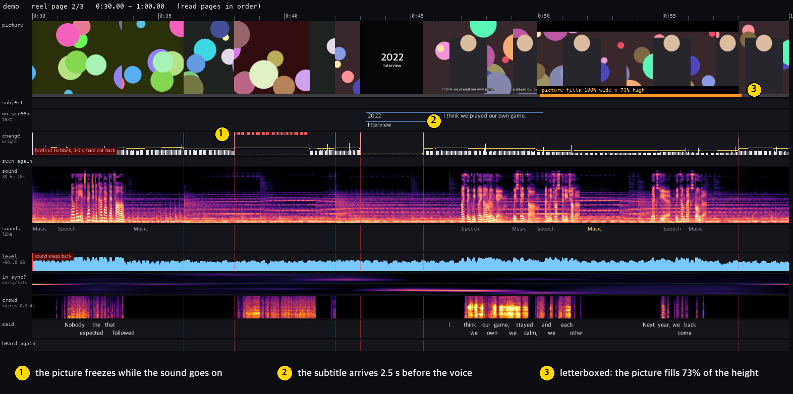

<div align="center">

# Reel

**언어 모델에게 영상을 보는 눈과 귀를**

Reel은 영상 하나를 글과 그림만 읽는 모델이 처음부터 끝까지 넘겨 볼 수 있는 페이지로 바꾼다.
모델은 그 페이지를 순서대로 읽으면서 시청자가 거슬려 할 지점을 알아챈다. 이야기 순서가 튀는 곳,
같은 소리가 두 번 나오는 곳, 화면이 멈춘 곳, 자막과 목소리가 어긋난 곳, 관중이 어떤 이름을 외치는 곳 같은 것들이다.


[English](README.md)


</div>

## 풀려는 문제

언어 모델은 이제 편집 목록을 짜고 모션 그래픽을 만들고 영상 파이프라인 전체를 돌리지만 결과물은 여전히 못 본다.
정지 화면 몇 장과 숫자만 보니 사람이 실제로 지적하는 문제는 그대로 빠져나간다. 해설 1초가 두 번 재생되는 것도,
무음으로 뚝 끊기는 것도 모른다. 자막이 목소리보다 8초 먼저 뜨거나 상대 팀 이름을 외치는 관중 녹음이 반복해서 깔려도 마찬가지다.

흔한 해결책으로는 이 빈틈이 안 메워진다. 몇 초마다 한 장씩 뽑으면 그 사이를 놓치고 알려진 문제마다 검사를 붙이면
이미 아는 문제만 잡히기 때문이다. 사람은 처음부터 순서대로 보다가 뭔가 걸리면 그때 알아챈다.

## 아이디어

글을 읽는 모델에게는 읽는 순서가 곧 시간이다. 그러니 영상 전체를 빠짐없이, 읽는 순서대로 주면 된다.

- **빈틈 없음.** 모든 프레임과 10ms 단위의 모든 소리가 페이지 어딘가에 흔적을 남긴다. 표본을 뽑지 않고 픽셀 열마다 최댓값을
  남기기 때문에 한 프레임짜리 번쩍임이나 1초짜리 반복도 사라지지 않는다.
- **하나의 시간축.** 화면, 자막, 소리, 음량, 관중, 말이 같은 시간축에 놓이므로 목소리가 그 화면의 것인지, 컷과 소리가 같이 바뀌는지가 보인다.
- **기억.** 시청자는 "방금 들었는데", "아까 본 장면인데" 하고 느낀다. Reel은 둘 다 표시한다. 같은 녹음이 다시 재생되면
  빨간색으로, 비슷한 장면이나 같은 사람의 목소리가 돌아오면 처음 나온 시점과 함께 적는다.
- **읽고 나서 판단.** 페이지는 30초씩 앞으로만 진행한다. 독자는 요약을 보기 전에 한 장씩 읽으며 짧은 기록을 남기고,
  페이지에는 판정을 적지 않는다.

## 페이지 구성



| 줄 | 내용 | 시청자가 알아채는 것 |
|---|---|---|
| picture | 모든 장면을 실제 길이로. 화면 모양 띠와 화질 띠 | 무엇이 나오는지, 검은 띠, 작은 화면, 흐리거나 늘린 화면 |
| subject | 영상의 주인공이 화면 어디에 있는지, 시선이 거기로 가는지 | 주인공을 놓치는 장면 |
| on screen | 읽을 수 있는 크기의 제목, 자막, 배너 | 날짜, 장소, 스코어로 이어지는 이야기 |
| change | 프레임 간 변화, 밝기, 정지 표시 | 컷, 번쩍임, 암전, 멈춘 화면 |
| seen again | 앞에서 나온 장면 | 돌려 쓴 영상 |
| sound | 스펙트로그램과 소리 장면이 바뀌는 지점 | 음악, 목소리, 무음. 컷과 소리가 같이 바뀌는지 |
| sounds like | 매초 무슨 소리처럼 들리는지(AudioSet 분류) | 찰싹 소리 같은 타격음, 싸구려 신시사이저 음악, 관중 |
| level | 10ms 단위 음량. 소리가 뚝 끊기거나 다시 튀어나오거나 한 번에 커지는 곳에 빨간 표시 | 갑작스러운 무음, 확 올린 볼륨 |
| in sync? | 소리가 화면보다 빠른지 늦은지, 2초 빠름부터 2초 늦음까지 매 순간 | 말보다 먼저 움직이는 입, 소리보다 먼저 맞는 공 |
| crowd | 음악과 해설에서 분리한 관중 소리. 박자로 구호를 찾고 들린 말을 화면에 나온 이름 중 발음이 가장 비슷한 것에 맞춤 | 관중이 구호를 외치는지, 무엇을 외치는지 |
| said | 해설과 인터뷰의 말 | 무슨 말인지, 자막과 맞는지 |
| heard again | 같은 녹음이 다시 재생되면 빨간색(3초 안의 메아리, 먼 곳에서 붙여넣은 구간 모두), 비슷한 목소리가 돌아오면 그 시점 | 편집 실수로 생긴 반복, 돌려 쓴 관중 녹음 |

## 시험 결과

정답을 모르는 새 독자(읽는 법 [안내서](docs/READING.md)와 페이지만 받은 모델)에게 사람이 이미 평가한 팬 영상을 보여줬다.

| 영상 | 사람이 한 지적 | 독자가 지시 없이 알아챈 것 |
|---|---|---|
| 10분짜리 e스포츠 다큐 1차본 | 연도 순서가 뒤죽박죽, 갑작스러운 암전, 해설 1초가 두 번 재생, 자막과 목소리 어긋남, 멈춘 화면 | 1차 시험 5개 중 4개, 반복 듣기를 넣은 뒤 **5개 전부** |
| 6분짜리 선수 헌정 영상 1차본 | 카드마다 같은 팀 구호 반복, 뚝뚝 끊기는 연결, 급한 후반, 스코어 바가 잘린 레터박스 게임 화면, 주인공 포커스 부족 | **5개 중 4개**: 구호(소리만으로 구호 구간 4곳 모두 **T1**으로 맞춤), 완전 무음 구간, 쌓인 정지 카드, 높이 74~79%로 잘려 스코어 바가 사라진 게임 화면. 포커스는 "후반 우승 콜이 다른 선수 이름으로 나온다" 정도로만 짚음 |
| 2분짜리 하이프 트레일러, **Reel을 만들 때 한 번도 안 쓴 영상** | 번개 효과음이 손바닥 찰싹 소리 같음, 의미 없는 장면, 싸 보이는 음악 | **3개 전부**: "타격음 9개 중 2개가 찰싹 소리로 들린다", 물 튀는 소리, 자동차, 오리 소리로 들리는 타격음. 같은 정지 화면 두 장 위로 13초 동안 연도만 바뀌는 구간과 검은 화면으로 시작하는 오프닝. 배경음악은 "무료 스톡 음악"으로 봄(이 판단은 소리만큼 크레딧 글자에도 기댔음) |
| 1분 30초짜리 하이프 트레일러, **Reel을 만들 때 한 번도 안 쓴 영상** | 임팩트 없는 장면, 화면과 안 맞는 글리치 효과, 엉뚱한 선수의 처치 배너, 낮은 화질 | **4개 전부**: "영상이 보여줄 장면이 떨어진 느낌", 기자회견 한 장면을 5초 동안 깜빡이는 글리치, 제우스 데뷔 구간의 페이커 처치 배너, 흐리고 늘린 것 같은 화면 |
| 같은 다큐의 수정본 | 아직 없음 | 편집자 검수에서 빠진 문제를 찾음: 인용문 위에 깔린 해설, 장 전환마다 떨어지는 소리, 안 읽히는 기록표 |

### 웹에서 무작위로 가져온 영상

장르별 검색에서 무작위로 고른 영상 26개로 시험했다. 토크쇼, 지역 뉴스, 애니메이션, 스케이트와 드럼 영상, 요리, 드론 영상, 축구와 테니스와 F1 하이라이트, TED 강연, 예고편, 팟캐스트, 라이브 음악, 충돌 시험 모음, 체스 방송, 브이로그까지 섞었다.

스크립트가 반복, 메아리, 암전, 정지, 번쩍임, 레터박스, 저화질 구간, 소리 끊김, 볼륨 점프, 화면보다 빠르거나 늦은 소리를 무작위 위치에 심었지만 정답지는 독자가 볼 수 없게 따로 뒀다. 라운드마다 영상 하나는 손대지 않고 남겨서 독자가 없는 문제를 지어내는지도 봤다.

| 라운드 | 심은 실수를 알아챈 수 | 손대지 않은 영상 |
|---|---|---|
| 1 | 15개 중 9개 | 원본 편집자의 페이드를 갑작스러운 암전이라고 함 |
| 2 | 15개 중 14개 | "문제 없음" |
| 3 | 15개 중 10개 | "문제 없음" |
| 4 | 14개 중 10개 | "문제 없음" |
| **5: 코드를 고정하고 이후 수정 없음** | 17개 중 12개(싱크 어긋남이 남긴 말 더듬기로 알아챈 경우까지 치면 14개) | "문제 없음" |

1라운드부터 4라운드 사이에는 독자가 놓친 것을 보고 뚝 끊기거나 갑자기 커지는 소리, 몇 프레임짜리 번쩍임, 주변보다 갑자기 흐려진 화면, 화면과 소리의 싱크, 같은 녹음의 재사용을 감각으로 추가했다. 따라서 이 사이의 점수에는 고친 결과가 섞여 있다. 정직한 숫자는 새 영상으로 시험하면서 코드를 건드리지 않은 5라운드다.

5라운드를 종류별로 보면 레터박스 3개 중 3개, 암전 3개 중 3개, 메아리 3개 중 3개, 붙여넣은 반복 1개 중 1개, 소리 끊김 2개 중 1개, 빠르거나 늦은 소리 3개 중 1개, 정지 1개 중 0개, 볼륨 점프 1개 중 0개다. 잘못 짚은 것은 하나로, 체스 방송의 허밍을 갑작스러운 볼륨 점프로 표시했다. 다섯 라운드 내내 손대지 않은 영상에서 없는 문제를 만들어 낸 적은 없다.

## 빠른 시작

Apple Silicon 맥용이다(글자 인식에 Apple Vision, 받아쓰기에 MLX를 쓴다). `ffmpeg`가 필요하다.

```bash
git clone <이 저장소> reel && cd reel
python3 -m venv .venv && source .venv/bin/activate
pip install -e ".[all]"           # 필요한 것만: separate, crowd, mlx, speech, ocr, gaze
reel setup --sync                  # 시선 모델과 싱크 모델(1.1GB) 받기
reel doctor                        # 이 맥에서 무엇을 보고 들을 수 있는지

reel watch film.mp4 --out reels/film --subject Zeus --genre lol --lang ko
reel zoom reels/film --t0 72 --t1 80          # 한 구간을 자세히 다시 보기
```

그다음 `reels/film/pages/`를 [docs/READING.md](docs/READING.md)에 따라 순서대로 읽는다. M4 Pro 기준 10분 영상에 싱크 측정을 포함해 10분쯤 걸린다.

먼저 보고 싶으면 `python examples/make_demo.py examples/out/demo.mp4 --music 쓸-수-있는-음악.wav`로
위 그림의 70초 예시 영상을 만들 수 있다. 문제 여섯 개가 일부러 심어져 있다.

분리 모델이 따로 가상환경을 써야 하면 `REEL_SEP_PYTHON`, `REEL_CROWD_PYTHON`, `REEL_ASR_PYTHON`, `REEL_GAZE_PYTHON`으로
지정한다. 모델과 캐시는 `~/.cache/reel`(`REEL_HOME`)에 둔다.

## 한계

- 함성 속에서 소리치는 해설은 여전히 받아쓰지 못할 때가 많다. 반복은 표시되지만 그 말은 비어 있을 수 있다.
- 구호의 말은 화면에 나온 이름과 장르에서 흔한 이름 중 발음이 가까운 것으로 추정한다. 화면에 한 번도 안 나온 이름은 잘못 들을 수 있다.
- 시선은 시선 추적 데이터로 학습한 모델이 내놓은 예측값이다. 누가 주인공인지도 모른다.
- 싱크는 화면에 보이는 입, 타격, 발걸음으로 읽는다. 내레이션, 풍경 위 음악, 작은 웹캠 얼굴, 빠른 몽타주에서는 읽을 단서가 적고 애니메이션에서는 판단이 약하다("확실" 대신 "아마").
- 원래 거의 움직이지 않는 장면의 정지, 이미 조용한 구간의 소리 끊김, 활발한 말소리 속 볼륨 점프는 아직 자주 놓친다.
- 소리 분류는 무슨 소리 같은지(찰싹, 사이렌, 자동차)를 알려줄 뿐 음악이 좋은지는 판단하지 않는다. 음악이 싸 보이는지는 읽는 쪽이 판단한다.
- 부주의한 독자는 `meta.json`이나 `stream.md`를 미리 볼 수 있다. 위 시험에서 두 독자가 앞부분을 잠깐 봤다고 밝혔다. 판단에는 쓰지 않았다고 했다.
- Reel은 보여줄 뿐 취향을 정하지 않는다.

## 사용한 오픈소스

- 시선: [UNISAL](https://github.com/rdroste/unisal)(Apache-2.0)
- 소리 분리: [Demucs](https://github.com/facebookresearch/demucs)(MIT), [audio-separator](https://github.com/nomadkaraoke/python-audio-separator)(MIT)의 Mel-Band Roformer 관중 모델(aufr33, viperx)
- 받아쓰기: [Whisper](https://github.com/openai/whisper)(MIT)를 [mlx-whisper](https://github.com/ml-explore/mlx-examples)와 [faster-whisper](https://github.com/SYSTRAN/faster-whisper)로 실행
- 화면 글자: [ocrmac](https://github.com/straussmaximilian/ocrmac)로 Apple Vision 사용
- 싱크: [Synchformer](https://github.com/v-iashin/Synchformer)(MIT)
- 소리 분류: [AST AudioSet 모델](https://huggingface.co/MIT/ast-finetuned-audioset-10-10-0.4593)(BSD-3)
- 그 밖에 librosa, OpenCV, PyTorch

상업적으로 쓰기 전에 모델마다 라이선스를 확인할 것.

예시 그림의 음악은 Kevin MacLeod(incompetech.com)의 "Crypto"(Creative Commons Attribution 4.0)이다. 내레이션은 macOS `say`로 만들었다.

## 라이선스

MIT
