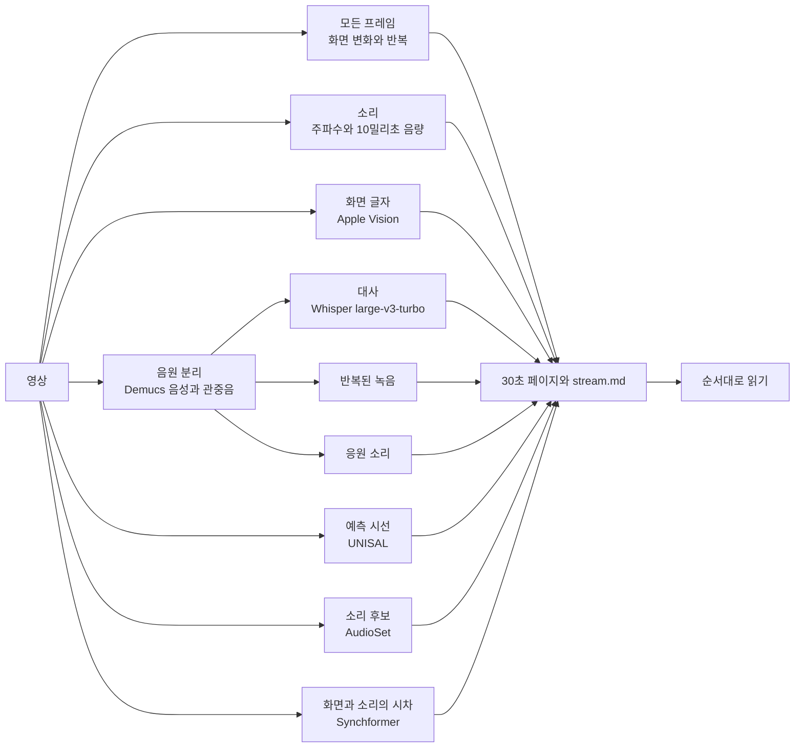

<a href="https://cdn.jsdelivr.net/gh/Dradradre/Reel@e9b9a19225546c9d1658f7309d7abe28f8673212/assets/door-demo.mp4">
<picture>
  <source media="(prefers-reduced-motion: reduce)" srcset="assets/door-at-cutoff.png">
  
</picture>
</a>

**[▶ A와 B 직접 듣기 (18초)](https://cdn.jsdelivr.net/gh/Dradradre/Reel@e9b9a19225546c9d1658f7309d7abe28f8673212/assets/door-demo.mp4)**

[English](README.md) | **한국어** | [简体中文](README.zh-CN.md) | [繁體中文](README.zh-TW.md) | [日本語](README.ja.md) | [Español](README.es.md)

[내 영상으로 시작하기](#빠른-시작)  |  [측정 결과](#시험-결과)  |  [읽기 안내서](docs/READING.md)

# 언어 모델의 눈과 귀

에이전트에 영화를 건네면 앞에서부터 보고 듣다가 궁금한 장면을 확대하거나 소리를 다시 확인할 수 있다. Reel은 MCP로 같은 시각의 화면과 녹음을 전달한다. `--until 8.5`로 멈추면 다시 보고 들을 수 있는 범위도 첫 8.5초까지다.

## 문이 열리기 전

**204프레임은 똑같다. 녹음이 달라지자 답도 달라졌다.** 문이 아직 닫혀 있는 8.5초에서 두 영상을 멈췄다.

| A에 열쇠 소리를 넣었을 때 | B에 방 소음만 남겼을 때 |
|---|---|
| "분석 결과로 보면 잠깐 짤랑거리거나 달그락거리는 소리가 난 것 같아요. 제가 직접 들을 수는 없었어요." | "무엇이 그 희미한 배경음을 냈는지는 알 수 없었어요." |

위 답변은 실제 응답의 한국어 번역이다. 이때 로컬 Codex의 GPT는 화면과 로컬 오디오 모델이 원음을 듣고 쓴 설명을 받았다. 비교 영상에서는 A와 B를 각각 8.5초씩 같은 음량으로 재생하며 실제 답변을 함께 보여준다. A에는 4.0~6.73초에 열쇠 소리가 들어 있다. GPT는 짤랑거림을 짚었고 무엇이 낸 소리인지는 단정하지 않았다. [영어 답변 원문](docs/benchmarks/short-listening-turns.json), [실험 재현](docs/door-trial.md#재현), [Joao_Janz의 열쇠 녹음, CC0](https://freesound.org/people/Joao_Janz/sounds/485110/)

## 내 편집본에 써보기

> 이 편집본을 봐. 소리는 계속 나는데 화면이 멈추는 곳이 있으면 시각을 알려주고 그 구간을 다시 보여줘.

예시 영상에서는 **00:38~00:41**에 화면이 멈추고 녹음은 계속 이어진다. Reel의 화면 변화 그래프와 소리 그래프를 같은 시간 눈금에서 읽으면 그 구간을 확인할 수 있다. 아래는 정지 전후와 정지한 동안의 실제 화면이다.


해당 구간까지 봤다면 에이전트는 `observe(start_s=38, end_s=41)`로 그때의 프레임과 원음을 함께 다시 확인할 수 있다. 자막이 바뀐 순간이나 반복해서 난 소리, 두 장면 사이의 움직임도 물어볼 수 있다. [예시 영상 생성 코드와 심어 둔 시각](examples/make_demo.py), [다시 보기 도구](docs/READING.md#watching-a-little-at-a-time)

## 빠른 시작

Apple Silicon Mac에 Python 3.11 이상과 FFmpeg가 필요하다. 아래 명령의 `film.mp4`에는 보려는 영상 경로를 넣는다.

```bash
git clone https://github.com/Dradradre/Reel.git && cd Reel
python3 -m venv .venv && source .venv/bin/activate
python -m pip install -e '.[mcp]'
reel play film.mp4 --out reels/first-view --until 8.5
```

재생기는 멈출 때마다 방금 본 구간을 저장한 경로를 출력한다. `next`를 입력하면 다음 구간으로 넘어가고 `quit`를 입력하면 끝난다. 처음부터 다시 보려면 새 출력 폴더를 쓴다.

**모델과 함께 보기.** Reel은 MCP(Model Context Protocol)로 영상을 건넨다. 로그인한 Codex CLI에서 보려면 가상환경을 켠 상태로 서버를 등록하고 새 채팅을 연다.

```bash
codex mcp add reel -- "$(command -v reel)" mcp "$PWD/film.mp4" --until 8.5 --image-client
```

> Reel로 영상을 봐. 뭐가 보이고 무슨 소리가 들렸어?

다른 MCP 클라이언트에는 `reel mcp /절대/경로/film.mp4 --until 8.5`를 stdio 명령으로 등록한다. 오디오 입력을 받는 클라이언트에는 녹음된 채널 그대로 WAV를 건넬 수 있다. 그림과 글을 읽는 클라이언트에는 화면과 소리 측정값을 보낸다.

로컬 청취기를 설치하면 원음을 듣고 쓴 설명을 받을 수 있다. 음성 인식 패키지까지 설치하면 두 번 받아써서 일치한 대사도 볼 수 있다. 원음을 듣는 모델은 약 39GB다. [클라이언트 입력과 설치 방법](#재생-옵션)

## 화면과 소리가 만나는 시각

| 보는 동안 | 모델이 할 수 있는 일 |
|---|---|
| 계속 보기 | `view(turn=1)` 다음에 `view(turn=2)`를 호출하면 다음 구간의 화면과 소리를 받는다. |
| 가까이 보기 | `look`에 시각과 영역을 지정하면 표지판 글씨나 누군가 손에 든 물건을 원본 픽셀로 살펴볼 수 있다. |
| 다시 듣기 | 6초까지 봤다면 `observe(start_s=4, end_s=6)`로 4초부터 6초까지의 화면을 당시 녹음과 함께 다시 확인할 수 있다. |

영화를 30초씩 한 장에 펼쳐 왼쪽에서 오른쪽으로 읽을 수도 있다. 아무 시각에나 세로줄을 그으면 그 순간의 화면과 움직임, 소리, 대사를 함께 볼 수 있다. 화면 변화 그래프에는 모든 프레임이, 음량 그래프에는 10밀리초마다 측정한 소리가 들어간다. [첫 장 크게 보기](assets/reel_page_1.png), [다음 30초 보기](assets/reel_page_2.png)

[](assets/reel_page_1.png)

<details>
<summary>페이지의 각 줄을 읽는 법</summary>

| 줄 | 내용 | 시청자가 알아채는 것 |
|---|---|---|
| frames over time | 고른 프레임을 실제 표시 시각에 배치. 다음 프레임이 늦게 나오면 앞 화면이 계속 보인다. 밝기를 전체 범위로 기록한 영상은 특정 시점에서 잘라도 그 범위를 유지한다. 색 변환을 지원하는 FFmpeg에서는 PQ나 HLG로 표시된 HDR 영상을 sRGB 그림으로 변환 | 누가 어떤 물체와 함께 보이는지 확인한다. 재생 중 한 부분에 변화가 두드러지면 그 위치와 전후 시각이 나온다. `look`으로 두 순간의 원본을 확대할 수 있다. [글자 읽기 실험](docs/perception-check.md#잠깐-나타난-글자를-다시-읽을-때) |
| motion point (재생 중) | 화면에서 한 점을 고르면 그곳을 지나는 가로줄과 세로줄의 색을 모든 프레임에서 읽어 시간순으로 표시 | 물체가 선을 몇 번, 어느 방향으로 지났는지 본다. `view(motion_point=[x,y])`로 위치를 고른다. |
| follow (재생 중) | 앞에서 짚은 점이 프레임마다 어디로 움직였는지 | 처음 짚은 곳과 마지막으로 찾은 곳을 확대해 같은 손이나 물건인지 확인 |
| subject | 영상의 주인공이 화면 어디에 있는지, 시선이 거기로 가는지 | 주인공을 놓치는 장면 |
| on screen | 글자와 숫자를 읽어 해당 프레임이 보이는 동안 표시한다 | 소리가 나는 순간에 어떤 점수나 표지판이 보였는지 확인한다 |
| change | 연속한 두 화면의 RGB 픽셀 차이와 밝기를 잰다. 밝기가 같아도 색이나 무늬가 바뀐 순간은 흰 선으로 보인다. MCP에서 `ask_scene(exposure_detail=true)`로 짧은 동작을 다시 보면 각 프레임 아래에 그동안 녹음된 최대 음량이 나온다. `sync_regions`로 영역을 고르면 사각형 전체의 움직임을 볼 수 있다 | 컷, 번쩍임, 암전, 멈춘 화면 |
| seen again | 저장한 컬러 축소 화면의 모든 픽셀이 같으면 초록색, 다른 컷에서 화면 배치가 닮으면 파란색으로 표시하고 앞선 시각을 적는다 | 다시 나온 연도 카드, 글자만 바뀐 카드 |
| sound | 주파수 대역마다 소리의 세기를 −80~0 dBFS 눈금으로 표시한다. 다시 들을 때는 표시한 구간의 앞뒤를 비교하거나, 스테레오 채널의 평균이나 차이를 들을 수 있다. | 다른 영상이나 확대 화면에서도 같은 소리는 같은 밝기로 보인다. 재생 중에는 길게 이어지는 음이나 짧게 치는 소리를 골라 원음과 대조할 수 있다. 목소리가 끊기는 구간에는 채널별로 남은 소리의 크기도 나온다. 재생할 때는 반복이 뚜렷한 소리의 추정 주파수도 나온다 |
| sounds like | 페이지에는 소리가 갑자기 변하는 시점이 나온다. 재생 중에는 어느 채널의 어떤 주파수 대역이 얼마나 커지거나 작아졌는지도 표시한다. `stream.md`에는 최대 10초, `play`에는 채널별로 최대 4초 동안 들린 소리 후보가 나온다. 문장으로 묘사할 때는 최대 10초를 듣는다. 앞 구간의 소리가 섞이면 최근 구간만 들은 설명도 시각과 함께 나온다. MCP에서는 WAV 첨부 여부와 관계없이 첫 재생부터 로컬 청취기의 설명과 두 번의 받아쓰기에서 일치한 단어도 읽을 수 있다. 원음을 해석하는 모델을 쓸 수 없으면 다른 모델이 들은 구간과 모델 이름을 보여준다. 상세 보기에서 앞 구간까지 들은 설명과 이번 구간의 시작 시각을 확인할 수 있다. 다시 들을 때는 초마다 나온 소리 후보와 원음을 이어서 비교한 결과를 함께 볼 수 있다. YAMNet을 설치하면 0.975초 길이의 녹음에서 들린 소리 후보를 볼 수 있고 다시 들을 때 볼륨을 바꿔 두 음량에서 나온 후보도 대조할 수 있다. 소리를 말로 묘사하고 가장 비슷한 1초로 돌아갈 수도 있다. | 짧은 타격음, 그 뒤에 깔린 음악, 북적이는 방에서 들리는 말소리 |
| level | 10ms마다 잰 전체 음량. 장면별 텍스트에는 구간별 중앙값과 가장 큰 순간의 음량 및 시각을 기록 | 서서히 줄어드는 소리, 조용한 배경에서 짧게 튀는 소리 |
| L level, R level | 채널별로 표시한 10ms 단위 음량. 채널이 셋 이상이면 번호로 표시 | 소리가 한쪽에만 있는지, 왼쪽에서 오른쪽으로 옮겨 가는지 |
| 1 early, 2 early | 같은 파형이 어느 채널에 먼저 도달했는지 0.25초 단위로 표시 | 양쪽 음량이 같아도 한쪽 귀에서 먼저 들릴 수 있다. 빈 구간은 시간차를 판별하기 어려운 곳이다. |
| film time, pixel change, ch peak, ch bands Hz | 처음 볼 때는 한 칸의 가운데 시각에 보인 화면과 그 칸에서 달라진 모습을 보여준다. `observe`로 다시 보거나 `view(focus=...)`로 확대할 때는 각 줄을 왼쪽부터 읽는다. 사진 아래 선을 따라가면 그 순간에 어느 채널에서 어떤 높이의 소리가 났는지 볼 수 있다. 주파수 띠는 해당 대역의 소리가 클수록 밝다. 화면을 확대해도 소리는 전체 장면의 녹음을 쓴다. | 짧은 동작이 소리보다 앞섰는지 뒤따랐는지 확인 |
| joint (선택 기능) | 같은 원음을 따로 듣고, 움직이는 화면과 다시 보면서 쓴 설명. 재생 중에 앞선 장면까지 포함해 질문할 수 있다 | 소리가 나는 동안 눈앞에서 이어진 동작을 확인 |
| in sync? | 소리가 화면보다 빠른지 늦은지, 2초 빠름부터 2초 늦음까지 매 순간 | 말보다 먼저 움직이는 입, 소리보다 먼저 맞는 공 |
| crowd stem | 분리 모델이 추정한 관중 소리를 원음과 같은 대역별 눈금으로 표시 | 구호처럼 반복되는 리듬이 원음에서도 들릴 만큼 큰지 비교 |
| said | 재생 중 소리를 키워야 검출된 목소리는 추정 시각만 표시한다. 다시 볼 때는 `heard_words`로 지정한 구간의 말소리를 따로 확인할 수 있다. 두 구간에서 단어와 시각이 일치한 대사. 분리한 트랙에서만 발화가 감지되면 원음과 대조하고 증폭해 확인한 후보는 `reel listen`에 표시 | 무슨 말인지, 자막과 맞는지 |
| heard again | 파형이 되풀이되거나 목소리의 주파수 변화가 닮으면 앞선 시각을 적는다. 다시 들을 때는 `compare_heard(similarity=true)`로 두 구간의 원음을 비교할 수 있다. `alternatives`를 주면 각 설명이 어느 녹음에 더 가까운지도 볼 수 있다 | 메아리처럼 들린 소리, 앞에서 들은 듯한 관중 소리 |

</details>

## 시험 결과

| 시험 | 로컬 GPT의 결과 |
|---|---|
| OVO-Bench 영상 644편에서 정해진 시각에 화면을 보고 답하기 | 공식 세 영역 평균 **66.08점**. 질문 시각 전에 나온 화면만 보고 3,035문항 중 2,002개를 맞혔다. [영역별 점수와 측정 조건](docs/benchmarks/ovo-full.json) |
| 처음 보는 영상 12편에서 화면과 소리를 각각 기억해 묘사하기 | 사람 점수를 100으로 두면 **화면 78.8%, 소리 43.8%**였다. 둘을 반씩 반영하면 61.3%이고 95% 구간은 43.3~91.1%였다. [영상별 답변과 채점 자료](docs/benchmarks/track-recall.json) |

회상 점수는 묘사한 문장만으로 해당 영상을 다른 영상과 얼마나 잘 구별하는지 잰 값이다. 같은 영상을 본 사람들의 문장을 기준으로 삼았다.

잔치 장면의 소리를 들은 네 명 중 세 명이 노래를 언급했다. GPT는 박수와 말소리를 기억했고 노래를 놓쳤다. [잔치 장면과 나머지 영상에서 나온 답](docs/perception-check.md#화면과-녹음을-바꿔-끼운-뒤의-자유-회상)

<details>
<summary>이전 측정과 블라인드 시험에서 맞히거나 놓친 사례</summary>

OVO-Bench 영상 644개에서 로컬 GPT가 Reel을 통해 질문 시각 직전까지의 화면을 최대 24장씩 봤다. 3,035개 시점 중 2,002개에서 정답을 골라 공식 채점법으로 **66.08점**을 받았다. [영역별 점수와 사람 기준](docs/perception-check.md#ovo-bench에서-질문-시각까지의-화면을-읽은-결과)

처음 보는 실사 여덟 편에서 GPT에게 화면과 로컬 청취기의 소리 설명, 받아쓰기를 보여줬다. 한 문장으로 어느 영상인지 구분하는 정도를 사람과 비교하면 첫인상은 98.2%, 화면 회상은 95.0%, 소리 회상은 56.9%였다. [사람이 들은 울음소리를 GPT가 놓친 영상과 점수 범위](docs/perception-check.md#아까-본-화면을-얼마나-정확히-기억하는가)

새 실사 여덟 편에서 화면과 소리 회상을 반씩 반영했을 때 사람 기준 61.3%였던 점수가 0.975초씩 원음을 읽은 소리 후보를 추가하자 70.9%가 됐다. 화면은 106.3%, 소리는 35.5%로 차이가 컸고 종합 점수의 영상별 재표집 95% 구간도 43.3~102.3%로 넓었다. [측정 방법과 영상별 응답](docs/benchmarks/short-sound-events.json)

처음 보는 실사 12편을 둘씩 짝지어 같은 화면에 서로 다른 녹음을 붙였다. GPT가 쓴 두 소리 설명을 채점기가 원래 녹음에 연결한 횟수는 기존 **10/12**, 해당 구간의 원음 설명을 앞에 표시했을 때 **9/12**였다. 원래 조합에서 화면과 소리 회상을 반씩 반영하면 사람 기준 52.6%와 61.3%였다. 새 점수의 95% 구간은 43.3~91.1%였다. [영상 조합과 실제 응답](docs/benchmarks/track-recall.json)

집 안과 주택가 녹음에서 8초씩 20구간을 잘라 소리 이름을 주고 다시 들을 시점을 찾았다. 사람이 그 소리를 표시한 1초를 기존 CLAP은 **31번 중 15번**, 새 모델은 **23번** 골랐다. GPT가 소리 종류를 답할 때 새 점수까지 보여주면 사람 기록에 없는 소리를 고른 횟수도 17번에서 30번으로 늘었다. [다시 들을 시각과 GPT의 응답](docs/benchmarks/sound-location.json)

밝기가 같은 색이나 가는 무늬가 잠깐 바뀌는 영상에서 GPT가 페이지의 변화 줄을 보고 해당 시점을 맞힌 횟수는 **0/8편에서 8/8편**으로 늘었다. 실사 여덟 편에서는 RGB 변화에 맞춰 더 자주 멈추자 사람과 GPT가 활동 변화를 짚은 시각의 F1이 **40.7점에서 34.6점**으로 낮아졌다. 기본 재생 간격은 유지했다. [영상별 변화 시각과 응답](docs/perception-check.md#밝기가-같은-화면에서-색이나-무늬가-바뀐-순간)

현장 녹음 24개에서 처음부터 좌우 평균과 차이음의 설명을 덧붙이자 GPT와 청취자가 고른 소리의 일치율은 55.9%에서 54.8%가 됐다. 그중 12개를 다시 들을 때 원음만 보기에 대조하면 57.3%, 평균과 차이음도 대조하면 63.1%였다. 차이의 95% 구간은 −3.1~+16.6%p였다. 두 소리가 분리되게 만든 별도 녹음 12개에서 GPT가 둘 다 맞힌 횟수는 1/12에서 11/12로 늘었다. [녹음별 결과와 재생 조건](docs/listening-check.md#좌우-채널을-나눠-들었을-때)

실사 녹음 32개를 잘라 만든 16kHz 모노 입력이 32개 모두 별도로 자른 WAV와 길이가 같았다. 샘플마다 진폭 차이가 최대 진폭의 100만분의 1 이내였다. 실사 영상 16편에서 화면이 바뀌는 순간과 그 직후에 멈췄을 때 마지막 그림의 픽셀도 **32번 모두** 원본과 일치했다. [화면과 소리를 원본에 대조한 결과](docs/perception-check.md#멈춘-순간의-화면과-원음을-원본과-대조한-결과)

실사 녹음 12개에서 짧은 소리를 두 곳씩 짚었을 때 GPT는 사람 주석과 **24번 중 15번** 같은 소리를 골랐다. 표시한 순간만 따로 분석한 점수까지 주자 **11번**으로 줄어, 기본 재생에는 앞뒤가 함께 들리는 구간의 비교 결과를 유지했다. [구간별 응답과 무음 대조군](docs/listening-check.md#표시한-순간의-소리만-따로-비교한-시험)

Kinetics 영상 24편에서 활동이 달라진 시각을 짚는 F1은 100점 만점에 **GPT와 사람이 39.2점**, **사람끼리 65.7점**이었다. GPT가 짚은 40곳 중 35곳에서는 다섯 관찰자 중 세 명 이상도 0.5초 안에 변화를 표시했다. 앞선 영상과 활동 종류가 겹치지 않는 12편을 같은 방식으로 쟀을 때는 GPT와 사람이 37.3점, 사람끼리 62.2점이었다. [영상별 시각과 대조 시험](docs/perception-check.md#활동이-달라졌다고-느낀-시각)

화면의 정해진 선을 지나는 횟수와 방향을 물었을 때 GPT는 기본 보기로 6편 중 1편을 맞혔다. 같은 선의 색 변화를 함께 보자 6편 모두 맞혔다. 실제 활동 영상 36편에서 사람과 같은 순간에 변화를 짚은 F1은 기본 보기에서 38.6점, 화면 중앙의 두 선을 함께 봤을 때 38.5점이었다. [움직임을 센 실험과 사람의 관찰 시각 비교](docs/perception-check.md#빠른-물체가-선을-지난-횟수와-방향)

두 구간에 같은 보기를 대조하자 정답은 **22/48개에서 25/48개**로 늘었지만 두 소리를 모두 맞힌 영상은 여전히 **6/24편**이었다. 별도 생활음 시험에서는 두 조건 다 보기에 있는 소리를 16/16개 맞혔고 보기 밖의 소리에서는 15/16개에 판단을 유보했다. [두 구간 비교와 실제 오답](docs/listening-check.md#두-구간에서-어떤-소리가-달라졌는지-비교)

실사 24편에서 같은 화면에 서로 다른 두 녹음과 무음을 붙여 로컬 GPT에 한 편씩 보여줬다. 소리를 바꿔도 두 녹음의 종류를 모두 맞힌 영상은 **5/24편**이었다. 무음 24편에서 GPT가 소리 이름을 댄 경우는 없었다. [소리만 바꾼 시험과 재현 방법](docs/listening-check.md#같은-화면에서-실제-소리만-바꿨을-때)

실사 28편에서 GPT가 소리 보기를 비교할 때 해당 구간의 스펙트로그램을 함께 보여줬다. 사람 주석과 일치한 답은 기존 두 회차에서 **57/84개**, 그림을 자동으로 보여줬을 때 **58/84개**였다. 12편에서는 21/36개에서 23/36개로 늘었지만 다른 16편에서는 36/48개에서 35/48개로 줄었다. [28편의 답과 채점 결과](docs/perception-check.md#소리를-다시-확인할-때-그림을-자동으로-보여준-결과)

소리 구간을 표시할 수 있게 한 뒤 같은 실사 12편을 다시 재생했다. 사람 주석과 일치한 답은 **21/36개**였고 화면은 10/12, 소리 종류는 6/12, 소리를 낸 대상이 보이는지는 5/12였다. 구간 표시를 요청한 세션은 없었다. 다른 실사 녹음에서 구간을 직접 표시해 보여주자 소리가 방금 시작됐는지 이어지고 있었는지 맞힌 답이 **2/24에서 9/24**가 됐다. 틀린 답은 1개에서 3개로 늘고 판단 유보는 21개에서 12개로 줄었다. [전체 시청 결과](docs/perception-check.md#소리-구간-표시를-추가한-뒤-같은-12편을-본-결과) · [소리 시각 비교](docs/listening-check.md#짧은-소리가-시작되는-순간)

처음 보는 실사 12편에서 로컬 Codex GPT의 답은 사람 주석과 **21/36개(58.3%)** 일치했다. 같은 영상을 새 세션에서 다시 봤을 때는 **22/36개(61.1%)**였다. 화면 내용은 각각 9/12, 10/12였고 소리 종류와 소리를 낸 대상이 보이는지는 두 번 모두 6/12였다. 영상 없이 보기만 보고 추측한 GPT는 16/36개를 맞혔다. [회차별 결과와 틀린 문항](docs/perception-check.md#새-영상-12편에서-두-번-잰-일치율)

별도의 일상 영상 8편에서는 GPT가 아무 질문 없이 한 문장씩 설명했다. 시청자들이 남긴 37개 문장과 비교해 어느 영상을 설명한 것인지 구별되는 정도를 쟀다. 사람끼리의 점수를 100으로 두면 **GPT는 87.0**이었다(영상 단위 95% 구간 74.0~103.7). GPT는 47구간 중 26구간에서 선택형 소리 분석을 껐다. 47구간 모두에서 소리 분석을 제공해 다시 재생하니 **86.5**였다. [계산 방법과 실제 설명](docs/perception-check.md#자유-설명에서-사람끼리의-일치도를-100으로-뒀을-때)

이전에 본 실사 16편에서는 로컬 Codex GPT의 답 중 사람 주석과 일치한 것이 **48개 중 36개(75.0%)**였다. 화면 내용은 14/16, 지정 구간에서 난 소리는 11/16, 그 소리를 낸 대상이 화면에 보이는지는 11/16이었다. 오답은 8개였고 4개는 판단을 유보했다. [영상별 응답과 측정 조건](docs/perception-check.md#같은-48문항으로-다시-잰-일치율)

다른 실사 12편에서는 나중에 난 소리가 앞의 두 소리 중 어느 쪽과 같은 종류인지 물었다. GPT가 도구를 자유롭게 골랐을 때 사람의 소리 분류와 일치한 답은 기존 버전 4/12, 원음끼리 비교할 수 있는 버전 8/12였다. [영상별 응답과 두 후보에 정답이 없는 경우](docs/listening-check.md#이름을-모르는-소리를-전에-들은-녹음과-비교)

동시에 보이는 두 장면 중 어느 쪽 녹음이 재생되는지 GPT는 14번 중 9번 맞혔다. 소리를 바꿨을 때 두 번 다 맞힌 쌍은 7쌍 중 3쌍이었다. 별도 실사 8편에서는 소리를 낸 대상이 보이는지 매번 판단을 유보했다. [영상별 응답과 이전 버전 비교](docs/perception-check.md#화면-가장자리에서-난-소리)

프레임 단위 상세 재생을 추가한 직후 같은 실사 16편을 다시 봤을 때 사람 주석과 일치한 답은 **48개 중 35개(72.9%)**였다. 화면 내용은 15/16, 소리 종류는 10/16, 소리를 낸 대상이 보이는지는 10/16이었다. 별도로 같은 영상의 12개 프레임에 짧은 소리를 한 번씩 옮겼을 때 그 순간 화면에 뜬 숫자는 기존 재생에서 6번, 상세 재생을 쓸 수 있을 때 12번 모두 맞혔다. [재생 방식별 결과](docs/perception-check.md#소리가-난-프레임을-다시-보는-시험)

앞선 버전은 당시 처음 쓰는 영상 16편에서 **48문항 중 38개(79.2%)**를 맞혔다. 소리 여덟 종류마다 출처가 보이는 영상과 가려진 영상을 한 편씩 골랐고 보기만 읽고 추측한 GPT는 같은 48문항 중 23개를 맞혔다. 기존 28편을 포함한 44편의 일치율은 **76.5%(101/132)**였다. [새 영상 16편의 결과](docs/perception-check.md#처음-사용한-영상-16편)

로컬 Codex의 GPT가 같은 버전의 Reel로 실사 영상 28편을 다시 봤다. 사람 주석과 일치한 답은 **84문항 중 63개(75.0%)**였다. 화면 내용 25/28, 지정한 구간에서 난 소리 20/28, 소리를 낸 대상이 보였는지 18/28이었고 12개를 틀리고 9개는 유보했다. 영상마다 새 세션을 열어 세 시험의 기존 문항으로 측정했으며 GPT에는 화면과 로컬 소리 분석 결과를 전달했다. [영상별 답과 채점 방법](docs/perception-check.md#같은-버전으로-다시-본-실사-영상-28편)

도시 녹음 23개에서 GPT와 청취자가 고른 소리는 평균 **56.3%** 겹쳤고 사람끼리는 **58.9%** 겹쳤다. 청취자 과반이 아이 목소리를 고른 세 곳에서 GPT는 한 번도 아이 목소리를 고르지 않았다. [녹음별 응답과 계산 방법](docs/listening-check.md#도시-녹음에서-gpt와-청취자가-고른-소리)

정답을 모르는 새 독자(읽는 법 [안내서](docs/READING.md)와 페이지만 받은 모델)에게 사람이 이미 평가한 팬 영상을 보여줬다.

| 영상 | 사람이 한 지적 | 독자가 지시 없이 알아챈 것 |
|---|---|---|
| 10분짜리 e스포츠 다큐 1차본 | 연도 순서가 뒤죽박죽, 갑작스러운 암전, 해설 1초가 두 번 재생, 자막과 목소리 어긋남, 멈춘 화면 | 1차 시험 5개 중 4개, 반복 듣기를 넣은 뒤 **5개 전부** |
| 6분짜리 선수 헌정 영상 1차본 | 카드마다 같은 팀 구호 반복, 뚝뚝 끊기는 연결, 급한 후반, 스코어 바가 잘린 레터박스 게임 화면, 주인공 포커스 부족 | **5개 중 4개**: 구호(소리만으로 구호 구간 4곳 모두 **T1**으로 맞춤), 완전 무음 구간, 쌓인 정지 카드, 높이 74~79%로 잘려 스코어 바가 사라진 게임 화면. 포커스는 "후반 우승 콜이 다른 선수 이름으로 나온다" 정도로만 짚음 |
| 2분짜리 하이프 트레일러, **Reel을 만들 때 한 번도 안 쓴 영상** | 번개 효과음이 손바닥 찰싹 소리 같음, 의미 없는 장면, 싸 보이는 음악 | **3개 전부**: "타격음 9개 중 2개가 찰싹 소리로 들린다", 물 튀는 소리, 자동차, 오리 소리로 들리는 타격음. 같은 정지 화면 두 장 위로 13초 동안 연도만 바뀌는 구간과 검은 화면으로 시작하는 오프닝. 배경음악은 "무료 스톡 음악"으로 봄(이 판단은 소리만큼 크레딧 글자에도 기댔음) |
| 1분 30초짜리 하이프 트레일러, **Reel을 만들 때 한 번도 안 쓴 영상** | 임팩트 없는 장면, 화면과 안 맞는 글리치 효과, 엉뚱한 선수의 처치 배너, 낮은 화질 | **4개 전부**: "영상이 보여줄 장면이 떨어진 느낌", 기자회견 한 장면을 5초 동안 깜빡이는 글리치, 제우스 데뷔 구간의 페이커 처치 배너, 흐리고 늘린 것 같은 화면 |
| 같은 다큐의 수정본 | 아직 없음 | 편집자 검수에서 빠진 문제를 찾음: 인용문 위에 깔린 해설, 장 전환마다 떨어지는 소리, 안 읽히는 기록표 |

### 웹에서 무작위로 가져온 영상

장르별 검색에서 무작위로 고른 영상 26개로 시험했다. 토크쇼, 지역 뉴스, 애니메이션, 스케이트와 드럼 영상, 요리, 드론 영상, 축구와 테니스와 F1 하이라이트, TED 강연, 예고편, 팟캐스트, 라이브 음악, 충돌 시험 모음, 체스 방송, 브이로그까지 섞었다.

스크립트가 반복, 메아리, 암전, 정지, 번쩍임, 레터박스, 저화질 구간, 소리 끊김, 볼륨 점프, 화면보다 빠르거나 늦은 소리를 무작위 위치에 심었지만 정답지는 독자가 볼 수 없게 따로 뒀다. 라운드마다 영상 하나는 손대지 않고 남겨서 독자가 없는 문제를 지어내는지도 봤다.

| 라운드 | 심은 실수를 알아챈 수 | 손대지 않은 영상 |
|---|---|---|
| 1 | 15개 중 9개 | 원본 편집자의 페이드를 갑작스러운 암전이라고 함 |
| 2 | 15개 중 14개 | "문제 없음" |
| 3 | 15개 중 10개 | "문제 없음" |
| 4 | 14개 중 10개 | "문제 없음" |
| **5: 코드를 고정하고 이후 수정 없음** | 17개 중 12개(싱크 어긋남이 남긴 말 더듬기로 알아챈 경우까지 치면 14개) | "문제 없음" |

1라운드부터 4라운드 사이에는 독자가 놓친 것을 보고 뚝 끊기거나 갑자기 커지는 소리, 몇 프레임짜리 번쩍임, 주변보다 갑자기 흐려진 화면, 화면과 소리의 싱크, 같은 녹음의 재사용을 감각으로 추가했다. 따라서 이 사이의 점수에는 고친 결과가 섞여 있다. 정직한 숫자는 새 영상으로 시험하면서 코드를 건드리지 않은 5라운드다.

5라운드를 종류별로 보면 레터박스 3개 중 3개, 암전 3개 중 3개, 메아리 3개 중 3개, 붙여넣은 반복 1개 중 1개, 소리 끊김 2개 중 1개, 빠르거나 늦은 소리 3개 중 1개, 정지 1개 중 0개, 볼륨 점프 1개 중 0개다. 잘못 짚은 것은 하나로, 체스 방송의 허밍을 갑작스러운 볼륨 점프로 표시했다. 다섯 라운드 내내 손대지 않은 영상에서 없는 문제를 만들어 낸 적은 없다.

</details>

## 재생 옵션

원음을 듣는 모델과 받아쓰기를 설치하려면 아래 명령을 쓴다.

```bash
python -m pip install -e '.[speech]'
reel setup --speech --describe-sounds
```

<details>
<summary>명령어 예시, 선택 모델, 클라이언트 설정</summary>

```bash
pip install -e ".[all]"           # 필요한 것만: separate, crowd, mlx, speech, ocr, gaze
reel setup --sync                  # 시선 모델과 싱크 모델(1.1GB) 받기
reel doctor                        # 이 맥에서 무엇을 보고 들을 수 있는지

reel play film.mp4 --out reels/first-view --until 8.5
reel play film.mp4 --out reels/sound-only --until 8.5 --tracks sound
reel watch film.mp4 --out reels/film --subject Zeus --genre lol --lang ko
reel watch film.mp4 --until 8.5 --out reels/view-01
reel zoom reels/film --t0 72 --t1 80          # 한 구간을 자세히 다시 보기
reel frame reels/film --at 73.25              # 73.25초에 보이던 원본 화면 꺼내기
reel frame reels/film --t0 73 --t1 74         # 이 1초 동안 표시된 모든 프레임 보기
reel listen reels/view-01 --t0 4 --t1 7       # 4초부터 7초까지 채널별 음량과 변화 시각 확인
reel observe reels/view-01 --t0 4 --t1 4.5    # 각 화면이 떠 있던 동안 재생된 소리 확인
```

모델이 무엇을 보고 무엇을 들었는지 비교하려면 같은 파일을 새 세션에서 세 번 연다. `--tracks picture`는 화면만, `--tracks sound`는 소리만 재생한다. 기본값 `--tracks both`는 둘을 함께 재생한다. `play`와 `mcp` 모두 원본의 시각과 `--until`을 지킨다. 지나간 장면을 다시 확인할 때도 처음에 고른 트랙만 쓴다. [영상 여덟 편에서 사람과 GPT가 알아차린 것](docs/perception-check.md#같은-영상을-보거나-듣거나-둘-다-했을-때)

영상이나 소리 트랙이 여러 개면 각 종류에서 기본 표시가 붙은 첫 트랙을 고른다. 기본 표시가 없으면 재생 가능한 첫 트랙을 쓰고 앨범 표지와 미리보기용 썸네일은 영상에서 제외한다. 다시 보기와 받아쓰기에서도 같은 트랙을 쓴다.

음높이를 가늠할 수 있는 구간에서는 각 채널의 추정 주파수를 `audio.pitch_contour`로 보낸다. 무엇이 낸 소리인지 몰라도 음이 올라갔는지 내려갔는지 살펴볼 수 있다.

MCP를 쓰는 모델은 Reel에서 화면과 녹음을 바로 받을 수 있다. `pip install -e '.[mcp]'`로 설치하고 로컬 stdio 서버의 실행 명령을 `reel mcp /path/to/film.mp4 --until 8.5`로 지정한다. Codex CLI에서는 Reel 환경을 활성화한 상태에서 다음과 같이 등록할 수 있다.

```bash
codex mcp add reel -- "$(command -v reel)" mcp /path/to/film.mp4 --until 8.5 --image-client
```

모델에 동영상을 건네려면 클라이언트에서 `view_media(turn=1, continuous_seconds=5)`를 호출한다. 응답의 MCP 링크를 순서대로 읽으면 당시 소리가 담긴 첫 5초를 사람도 재생해 볼 수 있다. 다음 턴에 `view`로 바꿔도 같은 시각부터 이어진다. 로컬 Codex CLI 시험에서 GPT에는 MOV의 인코딩된 바이트가 텍스트로 들어와 이 환경에서는 `view`를 쓴다. [재생 방법과 파일 형식](docs/READING.md#watching-a-little-at-a-time)

기본 `view(turn=1)`은 그 구간의 원음 WAV와 함께, 설치된 청취기가 녹음에서 들은 내용과 두 번의 받아쓰기에서 일치한 단어를 보낸다. 그림과 텍스트를 받는 모델도 같은 청취 기록을 읽을 수 있다. `--image-client`로 시작하거나 `native_audio=false`를 쓰면 WAV는 요청할 때만 붙는다. 원음과 측정값만 받으려면 기본 서버에서 `sound_estimates=false`로 호출한다.

재생을 짧게 끊으면 한 소리가 두 구간에 걸칠 수 있다. 주 청취기를 사용할 수 없을 때는 `view(turn=N, full_detail=true)`를 요청하면 보조 청취기가 직전 구간부터 들은 내용이 `sound_in_context`에 나온다. 설명에 적힌 시작 시각과 `current_start_s`를 비교하면 앞 구간에서 얼마나 들었는지 알 수 있다. 그때 들린 소리는 이미 멎었을 수 있다. [짧게 멈췄을 때 GPT가 들었다고 한 소리](docs/benchmarks/short-listening-turns.json)

클라이언트가 WAV를 생략해도 원음에서 잰 값과 로컬 청취 기록은 남는다. 이 경우 GPT는 무엇을 근거로 소리를 설명했는지 밝힐 수 있다. [목소리와 주변 소리 실험](docs/perception-check.md#목소리와-그-목소리가-가리키는-소리)

그림과 텍스트로 볼 때는 구간별 청취 결과가 먼저 나온다. 각 채널의 원음에서 잰 음량, 주파수별 에너지의 가운데 80%가 걸친 범위, 에너지가 가장 많이 모인 좁은 대역의 비율도 볼 수 있다. 음량이 같아도 한 음이 이어지는지, 잡음이 넓은 대역에 퍼졌는지 구별할 단서다.

스테레오에서는 어느 채널이 더 컸는지와 같은 파형이 어느 채널에 먼저 도착했는지를 첫 재생에서 볼 수 있다. 양쪽 음량이 같아도 도착 시각은 다를 수 있다. 같은 `view`에 `full_detail=true`를 붙이면 개별 측정값과 인코더에 들어간 프레임 시각이 나온다. [사람과 GPT의 첫 시청 결과](docs/perception-check.md#원래-녹음의-주파수와-첫-설명)

두 청취기는 `pip install -e ".[speech]"`와 `reel setup --speech --describe-sounds`로 준비한다. [같은 화면에 다른 녹음을 붙인 결과](docs/perception-check.md#wav를-첨부했을-때-gpt가-실제로-받아들인-소리)

모델에 영상을 봐 달라고 하면 `view`를 호출해 한 구간씩 받고 WAV 첨부를 선택한 클라이언트에는 그 구간의 원음도 전달된다. 소리가 뚜렷하게 달라진 순간에는 그 전후의 화면도 받는다. 서버에 `--describe-sounds`를 붙이면 재생이 멈출 때마다 로컬 청취기가 원음을 듣고 설명한다. `--gaze`를 붙이면 시선 모델이 고른 화면 일부도 시간순으로 볼 수 있다. 지나간 장면은 `observe(start_s, end_s)`로 원하는 시각을 골라 그때 뜬 프레임과 같은 구간의 녹음을 함께 확인한다. 그림과 텍스트를 받는 모델은 화면과 주파수 그림을 읽고 로컬 청취기에 소리를 묻거나 발화 기록을 확인할 수 있다. [도구 사용법](docs/READING.md#watching-a-little-at-a-time), [Codex MCP 설정](https://developers.openai.com/codex/mcp/)

재생 화면의 `at_s`는 각 칸을 관찰한 시각이고 `picture_pts_us`는 그때 화면에 떠 있던 프레임의 원본 시각이다. 한 프레임이 오래 떠 있으면 여러 칸에서 같은 원본 시각이 나온다. 소리 트랙을 꺼도 두 시각을 함께 받는다.

기본 재생에서도 대표 화면이 놓친 변화가 있고 그 구간의 모습을 열두 칸 안에 다 담을 수 있으면 시간순으로 보여준다. 축소했을 때 같은 모습이 이어지면 한 칸에 담는다. 계속 움직이는 장면에서 빠른 동작을 따라보려면 `view(turn=1, max_frames=12)`를 호출한다. 그 구간에 뜬 모든 화면이 시간순으로 나오고 녹음도 같은 시각에 멈춘다. 한 번에 볼 프레임 수는 1~12장 사이에서 고를 수 있다. 터미널에서는 `reel play film.mp4 --out reels/frames --continuous --max-frames 12`를 쓴다. [빠른 동작과 순서가 뒤바뀐 장면을 본 결과](docs/perception-check.md#빠른-동작을-프레임-순서대로-본-경우)

계속 움직이는 화면에서도 손이나 물체가 대표 화면 사이에 잠깐 다른 모습을 보이면 원본 프레임을 최대 12장까지 시간순으로 더 보여준다. `selected_picture_pts_us`에 그 시각이 담긴다. [사람이 행동 시각을 표시한 촬영 영상으로 확인한 결과](docs/perception-check.md#움직이는-장면에서-대표-화면-사이에-보인-모습)

각 화면이 보이는 동안 녹음된 소리의 크기도 확인할 수 있다. `audio.during_pictures`에는 그 프레임에 해당하는 원음 구간과 채널별 피크, RMS 레벨이 들어 있다. 두 프레임 사이에 빠진 구간의 소리는 원음에 남는다.

대화나 동작을 장면 전환 너머까지 보려면 `view(turn=1, continuous_seconds=8)`을 쓴다. 지나간 화면과 같은 구간의 녹음을 함께 받고, 다음 호출에서 다시 짧게 볼 수 있다. 터미널에서는 `reel play film.mp4 --out reels/view --step 8 --continuous`로 8초씩 이어 본다. [사람과 GPT가 시청 후 기억한 내용](docs/perception-check.md#한-장면을-이어-본-뒤-기억한-내용)

동작이 지난번 멈추기 전부터 이어졌다면 `view(turn=N, joint_seconds=6)`으로 직전 6초를 살핀다. 로컬 청취기가 그동안 들린 원음을 먼저 듣고 같은 구간의 화면과 소리를 함께 본다. 그림과 텍스트를 받는 모델은 `joint`에서 두 설명을 읽을 수 있다. N번째 구간이 끝난 시각까지만 되짚으며 터미널에서 재생 중일 때는 `joint 6`을 입력한다. [사람이 표시한 동작과 소리로 비교한 결과](docs/perception-check.md#여러-번-멈춘-장면의-화면과-소리를-이어-볼-때)

이미 본 2.4~3.7초에 무엇이 움직였는지 궁금하면 `ask_scene(start_s=2.4, end_s=3.7, question="소리가 바뀔 때 무엇이 움직였어?")`로 그 구간만 다시 볼 수 있다. 질문을 주면 원음을 들은 로컬 모델이 답하고 시작과 끝 시각만 주면 화면과 채널별 음량, 주파수 대역이 바뀐 시각을 받는다. 원음도 받으려면 `native_audio=true`를 붙인다.

어떤 소리가 언제 났는지 다시 확인하려면 `reel setup --locate-sounds`로 모델을 설치한다. 가중치는 1.76GB다. 예를 들어 `listen(turn=2, start_s=2, end_s=7, describe=false, locate_sounds=["water running"])`은 이미 들은 구간에서 물 흐르는 소리와 가장 비슷한 1초를 돌려준다. 터미널에서는 `reel match DIR --t0 2 --t1 7 --locate "water running"`을 쓴다. 물소리가 없어도 최고점은 나올 수 있으므로 해당 구간을 다시 들어 확인한다.

물이 흐르는 소리와 말소리가 각각 언제 들리는지 살필 때는 `ask_scene(start_s=2, end_s=7, alternatives=["water running", "a person speaking"])`로 같은 구간을 다시 본다. 채널별로 초마다 나온 소리 후보와 구간 전체를 이어서 들었을 때의 후보를 함께 보여 준다. 초 단위 비교는 모델 입력을 채우려고 짧은 소리를 반복한다. 연속 비교는 원음을 한 번만 쓰고 남은 입력을 0으로 채운다.

터미널에서는 재생을 멈추고 `match 2 7 --per-second`로 같은 구간을 확인할 수 있다. 소리 이름을 떠올리기 어려우면 `alternatives=[]`로 비슷한 소리 후보를 볼 수 있다. [촬영 영상과 환경음으로 확인한 결과](docs/perception-check.md#원음에서-소리-두-가지의-순서-짚기)

두 곳에서 보이는 움직임이 소리와 맞는지 궁금하면 `ask_scene(start_s=2, end_s=5, sync_regions=[[0.1,0.3,0.4,0.8],[0.6,0.3,0.9,0.8]])`로 비교한다. 번호가 붙은 사각형은 움직임을 재는 범위다. 가장자리까지 포함해 픽셀이 변한 시각을 아래 그래프에서 채널별 음량과 나란히 볼 수 있다. `reel setup --sync`로 동기화 모델을 설치하면 영역마다 움직임과 녹음의 타이밍이 얼마나 맞는지도 볼 수 있다.

화면의 한 부분을 고정해서 확대하려면 `view(turn=2, focus=[0.7, 0.4], max_seconds=0.3)`처럼 다음에 볼 위치와 시간을 고른다. 0.3초 안에 다시 멈추고, 그동안 해당 위치에서 일어난 움직임을 전체 화면과 소리와 함께 받는다. 마지막 화면에서는 전체에서 고른 위치와 해당 부분을 확대한 그림을 나란히 본다. 다음 구간에서 위치나 시간을 바꿀 수 있다. 이미 본 순간의 원본 픽셀은 `look(turn=2, at_s=0.15, box=[0.5, 0.2, 0.9, 0.6])`로 확인한다.

화면과 소리가 함께 바뀐 이유가 궁금하면 `view(turn=2, question="소리가 날 때 화면에서 무엇이 움직여?")`처럼 묻는다. 로컬 모델은 원음을 먼저 따로 듣고, 같은 구간을 소리와 화면으로 다시 보면서 질문에 답한다. 직전에 본 장면까지 필요하면 `joint_seconds=6`을 붙인다. `reel mcp FILM --joint --image-client`로 시작하면 연속 재생을 처음 볼 때부터 시청각 설명을 받는다. [영상 여덟 편을 본 사람과 GPT의 설명](docs/perception-check.md#사람들이-같은-영상을-설명한-문장)

화면 안에서 움직이는 물체도 따라볼 수 있다. 1.25초에 본 손잡이의 위치가 `[0.7,0.4]`였다면 `view(turn=2, focus=[0.7,0.4], follow_from_s=1.25)`를 호출한다. 원본 영상에서 처음 짚은 곳과 마지막으로 찾은 곳을 확대해 각각 시각을 표시한다. 원본을 다시 열 수 없으면 저장된 사진을 쓴다. 한 번에 최대 8초까지 따라가며 놓친 프레임에는 위치를 비워 둔다. 기본 설치에서는 인접한 프레임의 무늬를 따라간다. `reel setup --follow`로 BootsTAPIR를 설치하면 가려졌다 나타난 점도 다시 찾을 수 있다. [사람이 표시한 위치와 비교한 결과](docs/perception-check.md#움직이는-점을-따라본-결과)

모델이 소리 이름이나 대사에 대한 힌트 없이 먼저 보게 하려면 `view(turn=1, sound_estimates=false)`를 쓴다. 7초까지 본 뒤 `listen(turn=N, start_s=2, end_s=7, native_audio=true, describe=false)`를 호출하면 중간에 몇 번 멈췄든 2~7초의 녹음과 채널별 주파수 그림을 받는다. 들린 소리를 식별하기 어려우면 같은 구간에서 `describe=true`로 로컬 청취기의 의견을 들을 수 있다.

소리를 듣고 두 가지가 떠오르면 원음에 대조할 수 있다. 예를 들어 `listen(turn=3, start_s=2, end_s=5, describe=false, alternatives=["a voice humming", "an electric motor running"])`은 각 채널에서 두 설명이 녹음과 얼마나 비슷한지 돌려준다. `alternatives=[]`이면 비슷하게 들리는 소리 후보를 찾는다. 모델은 `reel setup --compare-sounds`로 준비한다. 점수가 높아도 실제 출처는 다를 수 있다.

여러 소리가 겹쳤을 때 `listen(turn=N, start_s=2, end_s=7, component="percussive")`를 쓰면 여러 주파수에 걸쳐 짧게 난 소리가 두드러진다. 일정한 주파수에서 이어진 소리를 들으려면 `"harmonic"`을 고른다. 주파수 그림과 요청한 WAV에는 고른 성분이 담기고 로컬 청취기는 그 성분을 원음과 함께 듣는다. 한 소리가 양쪽 성분에 모두 남을 수 있다. [겹친 소리 청취 결과](docs/listening-check.md#겹쳐-들리는-소리를-원음과-대조)

스테레오 녹음에서 `listen(turn=N, start_s=2, end_s=7, component="side", describe=false, alternatives=["footsteps", "speech"])`를 쓰면 원음과 좌우 채널의 차이음에서 각각 발걸음과 말소리가 얼마나 비슷한지 비교한다. `"mid"`를 고르면 좌우 채널의 평균을 듣는다. 어느 쪽에도 여러 소리가 함께 남을 수 있다.

처음 보는 영상은 `play`로 바로 열 수 있다. 출력된 `view.json`을 열면 그동안 지나간 프레임, 소리의 주파수 그림, 마지막 화면과 원래 채널의 WAV를 볼 수 있다. `next`를 입력하면 이어서 보고, `next 0.4`를 입력하면 최대 0.4초 뒤에 다시 멈춘다. 끝낼 때는 `quit`을 쓴다. 모델을 연결할 때도 표준 입력으로 같은 명령을 보내면 된다. 화면이나 음량이 급변하면 조금 일찍 멈추고 조용한 구간도 순서대로 보여준다. `play`나 `mcp`에 `--pause-on-sound-change`를 붙이면 전체 음량이 비슷해도 주파수 대역별 세기가 급변할 때 멈춘다. 평소 재생에서도 같은 변화의 시각을 확인할 수 있다. 이미 받은 구간을 로컬에서 다시 들으려면 `reel listen reels/first-view/turn_00001`을 쓴다.

짧은 소리를 확인하려면 `pip install -e ".[events]"`와 `reel setup --sound-events`를 실행한다. 설치하면 YAMNet이 채널마다 0.48초 간격으로 0.975초 분량을 듣고 `audio.sound_events`에 소리 후보와 시각을 남긴다. `listen(turn=3, start_s=2, end_s=4, describe=false, sound_events=true)`로 지나간 구간을 다시 열어 말소리나 개 짖는 소리 같은 후보를 원음과 대조할 수 있다.

이미 들은 구간의 볼륨을 바꾸려면 `gain_db`를 지정한다. 예를 들어 `listen(turn=3, start_s=2, end_s=4, gain_db=12, native_audio=true, sound_events=true, describe=false)`는 조절한 WAV와 두 음량에서 나온 소리 후보를 돌려준다. 가장 큰 샘플이 잘리지 않는 범위에서 모든 채널에 같은 게인을 적용한다. 명령줄에서는 `reel listen DIR --t0 2 --t1 4 --gain-db 12`로 실행한다. [현장 녹음에서 볼륨을 바꿔 들은 결과](docs/listening-check.md#이미-들은-구간의-볼륨을-바꿨을-때)

멈출 때마다 `audio.signal`을 보면 원음에 0이 아닌 샘플이 있었는지 알 수 있다. `reel setup --sound-labels`로 가중치를 받아 두면 `audio.source_estimates`에 직전 최대 4초의 소리 후보가 채널별로 나온다. 소리는 있어도 후보가 비어 있을 수 있다.

`reel setup --captions`를 한 번 실행하면 다음 재생부터 `audio.scene`에 방금 들린 소리를 묘사한 짧은 문장이 나온다. 처음 2초가 모이면 시작하고 직전 최대 10초까지 함께 듣는다. 소리가 바뀌었다면 `windows`와 `recent_windows`의 시각을 보고 어느 설명이 방금 들은 부분에 해당하는지 확인한다. uv나 Python 3.10이 설치돼 있으면 setup이 소리 묘사에 쓸 환경을 따로 만든다. 잡음을 빗소리로, 일정한 음을 기계음으로 추측할 수 있으니 채널별 실측값과 함께 읽는다. [현장 녹음을 들은 사람들과 비교한 결과](docs/listening-check.md#선택지-없이-현장-녹음을-들었을-때)

애매한 소리를 다시 들으려면 `reel setup --captions --compare-sounds`로 모델을 준비하고 `reel listen TURN --t0 2 --t1 5 --verify-sounds`를 실행한다. CoNeTTE가 낸 설명 최대 여섯 개를 CLAP이 같은 채널의 원음과 대조해서 하나를 고른다. `play`나 `mcp`에 `--verify-sounds`를 붙이면 재생할 때마다 대조한다. 처음 보는 영상 12편에서 사람의 설명을 100점으로 잡았을 때 로컬 GPT의 소리 설명은 54.6점에서 68.2점으로 올랐다. 개선 폭의 신뢰구간에는 0이 들어갔다. [영상별 답변과 채점 결과](docs/benchmarks/verified-hearing.json)

`reel setup --identify-sounds`를 한 번 실행하면 소리 이름을 두 개 이상 주고 다시 들을 때 Meta의 PE-AV와 LAION의 CLAP이 원음의 같은 채널을 각각 듣는다. 두 모델이 다른 소리를 고르면 `unresolved`로 표시한다. 예를 들어 `reel match TURN --t0 2 --t1 5 --identify "metal rattling" "fabric rubbing"`으로 금속이 달그락거리는 소리와 천이 스치는 소리를 대조할 수 있다. `play`나 `mcp`에 `--identify-sounds`를 붙이면 재생 중에도 AudioSet에서 후보를 찾는다. PE-AV 모델을 받을 때 8.9GB가 필요하다.

생활음 50종을 담은 녹음 99개에서 소리의 정체를 맞힌 횟수는 기존 CLAP이 85번, PE-AV가 94번이었다. 두 모델이 같은 답을 고른 81개는 모두 맞았다. 다만 보기에서 정답을 빼자 99개 중 40개에서는 두 모델이 같은 오답을 골랐다. [녹음별 후보와 순위](docs/benchmarks/source-identity-agreement.json)

실제 촬영한 영상 16편에서 두 번째 소리를 맞힌 경우는 긴 설명만 받았을 때 5편, 최근 설명도 받았을 때 7편이었다. [소리가 바뀐 구간의 청취 결과](docs/listening-check.md#방금-들린-소리와-앞서-들은-소리)

여러 소리가 겹칠 때는 `reel setup --layers`로 MixIT를 준비한다. 재생을 멈추고 `layer 2 5 2`를 입력하면 2~5초에 녹음된 원음과 그 구간에서 두 번째로 큰 추정 성분을 받는다.

MCP에서는 5초까지 재생한 뒤 `listen_layer(turn=3, start_s=2, end_s=5, layer=2)`로 들을 수 있다. 기본 채널은 1이며 오른쪽 채널을 따로 들으려면 스테레오 녹음에서 `channel=2`를 지정한다. 원음은 녹음 당시의 샘플레이트로 받고 분리본은 16 kHz로 듣는다. 한 소리가 여러 성분에 나뉘거나 다른 소리와 섞여 나올 수 있다.

찾고 싶은 소리를 말로 지정할 수도 있다. `reel setup --compare-sounds`로 CLAP를 준비한 뒤 MCP에서 번호 대신 `focus="a distant voice"`를 주면 원음과 여덟 성분 중 그 설명에 가장 가까운 녹음을 고른다. 원음이 선택될 수도 있다. 파형을 듣고 묘사하는 모델에는 검색어를 주지 않는다. 오디오를 받는 클라이언트는 WAV를, 이미지를 받는 클라이언트는 스펙트럼과 녹음별 설명을 받을 수 있다. [생활음을 겹쳐서 들은 결과](docs/listening-check.md#겹친-생활음을-하나씩-다시-들었을-때)

앞서 들은 배경음에 어떤 소리가 더해졌는지 궁금하면 재생을 멈추고 `compare-heard 0 2 4 6`을 입력한다. 로컬 모델이 0~2초와 4~6초의 원음을 따로 듣고 구간마다 답한다. MCP에서는 3번째 턴이 6초에 도달했다면 `compare_heard(turn=3, reference=[0,2], target=[4,6])`으로 같은 구간을 들을 수 있다. 이미 재생된 구간을 각각 최대 8초까지 지정한다. 오디오를 받는 클라이언트는 두 WAV를 받을 수 있고 이미지를 받는 클라이언트는 두 스펙트럼과 각 구간의 설명을 받는다. 이름을 모르지만 전에 들은 소리와 비슷하다면 `similarity=true`로 두 녹음을 직접 비교할 수 있다. CLI에서는 `--similarity`를 쓴다. 비슷한 배경음도 점수에 영향을 준다.

물 흐르는 소리나 금속 두드리는 소리가 더 뚜렷해졌는지 살피려면 `compare_heard`에 `alternatives=["running water","metal tapping"]`를 준다. Reel은 채널마다 두 녹음을 보기와 대조하고 보기 밖에서 원음과 비슷하게 들릴 수 있는 소리도 보여준다.

두 녹음의 특징이 같거나 한쪽에서 신호를 얻지 못하면 소리 변화에 이름을 붙일 근거가 없다고 알려준다. 재생 중에는 `compare-heard --alternatives 0 2 4 6 "running water" "metal tapping"`으로 비교할 수 있다.

짧은 소리의 앞뒤를 함께 들으려면 `ask_scene(start_s=2, end_s=4, mark_sound=[2.91,3.14])`로 최대 8초를 다시 재생한다. 채널별 스펙트로그램에서 표시한 구간과 양옆의 소리를 함께 볼 수 있다. CLI에서는 `reel listen DIR --t0 2 --t1 4 --mark-sound 2.91 3.14`를 쓴다.

4초까지 재생한 뒤 `match 2 4`를 입력하면 로컬 CLAP이 2~4초의 녹음과 비슷한 소리를 찾는다. `match 2 4 "fabric rubbing" "water running"`처럼 궁금한 소리를 덧붙이면 두 설명의 점수를 다른 소리 후보와 함께 볼 수 있다. 가중치를 `reel setup --compare-sounds`로 받아 두면 별도 창에서도 `reel match TURN --t0 2 --t1 4`로 같은 결과를 얻을 수 있다. [녹음만 바꿔 본 결과](docs/listening-check.md#화면을-두고-녹음만-바꿨을-때)

멈춘 자리에서 `listen`을 입력하면 로컬 오디오 모델이 직전 소리를 최대 30초까지 다시 듣고 설명한다. `listen Does the rhythm speed up?`처럼 궁금한 점을 물으면 답과 함께 녹음 당시 채널을 담은 WAV를 받는다.

별도 창에서는 `reel listen reels/first-view/turn_00005 --question "Does the rhythm speed up?"`로 물을 수 있다. [현장 녹음을 들은 사람들의 답과 비교한 결과](docs/listening-check.md#현장-녹음에서-궁금한-소리-다시-듣기)

재생을 멈추고 `speech`를 보내면 지금까지 들린 목소리를 확인할 수 있다. 발화로 추정한 구간과 두 번 받아썼을 때 일치한 단어를 따로 돌려주므로 목소리가 잡혀도 단어는 비어 있을 수 있다.

별도 창에서는 `reel speech reels/first-view/turn_00001`을 쓴다. 멈출 때마다 자동으로 받아쓰려면 `play`에 `--speech`를 붙인다. 언어를 알면 `--lang ko`처럼 지정할 수 있다.

동작이 보인 순간에 목소리도 들렸는지 확인하려면 `heard_words(turn=3, start_s=2.1, end_s=4.8)`을 호출한다. 재생 중에는 `speech 2.1 4.8`, 별도 창에서는 `reel speech TURN --t0 2.1 --t1 4.8`을 쓴다. 중간에 몇 번 멈췄든 그 구간의 원음만 들어 말소리로 추정한 시간과 알아들은 단어를 따로 돌려준다. `ask_scene`에서 질문을 하거나 소리 보기를 주면 같은 구간의 발화 기록도 함께 나온다.

어떤 언어인지 알면 멈춘 자리에서 그 언어로 다시 들을 수 있다. 예를 들어 벵골어는 재생 중에 `speech bn`을 입력하거나 MCP에서 `heard_words(turn=1, lang="bn")`을 호출한다. 지정한 언어는 그 요청에만 쓰인다. [여섯 언어의 낭독으로 확인한 결과](docs/perception-check.md#여섯-언어에서-실제로-인용할-수-있었던-말)

원음 청취기는 화면과 단어 후보를 가린 채 같은 채널의 소리를 듣는다. 같은 발화 구간에서 두 모델이 기존 단어를 하나 이상 함께 알아들으면 주변에서 놓친 말도 대조한다. 철자와 어순이 맞는 후보는 `possible_words`에서 볼 수 있다. 대사를 인용할 때는 `words`를 쓰고 후보를 언급할 때는 불확실하다고 밝힌다. 저장한 구간을 다시 들으려면 `reel speech TURN --verify`를 실행한다.

재생 중에 모델이 `look 0.2 0.1 0.6 0.5`를 보내면 그 자리에서 화면 일부를 원본 크기로 볼 수 있다. 네 숫자는 왼쪽 위를 기준으로 0부터 1까지 표시한 값이며 순서대로 왼쪽, 위, 오른쪽, 아래 경계를 뜻한다.

별도 창에서도 `reel look reels/first-view/turn_00001 --box 0.2 0.1 0.6 0.5`로 같은 PNG와 영상 시각을 얻을 수 있다. 사람들이 볼 만한 지점을 시선 모델에 맡기려면 `play`에 `--gaze`를 붙인다. [사람 시선과 비교한 결과](docs/perception-check.md#같은-화면에서-처음-눈에-띈-곳)

지나간 장면도 재생 중에 `look --at 1.25 0.2 0.1 0.6 0.5`로 다시 볼 수 있다. 1.25초에 떠 있던 화면에서 지정한 부분을 원본 해상도로 잘라 준다.

`--gaze`를 켜면 직전 1초 동안 시선 모델이 어느 부분을 짚었는지 `gaze.recent_details.file`에서 볼 수 있다. [사람이 실제로 본 곳과 비교한 결과](docs/perception-check.md#소리가-달라지기-전후의-시선)

재생 중 멈춘 상태에서 `observe 2 4 --focus 0.1 0.3 0.5 0.8`을 입력하면 2~4초 사이에 지정한 영역이 어떻게 움직였는지 다시 본다. `action_view.pages`의 그림에서는 주황색 선이 해당 영역의 변화량을, 파란색 선이 원래 채널의 음량 피크를 보여준다.

뒤에 `--question Does the sound repeat?`를 붙이면 로컬 오디오 모델이 같은 구간을 듣고 답한다. 짧은 동작은 `action_view.frame_pages`에서 지정한 부분의 모든 프레임을 펼쳐 볼 수 있다. 다음 재생은 멈췄던 시각에서 이어진다.

멈춘 자리에서 `observe 2 4 --joint`를 입력하면 로컬 모델이 2~4초의 원음을 먼저 귀로만 듣고 같은 소리를 화면과 함께 다시 살핀다. 두 설명은 `joint.windows`에서 읽을 수 있다. 특정 동작이 궁금하면 명령 뒤에 `--question 소리가 시작될 때 무엇이 움직였어?`를 붙인다.

화면이 먼저 끝나거나 프레임이 많아 장면을 나눠 봐도 `joint.recording`에서 그 구간의 소리를 이어서 들은 설명을 읽을 수 있다. 질문을 하면 원음만 들은 답도 함께 온다. 화면이 없는 녹음에도 같은 명령을 쓸 수 있다.

매번 멈출 때 이 결과를 받으려면 `reel play film.mp4 --out reels/view --until 8.5 --joint`를 쓴다. 설치 방법은 아래 Qwen3-Omni 항목에 있다. [같은 화면에서 녹음만 바꿨을 때 GPT의 답](docs/perception-check.md#같은-화면에-다른-영상의-녹음을-붙인-실험)

스테레오 녹음에서는 `play`, `observe`, `listen`이 두 채널의 음량과 도착 시간 차이를 `stereo_cues`에 담는다. 서라운드 녹음에서도 좌우 스피커를 짝지을 수 있으면 같은 값을 읽을 수 있다. 화면 밖 소리도 한쪽 귀에서 들릴 수 있으므로 소리를 낸 물체를 찾을 때는 화면의 동작을 함께 본다.

`play`와 `observe`는 녹음에 뚜렷한 변화가 있으면 그 직전과 직후의 화면을 `sound_views`에 모아 준다. 마지막 칸을 보면 화면 어디가 달라졌는지 알 수 있다. 소리를 낸 물체가 화면에 보이지 않을 수도 있다. 두 명령에 `--media`를 붙이면 움직이는 화면과 원래 채널의 PCM 소리를 파일 하나로 재생할 수 있다. [구간별 출력 읽는 법](docs/READING.md)

`--until 8.5`를 주면 처음 8.5초만 잘라 분석하고 화면을 확대하거나 원음과 프레임을 꺼낼 때도 그 구간에서 읽는다.
각 시점의 결과는 새 폴더나 빈 폴더에 저장한다.

화면과 소리를 함께 살피는 `reel observe`는 프레임 시트, 원래 채널을 보존한 WAV, 프레임별 JSON을 돌려준다. JSON에는 각 화면이 떠 있던 동안 재생된 오디오 샘플의 범위와 채널별 음량이 들어간다. 소리 분류 모델이 없어도 쓸 수 있다.

첫 반응을 보려면 페이지와 `stream.md`를 순서대로 건네고 마지막에 `now.png`가 있으면 함께 보여준다.
이 그림에는 멈추기 직전의 화면이 원본 크기로 담기며, 영상이 끝나고 소리만 이어지면 생략된다.
"방금 무엇을 알아차렸어요?"라고 묻고 첫 답을 들은 뒤에 궁금한 장면을 짚는다. [닫힌 문으로 시험한 결과](docs/door-trial.md)

빠른 동작은 `reel frame`에 시작과 끝 시각을 주면 프레임마다 볼 수 있다. JSON에 적힌 PNG를 순서대로 열면 각 칸 아래에 그 화면이 처음 뜬 시각이 나온다. 시작 시각에 이미 보이던 프레임도 들어가며 같은 프레임이 오래 떠 있으면 한 번만 나온다. 끝 시각에 새로 뜬 프레임은 다음 구간에 속한다. 특정 시각의 화면을 원본 해상도로 볼 때는 `--at`을 쓴다.

이미지와 텍스트를 읽을 수 있는 모델에는 같은 페이지 PNG와 `stream.md`의 해당 부분, `reel listen`이 출력한 JSON을 건네면 된다. 셸을 쓸 수 있는 모델은 궁금한 구간을 직접 지정할 수 있고, 오디오를 입력받는 모델에는 그 구간의 WAV 파일도 건넬 수 있다. JSON에는 형식 이름 `reel.listen.v1`, 로컬 WAV 경로, 채널별 음량과 소리가 커진 시각이 들어간다. AudioSet 가중치가 있으면 소리의 후보도 나온다.

소리의 출처를 더 알아보려면 `reel setup --compare-sounds`를 한 번 실행하고 `reel listen`에 `--compare-sounds`를 붙인다. 로컬 CLAP 모델이 527개 소리 설명과 비교해 구간마다 가장 가까운 세 후보를 돌려준다. 이 점수는 소리의 유사도를 나타내므로 생소한 소리는 세 후보 모두 빗나갈 수 있다. 대사를 받아쓸 근거는 별도로 필요하다. 별도 파이썬 환경에 `tags`를 설치했다면 `REEL_COMPARE_PYTHON`으로 지정한다.

원음을 듣거나 화면과 함께 읽으려면 `reel setup --describe-sounds`를 실행한다. 필요한 경우 별도 파이썬 환경을 만들고 Qwen3-Omni 8비트 가중치(약 39GB)를 받는다. 64GB Apple Silicon Mac에서 실행했다.

이미 `hearing`을 설치한 환경이 있으면 `REEL_HEAR_PYTHON`으로 그 환경의 파이썬을 지정할 수 있다.

`reel play`나 `reel listen`에 `--describe-sounds`를 붙이면 모델이 WAV를 듣고 적은 묘사와 채널별 측정값이 JSON에 들어간다. 모델이 소리의 출처를 잘못 짚기도 하므로 대사를 인용할 때는 발화 기록을 확인한다.

Synchformer를 설치하면 `reel observe`에 `--sync-region LEFT TOP RIGHT BOTTOM`을 붙여 지정한 영역의 움직임과 소리의 시점을 비교할 수 있다. 좌표는 왼쪽 위 (0, 0)에서 오른쪽 아래 (1, 1)까지이며 영역마다 같은 녹음에 대한 점수가 나온다. 화면 밖에서 난 소리도 동작과 우연히 때가 맞으면 높은 점수를 받을 수 있다. [측정값 읽는 법](docs/READING.md)

그다음 `reels/film/pages/`를 [docs/READING.md](docs/READING.md)에 따라 순서대로 읽는다. M4 Pro 기준 10분 영상에 싱크 측정을 포함해 10분쯤 걸린다.

먼저 보고 싶으면 `python examples/make_demo.py examples/out/demo.mp4 --music 쓸-수-있는-음악.wav`로
위 그림의 70초 예시 영상을 만들 수 있다. 문제 여섯 개가 일부러 심어져 있다.

분리 모델이 따로 가상환경을 써야 하면 `REEL_SEP_PYTHON`, `REEL_CROWD_PYTHON`, `REEL_ASR_PYTHON`, `REEL_GAZE_PYTHON`으로
지정한다. 모델과 캐시는 `~/.cache/reel`(`REEL_HOME`)에 둔다.

</details>

<details>
<summary>30초 페이지를 만드는 과정</summary>



</details>

## 한계

화면 밖에서 소리가 난 순간을 정확히 짚어도 무엇이 그 소리를 냈는지는 틀릴 수 있다. 함성에 파묻힌 말소리는 자주 놓친다.

<details>
<summary>화면과 소리를 읽을 때 놓치는 것</summary>

- 함성 속에서 소리치는 해설은 여전히 받아쓰지 못할 때가 많다. 반복은 표시되지만 그 말은 비어 있을 수 있다.
- 구호의 말은 화면에 나온 이름과 장르에서 흔한 이름 중 발음이 가까운 것으로 추정한다. 화면에 한 번도 안 나온 이름은 잘못 들을 수 있다.
- 시선은 시선 추적 데이터로 학습한 모델이 내놓은 예측값이다. 누가 주인공인지도 모른다.
- 싱크는 화면에 보이는 입, 타격, 발걸음으로 읽는다. 내레이션, 풍경 위 음악, 작은 웹캠 얼굴, 빠른 몽타주에서는 읽을 단서가 적고 애니메이션에서는 판단이 약하다("확실" 대신 "아마").
- 원래 거의 움직이지 않는 장면의 정지, 이미 조용한 구간의 소리 끊김, 활발한 말소리 속 볼륨 점프는 아직 자주 놓친다.
- 소리 분류는 무슨 소리 같은지(찰싹, 사이렌, 자동차)를 알려줄 뿐 음악이 좋은지는 판단하지 않는다. 음악이 싸 보이는지는 읽는 쪽이 판단한다.
- 부주의한 독자는 `meta.json`이나 `stream.md`를 미리 볼 수 있다. 위 시험에서 두 독자가 앞부분을 잠깐 봤다고 밝혔다. 판단에는 쓰지 않았다고 했다.
- Reel은 보여줄 뿐 취향을 정하지 않는다.

</details>

## 사용한 오픈소스

<details>
<summary>모델과 데이터 출처, 만든 사람, 이용 조건</summary>

다시 들을 시각을 찾는 모델은 Meta가 Apache 2.0으로 공개한 PE-A-Frame Small이다. 비교 실험에는 MIT 라이선스의 PretrainedSED에 포함된 Frame-MN과 탐페레 공과대학교가 비상업 과학 연구용으로 배포한 TUT Sound Events 2016 평가 녹음을 썼다. [Meta 모델 카드](https://huggingface.co/facebook/pe-a-frame-small), [PretrainedSED](https://github.com/fschmid56/PretrainedSED), [TUT 2016 녹음과 이용 조건](https://zenodo.org/records/996424)

짧은 소리 분류에는 Google의 Apache 2.0 모델 YAMNet을 쓴다. 거리 녹음 검증에는 탐페레 공과대학교의 TUT Sound Events 2017 평가 자료를 비상업 연구용 라이선스로 사용했다. [YAMNet 모델 카드](https://www.kaggle.com/models/google/yamnet/tfLite/classification-tflite/1), [TUT 녹음과 이용 조건](https://zenodo.org/records/1040179)

시각 검증에는 Niu 등이 CVPR 2025에서 발표한 OVO-Bench의 문항과 채점 코드를 사용했다. 벤치마크에는 CC BY-NC-SA 4.0이 적용되며 원본 영상은 각 데이터셋의 이용 조건을 따른다. [프로젝트와 이용 조건](https://github.com/JoeLeelyf/OVO-Bench#license)

장면의 변화 시각을 비교할 때는 Shou 등의 Kinetics-GEBD 주석(CC BY-NC 4.0)을 썼다. 원본 영상은 Common Visual Data Foundation에서 배포한다. [주석과 이용 조건](https://github.com/StanLei52/GEBD), [Kinetics 영상](https://github.com/cvdfoundation/kinetics-dataset)

낭독 비교에는 Google FLEURS의 벵골어, 영어, 힌디어, 한국어, 중남미 스페인어, 태국어 시험 자료를 썼다. 녹음과 기준 문장의 이용 조건은 CC BY 4.0이다. [녹음과 기준 문장](https://huggingface.co/datasets/google/fleurs)

사람과 GPT가 같은 발화를 들은 실험에는 Magnotti 등(2024)이 CC0으로 공개한 영상과 연구진이 집계한 참가자 응답을 썼다. [실험 영상](https://openwetware.org/wiki/Beauchamp:Stimuli), [연구진의 분석 자료](https://zenodo.org/records/10689633)

발음 비교 실험에는 Meta가 Apache-2.0으로 공개한 XLSR 음소 인식기를 썼다. [모델 카드](https://huggingface.co/facebook/wav2vec2-xlsr-53-espeak-cv-ft), [발음 비교 결과](docs/perception-check.md#같은-발화를-들은-사람-28명과-gpt)

- 시선: [UNISAL](https://github.com/rdroste/unisal)(Apache-2.0)
- 소리 분리: [Demucs](https://github.com/facebookresearch/demucs)(MIT), [audio-separator](https://github.com/nomadkaraoke/python-audio-separator)(MIT)의 Mel-Band Roformer 관중 모델(aufr33, viperx)
- 발화 구간 검출: [Silero VAD](https://github.com/snakers4/silero-vad)(MIT)
- 받아쓰기: [Whisper](https://github.com/openai/whisper)(MIT)를 [mlx-whisper](https://github.com/ml-explore/mlx-examples)와 [faster-whisper](https://github.com/SYSTRAN/faster-whisper)로 실행
- 화면 글자: [ocrmac](https://github.com/straussmaximilian/ocrmac)로 Apple Vision 사용
- 싱크: [Synchformer](https://github.com/v-iashin/Synchformer)(MIT)
- 소리 분류: [AST AudioSet 모델](https://huggingface.co/MIT/ast-finetuned-audioset-10-10-0.4593)(BSD-3)
- 소리 설명과의 유사도 비교에는 LAION의 [CLAP HTSAT 모델](https://huggingface.co/laion/clap-htsat-unfused)(Apache 2.0)을 쓴다.

소리의 정체를 비교할 때는 Meta가 Apache 2.0으로 공개한 PE-AV Large의 소리 및 텍스트 인코더를 쓴다. 생활음 녹음과 분류는 Karol Piczak의 ESC-50 자료(CC BY-NC 3.0)에서 가져왔다. [모델](https://huggingface.co/facebook/pe-av-large), [녹음과 이용 조건](https://github.com/karolpiczak/ESC-50)

점 추적에는 Google DeepMind가 Apache-2.0으로 공개한 온라인 BootsTAPIR 코드와 가중치를 쓴다. [코드와 가중치](https://github.com/google-deepmind/tapnet)

겹친 소리를 다시 들을 때는 Google Research가 YFCC100M으로 학습한 MixIT 모델을 쓴다. 연구진이 배포한 가중치의 라이선스는 Apache-2.0이다. [모델과 라이선스](https://github.com/google-research/sound-separation/tree/master/models/neurips2020_mixit#yfcc100m-model-checkpoint)

청취 비교 실험에는 Google의 Gemma 4 E4B-IT를 mlx-community가 4비트로 변환한 모델도 썼다. 원본 모델의 라이선스는 Apache-2.0이다. [Google 모델 카드](https://huggingface.co/google/gemma-4-E4B-it), [MLX 변환본](https://huggingface.co/mlx-community/gemma-4-e4b-it-4bit)

선택형 원음 묘사는 Qwen 팀의 Qwen3-Omni와 mlx-community의 8비트 MLX 변환본을 쓴다. 모델 카드의 라이선스는 Apache-2.0이다. [원본 모델](https://huggingface.co/Qwen/Qwen3-Omni-30B-A3B-Instruct), [MLX 가중치](https://huggingface.co/mlx-community/Qwen3-Omni-30B-A3B-Instruct-8bit)
- 그 밖에 librosa, OpenCV, PyTorch

상업적으로 쓰기 전에 모델마다 라이선스를 확인할 것.

예시 그림의 음악은 Kevin MacLeod(incompetech.com)의 "Crypto"(Creative Commons Attribution 4.0)이다. 내레이션은 macOS `say`로 만들었다.

사람이 소리만 들었을 때와 화면까지 봤을 때 쓴 설명은 Sudarsanam, Martín Morató, Hakala, Virtanen의 AVCaps에서 가져왔다. 저자들이 CC BY-NC 4.0으로 공개한 자료를 비상업 연구에 사용했다. [AVCaps 자료와 이용 조건](https://huggingface.co/datasets/TUT-ARG/AVCaps), [실험 결과](docs/listening-check.md#사람들이-낯선-영상을-한-문장으로-설명한-경우)

음높이 측정에는 Bittner, Pasalo, Bosch, Meseguer-Brocal, Rubinstein이 CC BY 4.0으로 공개한 독창 녹음 40개와 음악가의 주석을 썼다. [vocadito 녹음과 주석](https://zenodo.org/records/5578807)

영상 설명을 비교하는 `examples/check_first_impressions.py`에서는 Apache-2.0으로 공개된 all-MiniLM-L6-v2로 문장을 벡터로 바꾼다. [문장 모델과 사용법](https://huggingface.co/sentence-transformers/all-MiniLM-L6-v2)

발화 검증에는 [ESC-10](https://github.com/karolpiczak/ESC-50)(CC BY 3.0)과 [Free Spoken Digit Dataset](https://github.com/Jakobovski/free-spoken-digit-dataset)(CC BY-SA 4.0)의 녹음을 썼다.

두 소리를 겹쳐 듣는 실험에는 Karol J. Piczak이 공개한 ESC-50(CC BY-NC 3.0)의 50개 분류에서 녹음을 한 편씩 썼다. [자료 이용 조건과 녹음별 출처](https://github.com/karolpiczak/ESC-50/blob/master/LICENSE)

화면과 소리를 검증할 때는 Google DeepMind의 Perception Test에서 공개한 영상과 문항, 소리의 출처가 화면에 보이는지를 기록한 주석을 썼다. [Perception Test, CC BY 4.0](https://github.com/google-deepmind/perception_test)
입력에 따라 GPT가 무엇을 맞히고 어디서 답을 보류했는지는 [화면 검증 기록](docs/perception-check.md)에 정리했다.

처음 듣는 소리를 묘사할 때는 Étienne Labbé, Thomas Pellegrini, Julien Pinquier의 CoNeTTE 모델(MIT)을 쓴다. [모델과 한계](https://huggingface.co/Labbeti/conette), [구현](https://github.com/Labbeti/conette-audio-captioning)

현장 녹음 실험에는 Lipping, Sudarsanam, Drossos, Virtanen이 공개한 Clotho-AQA의 질문과 답(MIT) 및 Clotho v2.1의 소리 묘사를 썼다. 녹음마다 Freesound 원작자가 정한 이용 조건이 있고 소리 묘사에는 탐페레 대학교의 이용 조건이 적용된다. [Clotho-AQA](https://zenodo.org/records/6473207), [Clotho v2.1](https://zenodo.org/records/4783391)

화자의 설명과 화면 위치를 비교할 때는 Pont-Tuset, Uijlings, Changpinyo, Soricut, Ferrari의 Localized Narratives에서 공개한 녹음과 시각별 문장, 마우스 좌표(CC BY 4.0)를 COCO 검증 사진과 함께 사용했다. [Localized Narratives](https://google.github.io/localized-narratives/), [COCO 이용 조건](https://cocodataset.org/#termsofuse)

원음 청취 실험에서 Gemma 4 E2B IT를 시험했다. 원 모델 카드는 Apache 2.0, 실험에 쓴 MLX 변환본은 Gemma 라이선스를 표기한다. [Google 모델 카드](https://huggingface.co/google/gemma-4-E2B-it), [MLX 변환본](https://huggingface.co/mlx-community/gemma-4-e2b-it-4bit)

표지판을 읽는 실험에는 COCO 사진과 COCO-Text V2의 전사를 썼다. 사진마다 원작자가 정한 이용 조건이 있다. [COCO-Text V2](https://bgshih.github.io/cocotext/), [COCO 사진 이용 조건](https://cocodataset.org/dataset/termsofuse.htm)

영상을 자유롭게 보는 사람들의 시선을 비교할 때는 Mital, Smith, Hill, Henderson의 DIEM 연구 자료를 썼다. 비상업적 연구에 CC BY-NC-SA 3.0 조건으로 사용할 수 있다. [DIEM 자료와 이용 조건](https://jhenderson.org/vclab/DIEM.html)

헤드폰 방향 검증에는 Wierstorf, Spors, Raake가 공개한 Two!Ears 실험 자료(CC BY 4.0)로 정면을 향한 머리의 양쪽 귀에 도달하는 소리를 재현해 참가자들이 가리킨 방향과 비교했다. 화면 속 소리의 출처를 찾는 실험에는 SSL-SaN 저자들이 공개한 가중치와 MIT 라이선스 코드를 썼다. [Two!Ears 자료와 이용 조건](https://docs.twoears.eu/en/latest/database/listening-tests/localisation/), [SSL-SaN](https://github.com/xavijuanola/SSL_SaN)

자동으로 소리의 위치를 찾는 실험에는 SLAVC 저자들이 VGG-Sound 144k로 학습한 모델과 Apache-2.0으로 공개한 구현을 썼다. [SLAVC 논문, 코드, 가중치](https://github.com/stoneMo/SLAVC)

청각 실험에는 탐페레 대학교 Machine Listening Group의 MACS 주석과 탐페레 공과대학교 Audio Research Group의 TAU Urban Acoustic Scenes 2019 녹음을 비상업 실험용 라이선스로 사용했다. [청각 검증 기록](docs/listening-check.md), [MACS](https://zenodo.org/records/5114771), [TAU 녹음](https://zenodo.org/records/2589280)

</details>

## 라이선스

[MIT](LICENSE)
