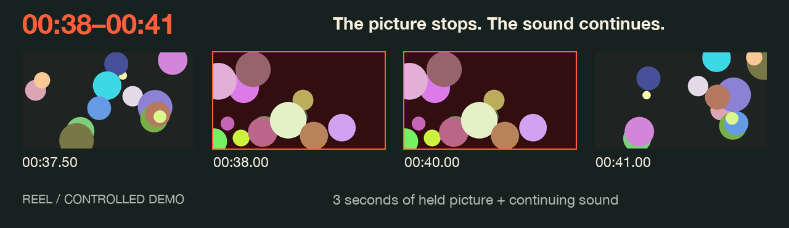
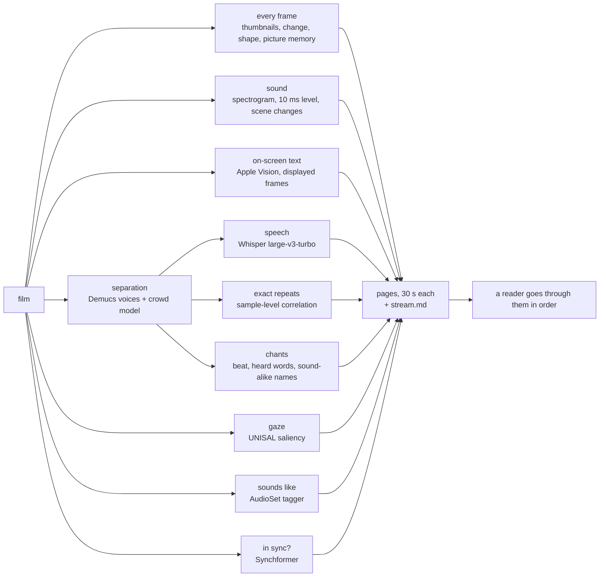

<a href="https://cdn.jsdelivr.net/gh/Dradradre/Reel@e9b9a19225546c9d1658f7309d7abe28f8673212/assets/door-demo.mp4">
<picture>
  <source media="(prefers-reduced-motion: reduce)" srcset="assets/door-at-cutoff.png">
  
</picture>
</a>

**[▶ Hear A, then B · 18 seconds](https://cdn.jsdelivr.net/gh/Dradradre/Reel@e9b9a19225546c9d1658f7309d7abe28f8673212/assets/door-demo.mp4)**

**English** | [한국어](README.ko.md) | [简体中文](README.zh-CN.md) | [繁體中文](README.zh-TW.md) | [日本語](README.ja.md) | [Español](README.es.md)

[Try your film](#quickstart)  |  [Measurements](#does-it-work)  |  [Reading guide](docs/READING.md)

# Eyes and ears for a language model

Give your agent a film. Let it watch, listen, look closer and replay what caught its attention. Reel delivers pictures and recorded sound on the same clock through MCP. Set `--until 8.5` and every observation stays inside the first 8.5 seconds.

## Before the door opens

**Same 204 frames. Different recordings. Different answers.** We stopped both films at 8.5 seconds, while the door was still closed.

| A · keys in the recording | B · room tone only |
|---|---|
| “The audio analysis suggested a brief jingling or rattling sound, though I could not hear it directly.” | “I could not tell what was making the faint background sound.” |

In this run local Codex GPT received pictures and a local audio model’s reading of the recording. The video plays both complete 8.5-second excerpts at the same gain and displays the recorded answers. A contains keys from 4.0 to 6.73 seconds. GPT describes a rattle and leaves its source open. [Full responses](docs/benchmarks/short-listening-turns.json) · [Recreate the trial](docs/door-trial.md#재현) · [Key recording by Joao_Janz, CC0](https://freesound.org/people/Joao_Janz/sounds/485110/)

## Try it on an edit

> Watch this cut. Find any moment where the picture stops while the sound carries on. Give me the time range and replay it.

In the generated demo, the picture holds from **00:38 to 00:41** while the recording continues. Reel’s change trace and sound trace put both events on the same clock. The stills below show the approach, the hold and the return to motion.



After watching that interval, the agent can call `observe(start_s=38, end_s=41)` to inspect its frames alongside the original audio. You can also ask about a subtitle, a repeated sound or a movement between two shots. [Demo source and planted timings](examples/make_demo.py) · [Replay tools](docs/READING.md#watching-a-little-at-a-time)

## Quickstart

Reel runs on Apple Silicon Macs. Install FFmpeg and Python 3.11 or later, then replace `film.mp4` with the path to your film.

```bash
git clone https://github.com/Dradradre/Reel.git && cd Reel
python3 -m venv .venv && source .venv/bin/activate
python -m pip install -e '.[mcp]'
reel play film.mp4 --out reels/first-view --until 8.5
```

The player prints the path to each turn. Type `next` for the next interval, or type `quit`. Use a fresh output directory for another viewing.

**Watch with a model.** Reel serves the film over the Model Context Protocol (MCP). For a signed-in Codex CLI, register the local server from the activated environment, then start a new chat.

```bash
codex mcp add reel -- "$(command -v reel)" mcp "$PWD/film.mp4" --until 8.5 --image-client
```

> Watch the film with Reel. What did you see and hear?

For other MCP clients, use `reel mcp /absolute/path/to/film.mp4 --until 8.5` as the stdio command. Audio-capable clients can receive the original channels as a WAV. Image-and-text clients get frames and acoustic measurements. Optional local readers describe the waveform and transcribe speech. The waveform model download is about 39 GB. [Client inputs and optional setup](#playback-options)

## One clock for picture and sound

| While watching | What the model can do |
|---|---|
| Advance | Call `view(turn=1)`, then `view(turn=2)`. Each call releases the next interval of the film. |
| Look closer | Use `look` with a time and a box to read the original pixels of a sign or see what someone held. |
| Replay | Once the film has reached six seconds, `observe(start_s=4, end_s=6)` pairs the successive pictures with the recording from those same two seconds. |

Reel can also lay out a film in 30-second pages. Read left to right. A vertical line through the page crosses the picture, motion, sound and words at the same instant. Every frame contributes to the change trace and every 10 ms of sound contributes to the level trace. [Open the first page at full size](assets/reel_page_1.png) · [Read the next 30 seconds](assets/reel_page_2.png)

[](assets/reel_page_1.png)

<details>
<summary>What each lane shows</summary>

| Lane | What it is | What a viewer notices there |
|---|---|---|
| frames over time | selected whole frames at their recorded presentation times. A frame can stay up across a long pause between updates. Bounded snapshots retain the brightness range of footage tagged as full range. Reel maps tagged PQ and HLG pictures to sRGB with a colour-managed FFmpeg build | See who and what share the screen. During playback, extra timestamped frames can reveal a brief local change. A pair of times and a box let you inspect its original pixels with `look`. [Reading trial](docs/perception-check.md#잠깐-나타난-글자를-다시-읽을-때) |
| motion point (playback) | the pixels along two fixed lines through a point, from every displayed frame | see how many times something crosses a line and in which direction with `view(motion_point=[x,y])` |
| follow (playback) | the point you selected in an earlier picture, followed through each released frame | compare the selected detail with the last picture in which the tracker located it |
| subject | where the person the film is about appears, and whether the eye is predicted to land on them | the film losing its subject |
| on screen | recognized words and numbers during the frames in which they appear | read a score or sign alongside the sound at that moment |
| change | mean absolute RGB change between displayed frames, brightness and holds. A colour change can register at constant brightness. On MCP replay, `ask_scene(exposure_detail=true)` places the recorded peak under each consecutive picture in a short sequence. With `sync_regions`, each motion trace covers the whole requested rectangle | cuts, flashes, blackouts, a frozen picture |
| seen again | Green marks a pixel-for-pixel match between two retained colour previews. Blue marks a similar layout across shots. Both give the earlier time. | a returning title card, two different cards with similar lettering |
| sound | power in each frequency band on a fixed −80 to 0 dBFS scale, with changes in the sound marked. On replay, a marked interval can be read against the surrounding channel spectra. In stereo you can listen to the average or difference between the channels. | the same sound keeps its brightness across recordings and zooms. During playback you can rehear a sustained band or a brief impact alongside the original. The speech reader measures what remains in the gaps before, between and after detected voices. Playback also reports the frequency of a repeating sound and the times of sharp attacks in each channel. |
| sounds like | short sound changes on the page. Live playback also gives the time, channel and frequency range of sharp rises or falls. Source estimates cover up to ten seconds in `stream.md` and four seconds per channel in `play`. First-listen descriptions can cover ten seconds. A second description can isolate the latest passage when the longer reading includes an earlier turn. A first MCP view includes available local waveform readings and supported words with or without a WAV attachment. If the waveform reader is unavailable, the local captioner gives the range it heard. The detailed MCP view can also show a phrase that began in an earlier turn. On replay, compare the one-second estimates with one continuous reading of the sound. With YAMNet installed, playback also gives possible sources in 0.975-second recording windows. On replay you can adjust the volume, compare the sources at both levels, or locate the second closest to a sound you describe. | a single impact, music underneath it, or voices in a busy room |
| level | recorded mix level in 10 ms steps, with the typical level and strongest moment of each window in `stream.md` | a slow fade, a quiet background or a brief rise |
| L level, R level | 10 ms levels for each recorded channel, numbered on larger layouts | a sound that is louder on one side or moves across the mix |
| 1 early, 2 early | Which recorded channel received a matching waveform first, in quarter-second windows | Two sounds can have the same left and right levels and still be heard toward one ear. A gap means the timing is unresolved. |
| film time, pixel change, ch peak, ch bands Hz | During playback each column shows a centre frame and sometimes an extra view below it. When revisiting a range with `observe` or looking closer with `view(focus=...)`, read each row left to right. Follow the line under a picture to the motion trace, the channel peaks and the frequency bands on replay. Brighter bands carry more energy. Cropping the picture keeps the original mix. | Follow a brief movement and check when it happened relative to a sound. |
| joint (optional) | Two readings of the same recording, one with moving pictures on their display clock. A live reader can ask about the scene across pauses. | Follow a sound and the movement that accompanies it. |
| in sync? | where the sound sits against the picture, from 2 s early to 2 s late, moment by moment | lips moving before the words, a ball struck before its sound |
| crowd stem | estimated audience sound on the same band-power scale as the mix, with repeated rhythms marked | the timing of a possible chant and its relation to the recorded mix |
| said | On replay, `heard_words` can check just the selected interval. Playback marks possible voices found only after amplification and keeps their times separate from the transcript. The page shows words that agree in two listening windows, checked against the mix when only the stem suggests speech. Gain-assisted candidates are available in `reel listen` | what is said; whether it matches the subtitles |
| heard again | A short waveform repeat or a sequence of similar voice patterns points to the earlier sound. On replay, `compare_heard(similarity=true)` compares two original excerpts. Pass `alternatives` to compare descriptions across them. | a possible echo, a recurring crowd sound |

</details>

## Does it work?

| Trial | Result with local GPT |
|---|---|
| Timed visual questions on all 644 OVO-Bench videos | **66.08** on the official three-mode average. GPT answered 2,002 of 3,035 checkpoints correctly using only pictures from before each question. [Score and protocol](docs/benchmarks/ovo-full.json) |
| Free recall of sight and sound on 12 unfamiliar films | **78.8% for sight, 43.8% for sound** on the human-relative recall measure. Giving the two tracks equal weight yielded 61.3% (95% interval 43.3–91.1%). [Captions and scoring](docs/benchmarks/track-recall.json) |

In 56 held-out recordings, 359 of 431 hand-marked note starts fell within 50 ms of a Reel attack. Using rises from the earlier band-change trace found 215. Misses fell from 216 to 72 and extra marks from 51 to 45. On the final compact MCP view, local GPT placed 93 of 103 starts within 50 ms, up from 84. Its extra marks fell from ten to five. This blind trial used 12 further excerpts from the held-out recordings and two controls. Two guitar phrases accounted for all nine additional matches. [Annotated recordings](docs/benchmarks/attack-timing.json) · [GPT timestamps](docs/benchmarks/attack-readers.json)

In two controlled tests with different environmental recordings, Reel found 189 and 202 of 218 short sounds inserted into each set of backgrounds. There were nine unmatched marks in the first set and 212 in the second. Of the latter, 138 came from rain or engine recordings played on their own. On 12 clips from the second set, giving GPT every confirmed peak count left it at eight exact counts and increased its total absolute error from 18 to 20. Showing just rapid runs gave ten exact counts and a total error of 13 on the same clips. [Environmental mixtures](docs/benchmarks/environment-attacks.json) · [Blind counts and background controls](docs/benchmarks/attack-readers.json)

The recall test compares how well a description distinguishes its film from the others, with human descriptions as the reference. In one party scene, three of four listeners mentioned singing. GPT recalled applause and speech and missed the singing. [Film-by-film account (Korean)](docs/perception-check.md#화면과-녹음을-바꿔-끼운-뒤의-자유-회상)

<details>
<summary>Earlier viewing trials, blind reader reports and misses</summary>

On all 644 OVO-Bench videos, local GPT with Reel answered 2,002/3,035 visual checkpoints correctly and scored **66.08** using the official three-mode average. Each question received up to 24 pictures displayed strictly before its timestamp. [Scores, human reference and reproduction](docs/benchmarks/ovo-full.json)

On eight unfamiliar films, the first sentence from GPT with Reel reached 98.2% of human same-film description separation. Picture recall reached 95.0% and sound recall 56.9%. GPT received pictures, local sound descriptions and speech readings. [Per-film responses and uncertainty](docs/benchmarks/earlier-observations.json)

On eight other films, equally weighted picture and sound recall reached 61.3% of human description separation. Adding sound categories from 0.975-second windows brought it to 70.9% (95% film bootstrap interval 43.3–102.3%). Picture recall reached 106.3% and sound recall 35.5%. [Methods and responses by film](docs/benchmarks/short-sound-events.json)

We paired 12 previously untested films and played each picture with both recordings in its pair. A scorer matched GPT’s two open sound descriptions to the correct recordings for **10/12** pictures with the previous report and **9/12** with the available waveform caption shown up front. On the original combinations, equally weighted picture and sound recall reached 52.6% and 61.3% of the human reference (95% interval for the new report, 43.3–91.1%). [Paired conditions and responses](docs/benchmarks/track-recall.json)

On 20 eight-second home and outdoor excerpts, a replay search for a supplied sound selected a second marked by a human in **23/31** cases, compared with **15/31** using one-second CLAP scores. Giving the new scores to GPT also raised the number of sources it picked outside the human annotations from 17 to 30. [Timing, missed sounds and extra answers](docs/benchmarks/sound-location.json)

When a colour or fine pattern changed briefly at constant average brightness, GPT found the right second from the page’s change trace on **8/8** clips, up from **0/8**. Pausing more often for RGB changes on eight real films reduced activity-boundary F1 against five observers from **40.7 to 34.6**. Reel keeps its ordinary viewing pace. [Frame changes and human timing](docs/perception-check.md#밝기가-같은-화면에서-색이나-무늬가-바뀐-순간)

On 24 field recordings, adding stereo descriptions to the first view changed GPT’s agreement with individual listeners from 55.9% to 54.8%. On a 12-recording subset, comparing proposed sounds with the original, mid and side signals scored 63.1%, versus 57.3% with the original alone. The paired 95% interval for the difference was −3.1 to +16.6 percentage points. On 12 mixes designed to separate the sources, GPT identified both sounds in 1/12 with the original and 11/12 with all three signals. [Listening conditions and individual responses](docs/listening-check.md#좌우-채널을-나눠-들었을-때)

Across 32 real recordings, a 16 kHz mono excerpt matched an independently cut WAV in length and waveform within 0.000001 of full scale for **32/32** excerpts. In a separate test of 16 films, the final picture at a frame boundary and just after it matched all **32/32** reference images. [Signal and picture checks](docs/perception-check.md#멈춘-순간의-화면과-원음을-원본과-대조한-결과)

On 12 unedited recordings, GPT matched the annotated sound at **15 of 24 marked moments**. Adding a separate source comparison for just the bracketed samples reduced that to **11/24**. Reel keeps the surrounding recording on replay. [Paired readings and controls](docs/listening-check.md#표시한-순간의-소리만-따로-비교한-시험)

On 24 Kinetics films, GPT marked changes in the main activity as it watched. Its one-to-one timing F1 against individual human annotators was **39.2** on a 0–100 scale. Two people averaged **65.7**. GPT marked 40 changes, with 35 within half a second of at least three of the five observers. In 12 further films from different activity categories, GPT and human observers averaged 37.3 and two humans averaged 62.2 with the same protocol. [Film times, reader instructions and controls](docs/perception-check.md#활동이-달라졌다고-느낀-시각)

When GPT had to count and give the direction of crossings at a specified point, it got one of six silent clips right in the ordinary view and all six with the optional motion plot. Adding the plot at the centre of 36 filmed activities gave timing F1 of 38.5 versus 38.6 in the ordinary view. [Crossing task and human comparison](docs/perception-check.md#빠른-물체가-선을-지난-횟수와-방향)

When GPT heard both recordings in sequence and could compare its own descriptions across them, it identified **25/48** sounds, up from **22/48**. Both versions identified both sounds on **6/24 films**. In a separate environmental test, each version named 16/16 sounds present in the choices and abstained on 15/16 sounds outside them. [Paired listening and false identifications](docs/listening-check.md#두-구간에서-어떤-소리가-달라졌는지-비교)

Across 24 filmed scenes, we gave local GPT three independent plays of the same moving picture with the original sound, another sound from the same film, or silence. GPT identified both recordings on **5/24 films** and named a sound on **0/24** silent controls. [Soundtrack swaps, individual answers and reproduction](docs/listening-check.md#같은-화면에서-실제-소리만-바꿨을-때)

On two sets of real films, we tested including the interval spectrogram whenever GPT replayed a scene to compare sound choices. The earlier runs matched **57/84** human annotations across 28 films. The new run matched **58/84**. On 12 films the count rose from 21/36 to 23/36, and on the other 16 it fell from 36/48 to 35/48. [Answers and protocol for all 28 films](docs/perception-check.md#소리를-다시-확인할-때-그림을-자동으로-보여준-결과)

With the marked sound replay available, local GPT matched **21/36** human annotations on the same 12 films (picture 10/12, sound 6/12, visible source 5/12). None of the readers requested a mark. When explicitly shown a sound interval in a separate timing task, GPT matched annotated starts and continuations on **9/24** natural excerpts, up from 2/24. Wrong answers rose from 1 to 3, and abstentions fell from 21 to 12. [Ordinary viewing](docs/perception-check.md#소리-구간-표시를-추가한-뒤-같은-12편을-본-결과) · [Timing trial](docs/listening-check.md#짧은-소리가-시작되는-순간)

On 12 previously unused films, signed-in local Codex GPT matched human annotations on **21/36 questions (58.3%)** and **22/36 (61.1%)** in a second independent pass. Picture agreement was 9/12 then 10/12. Sound identity and whether its source was visible each scored 6/12 both times. A reader given only the questions and forced to guess scored 16/36. [Both runs, human references and individual misses](docs/perception-check.md#새-영상-12편에서-두-번-잰-일치율)

On eight everyday clips, GPT described each whole film in a single sentence without questions about its content. Against 37 human descriptions, its captions distinguished the matching film from the other seven **87.0% as well as a held-out viewer's caption** (film bootstrap interval 74.0–103.7%). GPT chose to skip optional sound estimates on 26 of 47 playback turns. A separate run that delivered those estimates on all 47 turns scored **86.5%** by the same measure. [Human comparison and viewing conditions](docs/perception-check.md#자유-설명에서-사람끼리의-일치도를-100으로-뒀을-때)

On an earlier 16-film panel, local Codex GPT matched the human annotations on **36 of 48 questions (75.0%)**. Agreement was 14/16 for the picture, 11/16 for the sound and 11/16 for whether its source was visible. GPT answered 8 questions incorrectly and left 4 unresolved. [Film-by-film results and test conditions](docs/perception-check.md#같은-48문항으로-다시-잰-일치율)

On 12 other films, GPT chose its own tools to decide which earlier sound belonged to the same category as a later one. It matched the human event labels 4/12 times before the recording comparison was available and 8/12 with it. [Individual responses and trials where neither sound matched](docs/listening-check.md#이름을-모르는-소리를-전에-들은-녹음과-비교)

When one of two filmed actions supplied the soundtrack, GPT chose the correct picture on 9 of 14 plays. It followed both soundtrack swaps in 3 of 7 pairs. On eight separate single scenes, GPT left source visibility unresolved every time. [Responses and comparison with the previous version](docs/perception-check.md#화면-가장자리에서-난-소리)

Immediately after frame-by-frame replay was introduced, local Codex GPT matched the human annotations on **35 of 48 questions (72.9%)** on the same 16 films. It matched 15/16 picture answers, 10/16 sounds and 10/16 source-visibility answers. On a separate timing control, a brief tone moved through all 12 frames of the same sequence. GPT read the number on the sounding frame **12/12** times with the option available and **6/12** with the previous replay. [Comparison and individual responses](docs/perception-check.md#소리가-난-프레임을-다시-보는-시험)

In the preceding version, on 16 films new to Reel development, local GPT matched the human annotations on **38 of 48 questions (79.2%)**. Each of eight sounds had one film with a visible source and one with a hidden source. GPT guessed 23 of 48 correctly from the questions and choices alone. Across these and the 28 earlier films, agreement was **76.5% (101/132)**. [Results on the 16 new films](docs/perception-check.md#처음-사용한-영상-16편)

On all 28 filmed scenes, local Codex GPT matched the human annotations on **63/84 questions (75.0%)**. It matched 25/28 for the picture, 20/28 for the sound in a specific interval and 18/28 for whether the sound source was visible. It gave 12 wrong answers and abstained on 9. Each film ran in a fresh session of the same version with pictures and local sound readings. The three panels used the original questions and choices. [Film-by-film answers and scoring](docs/perception-check.md#같은-버전으로-다시-본-실사-영상-28편)

On 23 urban recordings, GPT and individual listeners overlapped on **56.3%** of the sound categories either picked. Two people listening to the same recording averaged **58.9%**. GPT missed children’s voices in all three recordings where a majority marked them. [Individual recordings and listener comparison](docs/listening-check.md#도시-녹음에서-gpt와-청취자가-고른-소리)

Fresh readers (a model given only the [reading guide](docs/READING.md) and the reel, never told what was wrong)
watched real fan edits that a person had already reviewed:

| Film | What the person complained about | Noticed by the blind reader |
|---|---|---|
| 10-minute esports documentary, first cut | the order of years jumps around; abrupt blackouts; a second of commentary plays twice; subtitles drift from the voice; a frozen picture | 4 of 5 in the first round; **5 of 5** after exact-repeat hearing was added |
| 6-minute player tribute, first cut | a team chant looped under the title cards; choppy joins; rushed second half; letterboxed game footage that loses the scoreboard; the player not in focus | **4 of 5**: the chant (named **T1** by sound alone, in 4 of 4 chant windows), the holes of dead silence, the pile of still cards, the game footage cropped to 74-79% height with the score bar gone. Focus was only touched on ("the later wins are called through other players") |
| 2-minute hype trailer, **never used while building Reel** | thunder effects that sound like a hand slap; scenes that mean nothing; cheap-sounding music | **3 of 3**: "2 of the 9 hits sound like a slap", impacts heard as a splash, a car, a quack; a 13 s strobe of years over the same two stills and a black cold open; the bed taken for "free stock music" (that verdict leaned on the credits as much as on the sound) |
| 1.5-minute hype trailer, **never used while building Reel** | plays with no impact; a glitch effect that fights the shot; kill banners naming the wrong player; poor picture quality | **4 of 4**: "it feels like the film ran out of moments"; a 5 s glitch strobe of one press-conference shot; a Faker kill banner in Zeus's debut; soft, upscaled-looking footage |
| the same documentary, revised | nothing yet | found faults the editor's own checks had missed: commentary over quote cards, sound dropping at chapter turns, an unreadable results grid |

### Random videos from the web

26 videos picked at random from searches across genres: talk shows, local TV news, animation, skate and drum videos,
cooking, drone footage, football, tennis and F1 highlights, a TED talk, trailers, a podcast, live music, a crash-test
compilation, a chess stream, vlogs. A script planted editing faults at random times (repeats, echoes, blackouts,
freezes, flashes, letterboxing, low-resolution stretches, dropouts, volume jumps, sound running early or late against
the picture) and kept the answer key away from the reader. One video per round was left untouched.

| Round | Planted faults noticed | On the untouched video |
|---|---|---|
| 1 | 9 of 15 | called the original editor's fade a hard cut |
| 2 | 14 of 15 | "nothing wrong" |
| 3 | 10 of 15 | "nothing wrong" |
| 4 | 10 of 14 | "nothing wrong" |
| **5: code frozen, nothing changed after** | **12 of 17** (14 counting a slip in sync noticed by the stutter it leaves) | **"nothing wrong"** |

Senses were added between rounds 1 and 4, after looking at what the reader missed: sound that cuts dead or jumps in
volume, flashes of a few frames, footage suddenly softer than around it, picture-sound sync, and the very same recording
replayed. Round 5 is the honest number: new videos, code untouched.

In round 5, by kind: letterboxing 3 of 3, blackouts 3 of 3, echoes 3 of 3, a pasted repeat 1 of 1, dropouts 1 of 2,
sound early or late 1 of 3, a freeze 0 of 1, a volume jump 0 of 1. One false alarm: a hum in a chess stream marked as a
sudden volume jump. Across all five rounds the reader never invented a fault in an untouched video.

</details>

## Playback options

Run these commands to enable local listening and speech recognition.

```bash
python -m pip install -e '.[speech]'
reel setup --speech --describe-sounds
```

<details>
<summary>Commands, optional models and client configuration</summary>

```bash
pip install -e ".[all]"           # or pick extras: separate, crowd, mlx, speech, ocr, gaze
reel setup --sync                  # fetch the gaze model and the sync model (1.1 GB)
reel doctor                        # what this machine can see and hear

reel play film.mp4 --out reels/first-view --until 8.5
reel play film.mp4 --out reels/sound-only --until 8.5 --tracks sound
reel watch film.mp4 --out reels/film --subject Zeus --genre lol --lang ko
reel watch film.mp4 --until 8.5 --out reels/view-01
reel zoom reels/film --t0 72 --t1 80          # re-watch a stretch closer
reel frame reels/film --at 73.25              # inspect the full frame on display here
reel frame reels/film --t0 73 --t1 74         # read every displayed frame in this second
reel listen reels/view-01 --t0 4 --t1 7       # inspect channel levels and changes on the film's clock
reel observe reels/view-01 --t0 4 --t1 4.5    # see each frame with the audio that played during it
```

To find out what a viewer picked up from the picture or the soundtrack, start fresh sessions on the same file with `--tracks picture`, `--tracks sound` and the default `--tracks both`. Both `play` and `mcp` keep the original film clock and cutoff. Later looks and listens in each session use the selected tracks. [What people and GPT noticed in eight films](docs/perception-check.md#같은-영상을-보거나-듣거나-둘-다-했을-때)

When a file has several picture or sound tracks, Reel uses the first track marked default within each type. With no marked default it takes the first eligible track. Attached cover art and thumbnail tracks are excluded from the moving picture. The same selection supplies the pictures, recording and transcript.

On a first MCP view, `audio.rapid_rises` gives the film times of closely spaced attacks, such as a short drum roll. A single jingle can leave several marks. Replay the same turn with `full_detail=true` for the complete `audio.attacks` trace from each channel. The trace is also saved during ordinary `play`.

Reel measures pitch changes in each recorded channel. A clear repeating sound leaves a series of frequency estimates in `audio.pitch_contour`, so a reader can follow a rise or fall even when the source is unclear.

An MCP client can receive the pictures and recorded sound directly. Install `pip install -e '.[mcp]'` and configure a local stdio server with the command `reel mcp /path/to/film.mp4 --until 8.5`. For Codex CLI, run this command from the active Reel environment.

```bash
codex mcp add reel -- "$(command -v reel)" mcp /path/to/film.mp4 --until 8.5 --image-client
```

A host that accepts video can call `view_media(turn=1, continuous_seconds=5)` and pass the returned movie to its model or player. The movie keeps the picture timing and recorded channels together. It shares the cutoff and turn numbers with `view`. The host reads the MCP resource links in order. In our Codex CLI test GPT received encoded bytes, so use `view` there. [Playback and file format](docs/READING.md#watching-a-little-at-a-time)

A normal `view(turn=1)` includes the original WAV, the prepared local listener’s description of that turn and any timed words supported by two transcriptions. This lets clients use the same listening evidence when their model accepts only pictures and text. With `--image-client` or `native_audio=false`, the WAV stays available on request. Use `sound_estimates=false` to get the recording and measurements without interpretations. Install the speech extra and run `reel setup --speech --describe-sounds` to prepare the local readers. [Test with the same pictures and different recordings](docs/perception-check.md#wav를-첨부했을-때-gpt가-실제로-받아들인-소리)

At a short pause the local captioner may have heard a phrase that began in the previous turn. If the primary listener is unavailable, request `view(turn=N, full_detail=true)` to read that phrase and its time range in `sound_in_context`. `current_start_s` shows how much was heard earlier. A sound in the description may already have stopped. [What GPT heard across short pauses](docs/benchmarks/short-listening-turns.json)

If a client omits the WAV, it can still report indirect observations from the channel measurements and local readings. The first-impression viewer uses the same guidance. [Speech and surrounding sounds](docs/perception-check.md#목소리와-그-목소리가-가리키는-소리)

For a picture-and-text viewer the timed readings come first. Each channel also carries measurements from the original recording, including its level, the frequency range containing the middle 80% of its spectral power, and the share in its strongest narrow band. These can distinguish a steady tone from broadband noise even at the same level.

The first view also shows when one channel was louder or received the same waveform earlier, even when the levels were equal. Replay with `full_detail=true` for the individual measurements and encoder timings. [Blind listening and viewing results](docs/perception-check.md#원래-녹음의-주파수와-첫-설명)

Ask the model to view the film. When the sound changes sharply, the model also receives the pictures displayed around that instant. Start the server with `--describe-sounds` to include the local waveform reader’s impression at each pause. Add `--gaze` for a sequence of details selected by the visual gaze model. Each `view` call returns one interval. To inspect a moment you have passed, use `observe(start_s, end_s)` to get the successive pictures and the matching recording together. Audio-capable clients get its WAV. An image-and-text client can inspect the pictures and spectrum, ask the local listener about a sound, or check spoken words. [Tool usage](docs/READING.md#watching-a-little-at-a-time) · [Codex MCP configuration](https://developers.openai.com/codex/mcp/)

In each playback overview, `at_s` gives the time of each observation and `picture_pts_us` gives the timestamp of the picture on screen then, including when viewing only the picture track. A held frame can appear at several observation times.

An ordinary turn also includes a chronological sheet when the overview skips a visible change and every successive picture fits on one sheet. Repeated identical previews can share one cell. To see a quick action unfold on a busy screen, call `view(turn=1, max_frames=12)`. Reel shows every displayed picture in that turn, in time order, and stops the recording at the same boundary. Choose 1–12 pictures on any advance. On the command line use `reel play film.mp4 --out reels/frames --continuous --max-frames 12`. [Brief actions and reversed visual cues](docs/perception-check.md#빠른-동작을-프레임-순서대로-본-경우)

In a busy scene, a normal turn can also show up to twelve original pictures of brief local changes that the overview skipped. Their timestamps appear in `selected_picture_pts_us`. [Camera footage with human action timings](docs/perception-check.md#움직이는-장면에서-대표-화면-사이에-보인-모습)

For the pictures shown on a turn, `audio.during_pictures` gives the peak and RMS level in each channel while that exposure was on screen. Each row identifies the samples in the turn’s WAV. Sounds can also fall between the pictured exposures.

To follow an exchange or movement through a cut, use `view(turn=1, continuous_seconds=8)`. Reel returns the pictures in order and the recording from the same interval. The next turn can continue at that pace or stop on changes again. On the command line, `reel play film.mp4 --out reels/view --step 8 --continuous` uses eight-second intervals. [What human viewers and GPT recalled](docs/perception-check.md#한-장면을-이어-본-뒤-기억한-내용)

For a question about the sound and action together, call `view(turn=2, question="What changes when the sound begins?")`. The local reader sees the moving pictures and hears the same interval. Add `joint_seconds=6` to look back through earlier pauses. With `reel mcp FILM --joint --image-client`, a continuous view includes that audiovisual reading on the first watch. [First descriptions of eight films](docs/perception-check.md#사람들이-같은-영상을-설명한-문장)

To see how a sound relates to a movement that began before the last pause, use `view(turn=N, joint_seconds=6)`. The local reader hears the last six seconds and then sees the same interval with its sound. It uses only frames and samples released by turn N. An image-and-text client receives both descriptions in `joint`. To ask about a shorter event inside a turn, use `ask_scene(start_s=2.4, end_s=3.7, question="What moved when the sound changed?")`. The pictures, measured channel levels, local reading and optional WAV cover that same interval. With just the two times, Reel returns the pictures, channel levels and times of frequency-band changes without loading a model. At a terminal playback pause, enter `joint 6`. [Comparison with human event annotations](docs/perception-check.md#여러-번-멈춘-장면의-화면과-소리를-이어-볼-때)

To revisit a sound you have in mind, install the optional local model with `reel setup --locate-sounds` (1.76 GB of weights). Call `listen(turn=2, start_s=2, end_s=7, describe=false, locate_sounds=["water running"])` or use `reel match DIR --t0 2 --t1 7 --locate "water running"`. Replay the returned second. An absent sound can also have a highest-scoring second.

To follow changes in the sound alongside the pictures, call `ask_scene(start_s=2, end_s=7, alternatives=["water running", "a person speaking"])`. Each channel has a comparison for each second and a second reading of the uninterrupted recording. The first uses short clips repeated inside the encoder. The second plays the original sequence once and pads the unused encoder input with zeros. At a playback pause use `match 2 7 --per-second`. Use `alternatives=[]` to see nearby catalogue sounds when you have no name in mind. [Tests on sound order](docs/perception-check.md#원음에서-소리-두-가지의-순서-짚기)

To check two visible movements against the sound, call `ask_scene(start_s=2, end_s=5, sync_regions=[[0.1,0.3,0.4,0.8],[0.6,0.3,0.9,0.8]])`. Each numbered box outlines the full area measured, including movement at the edges. Each trace shares its clock with the recorded channel peaks. With `reel setup --sync`, the local sync reader also measures how closely each region moves in time with each channel.

To magnify a fixed part of the picture, use `view(turn=2, focus=[0.7, 0.4], max_seconds=0.3)`. This pauses within 0.3 s and shows the chosen part of the scene through time, the whole picture and the same sound. The final picture also shows the exact region enlarged next to its location. You can choose another point or pace on the next turn. To inspect original pixels from an earlier moment, use `look(turn=2, at_s=0.15, box=[0.5, 0.2, 0.9, 0.6])`.

To follow something that moves across the screen, select a point in a picture you have seen. For example, if the point was at `[0.7,0.4]` in the picture at 1.25 seconds, use `view(turn=2, focus=[0.7,0.4], follow_from_s=1.25)`. Reel follows it through the end of turn 2, up to eight seconds. The two close-ups show the point you selected and its most recent match. Reel uses the original picture when available. If the tracker loses the point, the second close-up gives the time of the last match. Basic tracking uses optical flow. Run `reel setup --follow` to prepare the local online BootsTAPIR model, which can pick up a point again after it was hidden. [Tracking checks](docs/perception-check.md#움직이는-점을-따라본-결과)

For a first look without suggested sound names or speech, use `view(turn=1, sound_estimates=false)`. Once playback has reached the time you want, `listen(turn=N, start_s=2, end_s=7, native_audio=true, describe=false)` returns the recorded channels and their spectrum from 2 to 7 seconds, even across pauses. A reader that needs help identifying the sound can set `describe=true` to ask the local waveform reader about that same interval.

When you have two explanations for a sound, compare them with the original recording. For example, `listen(turn=3, start_s=2, end_s=5, describe=false, alternatives=["a voice humming", "an electric motor running"])` returns a similarity score for each description on each channel. Use `alternatives=[]` to ask for nearby catalogue sounds. Prepare the local model with `reel setup --compare-sounds`. A close match can still misidentify the source.

When sounds overlap, try `listen(turn=N, start_s=2, end_s=7, component="percussive")` to bring out brief, broadband sounds. Use `"harmonic"` for frequency bands that persist. The spectrum and optional WAV follow that choice. The local listener hears the selected component and the original recording together. A single source can appear in both components. [Listening comparison](docs/listening-check.md#겹쳐-들리는-소리를-원음과-대조)

For a stereo recording, `listen(turn=N, start_s=2, end_s=7, component="side", describe=false, alternatives=["footsteps", "speech"])` compares the same descriptions with the original and with the difference between the channels. Use `"mid"` to hear their average. Either component can contain several sounds.

For a first viewing, `play` works directly from the film. Open the printed `view.json` and its frame sheets, sound image and final still. The WAV plays the same interval on its original channels. Type `next` when ready, `next 0.4` for a closer look at the next part, or `quit`. An agent can write these commands to standard input. A change in the picture or recorded level can bring the next pause forward. Add `--pause-on-sound-change` to `play` or `mcp` to pause on a sharp shift between frequency bands, even at steady volume. Each turn reports those shifts at either pace. Quiet stretches continue in order. Use `reel listen reels/first-view/turn_00001` for local sound estimates from a delivered interval.

For shorter sounds, install `pip install -e ".[events]"` and run `reel setup --sound-events`. YAMNet reads each recorded channel in 0.975-second windows starting 0.48 seconds apart. Playback exposes the candidate categories in `audio.sound_events`. To recheck a released interval, call `listen(turn=3, start_s=2, end_s=4, describe=false, sound_events=true)`. A category such as speech or barking points to an interval to listen to again.

Use `gain_db` when you want to hear an already released interval louder or quieter. For example, `listen(turn=3, start_s=2, end_s=4, gain_db=12, native_audio=true, sound_events=true, describe=false)` returns the adjusted WAV and candidate sources at both levels. Each channel gets the same gain. The loudest sample limits how far it can rise. From the command line use `reel listen DIR --t0 2 --t1 4 --gain-db 12`. [Replays at different volumes](docs/listening-check.md#이미-들은-구간의-볼륨을-바꿨을-때)

At each pause, `audio.signal` says whether any recorded sample was nonzero. With cached AudioSet weights, `audio.source_estimates` also gives possible sources per channel over the past four seconds. Use `reel setup --sound-labels` to prepare the weights. A channel can carry sound with no identifiable source.

Run `reel setup --captions` once to enable first-listen descriptions. The next `play` writes a short impression under `audio.scene` as the recording unfolds. It starts with two seconds of sound and can draw on the last ten seconds. When the sound changes, compare the times in `windows` and `recent_windows` to see which words describe the latest passage. The model runs locally in a separate Python 3.10 environment, which setup creates with uv or an installed Python 3.10. Read the description with the channel measurements. The model can mistake a hiss for rain or infer a machine from a steady tone. [Comparison with human listeners](docs/listening-check.md#선택지-없이-현장-녹음을-들었을-때)

For a second opinion on a sound, prepare `reel setup --captions --compare-sounds` and use `reel listen TURN --t0 2 --t1 5 --verify-sounds`. CoNeTTE proposes up to six descriptions. CLAP hears the same channel and selects the closest one. Add `--verify-sounds` to `play` or `mcp` to do this at every pause. On 12 unfamiliar videos the local GPT sound-description score rose from 54.6 to 68.2 on a scale where human descriptions scored 100. The interval for the paired change included zero. [Recordings, responses and scoring](docs/benchmarks/verified-hearing.json)

To distinguish possible sources, run `reel setup --identify-sounds` once. From then on, `match` and MCP `listen` with two or more alternatives also report how Meta PE-AV and LAION CLAP ranked the same original channels. Reel also checks descriptions outside the proposed list. It returns `unresolved` if the encoders disagree or if both prefer an outside description. Use `reel match TURN --t0 2 --t1 5 --identify "metal rattling" "fabric rubbing"` for the two-model report alone. With `--identify-sounds` on `play` or `mcp`, both encoders can search AudioSet at each pause. The PE-AV checkpoint download is 8.9 GB.

Across 99 environmental recordings from 50 source categories, CLAP picked the labelled source 85 times and PE-AV picked it 94 times. Both picked it on all 81 recordings where they agreed. Removing the correct choice made them agree on a different source 40 times. On a fresh set of 49 recordings with the correct option removed, checking outside the list reduced false shared choices from 16 to 0. With the correct option restored, it retained 21 of the 39 correct agreements. [Source rankings](docs/benchmarks/source-identity-agreement.json) and [omitted-source trials](docs/benchmarks/source-outside-choices.json)

Across 16 original filmed transitions GPT identified the second sound in 5 with the wider reading and 7 when it also received the recent one. [Listening trial](docs/listening-check.md#방금-들린-소리와-앞서-들은-소리)

When sounds overlap, `reel setup --layers` prepares a local MixIT separator. At a pause, `layer 2 5 2` plays back the chosen channel’s mix from 2–5 seconds and its second-loudest estimate. In MCP, use `listen_layer(turn=3, start_s=2, end_s=5, layer=2)` after the fifth second has played. Pass `channel=2` for the second recorded channel. The mix keeps the channel’s original sample rate, while the estimate uses 16 kHz. Estimates are ranked afresh for each interval and can split one event or contain several.

To seek a sound by ear, prepare CLAP with `reel setup --compare-sounds` and pass `focus="a distant voice"` in place of the layer number. CLAP compares the description with the mix and all eight estimates. The waveform reader hears its inputs without that description. Audio clients can receive both WAVs. Image clients get the spectra and independent readings. [Overlapping sound checks](docs/listening-check.md#겹친-생활음을-하나씩-다시-들었을-때)

To hear what changed against an earlier background, type `compare-heard 0 2 4 6` at a playback pause. It replays the original channels from 0–2 and 4–6 seconds and reads each excerpt independently, so a sound in the second cannot affect the first description. In MCP, call `compare_heard(turn=3, reference=[0,2], target=[4,6])` once that turn has reached six seconds. Both ranges must already have played. Each can be up to eight seconds long. Audio clients can receive both WAVs. Image clients receive the spectra and a separate description for each recording. If you recognize a sound from earlier but cannot name it, set `similarity=true` (CLI `--similarity`) to compare both recordings with the local CLAP audio encoder. A similar background can also raise the score.

To check whether a sound became more like running water or metal tapping, pass `alternatives=["running water","metal tapping"]` to `compare_heard`. For distinct active recordings it reports each channel’s matches, the change between the two recordings, and nearby catalogue sounds. Identical encoder features or missing signal give no basis for naming a change. At a playback pause use `compare-heard --alternatives 0 2 4 6 "running water" "metal tapping"`.

To hear a moment in its surroundings, replay up to eight seconds with `ask_scene(start_s=2, end_s=4, mark_sound=[2.91,3.14])`. A spectrogram of the original channels shows the marked interval and the sound on either side. The same window is available from `reel listen DIR --t0 2 --t1 4 --mark-sound 2.91 3.14`.

For a second listen, type `match 2 4` once playback has reached four seconds. Local CLAP returns similar sounds from a general catalogue. Add your own descriptions, for example `match 2 4 "fabric rubbing" "water running"`, to see how well each fits alongside the catalogue matches. Use `reel match TURN --t0 2 --t1 4` from another process. Set up CLAP with `reel setup --compare-sounds`. [Listening checks](docs/listening-check.md#화면을-두고-녹음만-바꿨을-때)

At a pause, type `listen` for an open description or ask your own question, such as `listen Does the rhythm speed up?`. The local audio model listens to up to 30 seconds leading up to the pause. The reply includes that stretch as a WAV with its recorded channels. Another process can ask the same question with `reel listen reels/first-view/turn_00005 --question "Does the rhythm speed up?"`. [Field recordings compared with human answers](docs/listening-check.md#현장-녹음에서-궁금한-소리-다시-듣기)

When a voice draws attention, type `speech` into the player. It returns possible speech intervals and the words that survived two transcriptions of the recorded audio up to this pause. A detected voice can have no clear words. The same request works from another process with `reel speech reels/first-view/turn_00001`. Add `--speech` to `play` for words at every pause. Give `--lang en` or another language code if you know the language.

To check whether a voice was audible during a particular action, pass the film times to `heard_words(turn=3, start_s=2.1, end_s=4.8)` or use `reel speech TURN --t0 2.1 --t1 4.8`. In the player, type `speech 2.1 4.8`. The selected recording can cross pauses. Voice activity and recognized words are reported separately. An `ask_scene` question or sound comparison also includes this reading.

If you know which language someone is speaking, type `speech bn` for Bengali, for example, or call `heard_words(turn=1, lang="bn")` over MCP. This rereads the sound available through that turn. The result records the supplied language. [Read speech in six languages](docs/perception-check.md#여섯-언어에서-실제로-인용할-수-있었던-말)

When the local waveform reader is active, it can fill gaps in the timed words. It listens to the same channel without seeing pictures or proposed words. The two readers must first agree on an existing word within the same speech interval. When another word matches in spelling and order, it appears under `possible_words`. A reader can mention that word as uncertain. Use `words` for quotations. To request this on a saved turn, use `reel speech TURN --verify`.

At any pause, an image-capable reader can choose a detail from the current frame. Type `look 0.2 0.1 0.6 0.5` into the running player to get the cropped PNG and stay at the same moment. From another process, `reel look reels/first-view/turn_00001 --box 0.2 0.1 0.6 0.5` returns those original pixels and their film timestamp. Coordinates run from 0 to 1, measured from the top left. Add `--gaze` to `play` for an optional crop around the point where UNISAL predicts a viewer would look. [Comparison with recorded human fixations](docs/perception-check.md#같은-화면에서-처음-눈에-띈-곳)

To inspect a detail that has already gone by, type `look --at 1.25 0.2 0.1 0.6 0.5` in the running player. This returns the original pixels from the picture on display at 1.25 seconds. With `--gaze`, each pause can also show the predicted point moving across the preceding second in `gaze.recent_details.file`. [Gaze over time compared with human viewers](docs/perception-check.md#소리가-달라지기-전후의-시선)

At a playback pause, `observe 2 4 --focus 0.1 0.3 0.5 0.8` revisits the chosen rectangle from 2 to 4 seconds. Open the PNGs in `action_view.pages`. The orange marks follow changes in that part of the picture. The blue trace below follows the peaks of the whole recorded channel. Append `--question Does the sound repeat?` to have the local audio reader listen to that exact interval. For a motion between thumbnails, `action_view.frame_pages` contains every displayed frame of the selected region. Playback resumes at the same pause.

To compare hearing a sound with seeing its possible source, type `observe 2 4 --joint`. A local model hears the waveform alone, then receives the same waveform together with the full scene. Read both descriptions in `joint.windows`. You can append `--question What moves when that sound begins?` or use `reel play film.mp4 --out reels/view --until 8.5 --joint` for every pause. Both commands use the hearing environment described below. If the recording continues past the last frame or a movement needs several windows, `joint.recording` describes the sound across the requested interval. A question also gets a separate answer from the waveform alone, including on audio-only files. [What GPT said when the same pictures had different soundtracks](docs/perception-check.md#같은-화면에-다른-영상의-녹음을-붙인-실험)

In a stereo recording, `play`, `observe` and `listen` report the level and arrival-time difference between channels in `stereo_cues`. This also works for named pairs in surround mixes. A soundtrack can put an offscreen sound to one side. To locate a visible source, look for the action that produced it.

When the recorded sound changes sharply, `play` and `observe` also show the full picture just before, during and after the change in `sound_views`. The last panel highlights pixels that changed. A reader can inspect any part of the scene and can leave the sound's source open. Add `--media` to either command for a playable excerpt with the pictures and original-channel PCM together. [Reading an interval](docs/READING.md)

With `--until 8.5`, Reel analyses the first 8.5 seconds and uses the clipped media for zoom, frame inspection and audio excerpts.
Use a new or empty output directory for each snapshot. Give the reader the pages in order with
`stream.md`, then `now.png` if present. This is the full frame on screen immediately before the stop.
When only audio is still playing, there is no current picture. Ask “What did you notice?” before asking about a particular event. [Door trial and reader responses (Korean)](docs/door-trial.md)

For a quick action, the range form of `reel frame` returns JSON pointing to PNG sheets in reading order. Each cell has its presentation time on the film clock. The first frame may already be on screen at the start. A held frame appears once and the end of the requested interval is exclusive. Use `--at` for the full-resolution picture.

Give any reader with image and text input the same page PNG, the matching part of `stream.md`, and the JSON from `reel listen`. A reader with shell access can request its own interval. The JSON identifies its format as `reel.listen.v1` and includes a local WAV path, measured channel levels, times of louder stretches, and possible sources when the local AudioSet model is available. A reader with native audio input can also take the WAV itself.

For a closer look and listen together, `reel observe` returns frame sheets, the native-channel WAV and a JSON entry for each displayed frame. Each entry pairs its image with the exact sample span that played while it was on screen and the measured level in each channel. An agent can use this without any sound recognition model.

With Synchformer installed, add one or more `--sync-region LEFT TOP RIGHT BOTTOM` options to `reel observe`. Coordinates run from 0 to 1 across the displayed frame. Each box gets a timing score against the same sound for each distinct channel. Motion can coincide with sound from somewhere else. [How to read the scores](docs/READING.md)

For an additional comparison, run `reel setup --compare-sounds` once and add `--compare-sounds` to `reel listen`. Local CLAP ranks 527 general sound descriptions and returns its three nearest matches per window. Even an unfamiliar sound can have three poor matches. The scores measure similarity and provide no transcript. Set `REEL_COMPARE_PYTHON` to use a separate Python with the `tags` extra installed.

Run `reel setup --describe-sounds` to prepare local listening and joint picture/sound reads. Setup creates a separate Python environment when needed and fetches the 8-bit Qwen3-Omni weights (about 39 GB, tested on a 64 GB Apple Silicon Mac). If you already have an environment with the `hearing` extra, point `REEL_HEAR_PYTHON` at its Python. Add `--describe-sounds` to `reel play` or `reel listen` for an audio-only interpretation and per-channel measurements. Use the speech track for quoted words.

Then read `reels/film/pages/` in order, following [docs/READING.md](docs/READING.md). About ten minutes of work
per ten minutes of film on an M4 Pro, sync included.

Want to see it first? `python examples/make_demo.py examples/out/demo.mp4 --music any-track-you-may-use.wav` builds
the 70-second demo above, with six faults planted in it.

If a separator needs its own environment, point Reel at it: `REEL_SEP_PYTHON`, `REEL_CROWD_PYTHON`,
`REEL_ASR_PYTHON`, `REEL_GAZE_PYTHON`. Models and caches live in `~/.cache/reel` (`REEL_HOME`).

</details>

<details>
<summary>How Reel builds a page</summary>



</details>

## Limits

An offscreen sound can register clearly while its source stays uncertain. Voices buried in a crowd are easy to miss.

<details>
<summary>Reading limits for each sense</summary>

- Commentary shouted over a roaring crowd is often still not transcribed. The repeat is marked; the words may not be.
- A chant's word is inferred by sound from names the film shows and the genre's usual names; a name never shown can
  be misheard.
- Gaze is predicted by a saliency model trained on eye tracking, not measured, and it does not know who the star is.
- Sync is read from what the picture shows: lips, hits, steps. Over a voice-over, music under scenery, a small webcam
  face or a fast montage there is little to read, and in animation the reading is weaker ("likely" rather than "sure").
- A freeze on a shot that hardly moves anyway, a dropout over an already quiet stretch, and a volume jump inside lively
  speech are still missed often.
- Sound labels name what a sound is like (a slap, a siren, a car), not whether music is good. Judging a track as cheap
  still rests on the reader.
- A careless reader can peek at `meta.json` or `stream.md` ahead of the page; two of the blind readers above admitted
  a glimpse and said they kept it out.
- Reel shows; it does not decide taste.

</details>

## Credits

The attack detector draws on Böck and Widmer’s frequency-neighbourhood method for suppressing vibrato. John Glover and colleagues provide the Modal recordings and hand annotations, with samples credited to the OLPC sound library. The environmental mixtures use Karol Piczak’s ESC-50 recordings (CC BY-NC 3.0). [Method](https://www.cp.jku.at/research/papers/Boeck_Widmer_DAFx_2013.pdf) · [Modal database](https://github.com/johnglover/modal) · [ESC-50 credits and licence](https://github.com/karolpiczak/ESC-50/blob/master/LICENSE)

<details>
<summary>Models, datasets, authors and licences</summary>

Sound location uses Meta’s Apache-2.0 PE-A-Frame Small. The timing comparison also tested Frame-MN from the MIT-licensed PretrainedSED repository and TUT Sound Events 2016 under its noncommercial scientific research agreement. [Meta model card](https://huggingface.co/facebook/pe-a-frame-small), [PretrainedSED](https://github.com/fschmid56/PretrainedSED) and [TUT 2016 evaluation data and terms](https://zenodo.org/records/996424)

The optional short-window classifier is Google’s Apache-2.0 YAMNet. The street recording check uses TUT Sound Events 2017, Evaluation, under its noncommercial research licence. [YAMNet model card](https://www.kaggle.com/models/google/yamnet/tfLite/classification-tflite/1) and [TUT recordings and terms](https://zenodo.org/records/1040179)

OVO-Bench by Niu et al. (CVPR 2025) provides the timed visual questions and their scorer. The benchmark uses CC BY-NC-SA 4.0 and the source-video datasets retain their own terms. [Project and dataset terms](https://github.com/JoeLeelyf/OVO-Bench#license)

The event timing check uses annotations from Shou et al. (Kinetics-GEBD, CC BY-NC 4.0). The clips are distributed separately by the Common Visual Data Foundation. [Annotations and licence](https://github.com/StanLei52/GEBD), [Kinetics recordings](https://github.com/cvdfoundation/kinetics-dataset).

The read-speech check uses the Bengali, English, Hindi, Korean, Latin American Spanish and Thai test sets from Google FLEURS (CC BY 4.0). [Recordings and reference transcripts](https://huggingface.co/datasets/google/fleurs).

The same-clip speech comparison uses the stimuli released by Magnotti et al. (2024) under CC0 and participant summaries from their deposited analysis. [Stimulus archive](https://openwetware.org/wiki/Beauchamp:Stimuli) and [authors’ analysis](https://zenodo.org/records/10689633).

A separate comparison used Meta’s Apache-2.0 XLSR phoneme recognizer. [Model card](https://huggingface.co/facebook/wav2vec2-xlsr-53-espeak-cv-ft) and [speech results](docs/perception-check.md#같은-발화를-들은-사람-28명과-gpt).

The natural video comparison uses the human sound-only and audiovisual captions in AVCaps by Sudarsanam, Martín Morató, Hakala and Virtanen. We used the authors’ non-commercial research release (CC BY-NC 4.0). [AVCaps dataset card](https://huggingface.co/datasets/TUT-ARG/AVCaps) and [listening results](docs/listening-check.md#사람들이-낯선-영상을-한-문장으로-설명한-경우)

The pitch check uses the 40 solo recordings and musician annotations released by Bittner, Pasalo, Bosch, Meseguer-Brocal and Rubinstein under CC BY 4.0. [vocadito recordings and annotations](https://zenodo.org/records/5578807)

The caption comparison in `examples/check_first_impressions.py` uses the sentence-transformers all-MiniLM-L6-v2 encoder under Apache-2.0. [Encoder and evaluation procedure](https://huggingface.co/sentence-transformers/all-MiniLM-L6-v2)

Reel stands on open work: [UNISAL](https://github.com/rdroste/unisal) (Apache-2.0) for gaze,
[Demucs](https://github.com/facebookresearch/demucs) (MIT) and
[audio-separator](https://github.com/nomadkaraoke/python-audio-separator) (MIT) with the Mel-Band Roformer crowd
model by aufr33 and viperx for separation, [Silero VAD](https://github.com/snakers4/silero-vad) (MIT) for speech activity and [Whisper](https://github.com/openai/whisper) (MIT) through
[mlx-whisper](https://github.com/ml-explore/mlx-examples) and [faster-whisper](https://github.com/SYSTRAN/faster-whisper)
for speech, [ocrmac](https://github.com/straussmaximilian/ocrmac) for Apple Vision text, the
[Synchformer](https://github.com/v-iashin/Synchformer) (MIT) for picture-sound sync, the [AST AudioSet model](https://huggingface.co/MIT/ast-finetuned-audioset-10-10-0.4593) (BSD-3) for sound labels, librosa, OpenCV and PyTorch.

Optional sound comparison uses LAION's [CLAP HTSAT model](https://huggingface.co/laion/clap-htsat-unfused) (Apache 2.0).

Source identification uses the audio and text branches of Meta’s PE-AV Large checkpoint (Apache 2.0). Environmental source labels and recordings come from Karol Piczak’s ESC-50 collection (CC BY-NC 3.0). [Model](https://huggingface.co/facebook/pe-av-large) and [dataset and licences](https://github.com/karolpiczak/ESC-50)

Optional point tracking uses Google DeepMind’s online BootsTAPIR and its causal checkpoint, released under Apache-2.0. [Code and weights](https://github.com/google-deepmind/tapnet)

Optional sound separation uses Google Research’s MixIT checkpoint trained on YFCC100M. The authors release the checkpoint under Apache-2.0. [Model and license](https://github.com/google-research/sound-separation/tree/master/models/neurips2020_mixit#yfcc100m-model-checkpoint)

For the listening comparison we also tested Google’s Gemma 4 E4B-IT with the mlx-community 4-bit conversion. The original model card lists Apache-2.0. [Google model card](https://huggingface.co/google/gemma-4-E4B-it), [MLX conversion](https://huggingface.co/mlx-community/gemma-4-e4b-it-4bit)

Optional waveform descriptions use the Qwen team's Qwen3-Omni and the mlx-community 8-bit conversion. The model card lists Apache-2.0. [Original model](https://huggingface.co/Qwen/Qwen3-Omni-30B-A3B-Instruct), [MLX weights](https://huggingface.co/mlx-community/Qwen3-Omni-30B-A3B-Instruct-8bit)
Check each model's own licence before commercial use.

The demo images use the track "Crypto" by Kevin MacLeod (incompetech.com), licensed under Creative Commons
Attribution 4.0, and narration made with macOS `say`.

The speech check uses [ESC-10](https://github.com/karolpiczak/ESC-50) (CC BY 3.0) and the [Free Spoken Digit Dataset](https://github.com/Jakobovski/free-spoken-digit-dataset) (CC BY-SA 4.0).

The overlap check used recordings from all 50 categories of Karol J. Piczak’s ESC-50 dataset (CC BY-NC 3.0). [Dataset licence and individual recording credits](https://github.com/karolpiczak/ESC-50/blob/master/LICENSE)

The picture and sound checks use recordings, questions and visible sound annotations from Google DeepMind’s [Perception Test](https://github.com/google-deepmind/perception_test) (CC BY 4.0).
The full-frame and source-inspection comparison is recorded in [the perception check (Korean)](docs/perception-check.md).

First-listen descriptions use the MIT-licensed CoNeTTE model by Étienne Labbé, Thomas Pellegrini and Julien Pinquier. [Model and limitations](https://huggingface.co/Labbeti/conette) and [implementation](https://github.com/Labbeti/conette-audio-captioning)

The field listening check uses Clotho-AQA by Lipping, Sudarsanam, Drossos and Virtanen, and the captions from Clotho v2.1. The questions and answers use the MIT licence. Each Freesound recording has its own licence, and the captions use the Tampere University licence. [Clotho-AQA](https://zenodo.org/records/6473207) and [Clotho v2.1](https://zenodo.org/records/4783391)

The spoken grounding check uses the voice recordings, timed descriptions and pointer traces in Localized Narratives by Pont-Tuset, Uijlings, Changpinyo, Soricut and Ferrari (CC BY 4.0) with COCO validation photographs. [Localized Narratives](https://google.github.io/localized-narratives/) and [COCO terms](https://cocodataset.org/#termsofuse)

A local waveform experiment used Gemma 4 E2B IT. The base model card lists Apache 2.0 and the tested MLX conversion lists the Gemma licence. [Google model card](https://huggingface.co/google/gemma-4-E2B-it) and [MLX conversion](https://huggingface.co/mlx-community/gemma-4-e2b-it-4bit).

The sign-reading check uses human word transcriptions from COCO-Text V2 and COCO photographs. The source images retain their individual licences. [COCO-Text V2](https://bgshih.github.io/cocotext/) and [COCO image terms](https://cocodataset.org/dataset/termsofuse.htm)

The free-viewing check uses fixation data from the DIEM Project (Mital, Smith, Hill and Henderson), available for non-commercial research under CC BY-NC-SA 3.0. [DIEM data and licence](https://jhenderson.org/vclab/DIEM.html)

The headphone direction check uses the Two!Ears localization experiment by Wierstorf, Spors and Raake (CC BY 4.0). We rendered a fixed forward-facing head from their impulse responses and compared results with their listeners’ pointing responses. The screen localization comparison used the authors’ SSL-SaN weights and MIT implementation. [Two!Ears data and licence](https://docs.twoears.eu/en/latest/database/listening-tests/localisation/) and [SSL-SaN](https://github.com/xavijuanola/SSL_SaN)

The automatic localization experiment used the SLAVC authors’ audiovisual encoders trained on VGG-Sound 144k, with their Apache-2.0 implementation. [SLAVC paper, code and checkpoint](https://github.com/stoneMo/SLAVC)

The listening experiments also use MACS annotations from the Machine Listening Group at Tampere University and TAU Urban Acoustic Scenes 2019 recordings from the Audio Research Group at Tampere University of Technology, under their non-commercial experimental licences. [Listening results (Korean)](docs/listening-check.md) · [MACS](https://zenodo.org/records/5114771) · [TAU recordings](https://zenodo.org/records/2589280)

</details>

## License

[MIT](LICENSE)
