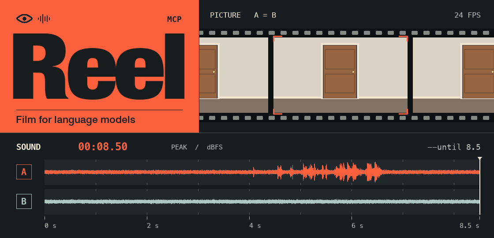

<!-- mcp-name: io.github.Dradradre/reel -->
<a href="https://cdn.jsdelivr.net/gh/Dradradre/Reel@e9b9a19225546c9d1658f7309d7abe28f8673212/assets/door-demo.mp4">
<picture>
  <source media="(prefers-reduced-motion: reduce)" srcset="assets/door-at-cutoff.png">
  
</picture>
</a>

**[▶ Hear A, then B · 18 seconds](https://cdn.jsdelivr.net/gh/Dradradre/Reel@e9b9a19225546c9d1658f7309d7abe28f8673212/assets/door-demo.mp4)**

**English** | [한국어](README.ko.md) | [简体中文](README.zh-CN.md) | [繁體中文](README.zh-TW.md) | [日本語](README.ja.md) | [Español](README.es.md)

[](https://pypi.org/project/reel-mcp/)
[](https://github.com/Dradradre/Reel/actions/workflows/ci.yml)
[](https://registry.modelcontextprotocol.io/v0/servers?search=io.github.Dradradre/reel)
[](#quickstart)
[](LICENSE)

# Reel: Video Understanding for AI Agents

Reel is an open-source Model Context Protocol (MCP) server that lets an AI agent watch and listen to a video. It gives the model a film's frames and its recorded sound on one clock, a few seconds at a time. The model can look closer at part of a frame or replay a stretch it wants to check. Set `--until 8.5` and nothing after the first 8.5 seconds reaches the model.

```bash
pipx install reel-mcp
claude mcp add reel -- reel-mcp "$PWD/film.mp4" --until 8.5 --image-client
```

> Watch the film with Reel. What did you see and hear?

[Quickstart](#quickstart)  |  [Measurements](#does-it-work)  |  [Reading guide](docs/READING.md) | [Video analysis with Codex](docs/video-analysis-mcp.md)

## Before the door opens

**Same 204 frames. Different recordings. Different answers.** We stopped both films at 8.5 seconds, while the door was still closed.

| A · keys in the recording | B · room tone only |
|---|---|
| “The audio analysis suggested a brief jingling or rattling sound, though I could not hear it directly.” | “I could not tell what was making the faint background sound.” |

In this run local Codex GPT received pictures and a local audio model’s reading of the recording. The video plays both complete 8.5-second excerpts at the same gain and displays the recorded answers. A contains keys from 4.0 to 6.73 seconds. GPT describes a rattle and leaves its source open. [Full responses](docs/benchmarks/short-listening-turns.json) · [Recreate the trial](docs/door-trial.md#재현) · [Key recording by Joao_Janz, CC0](https://freesound.org/people/Joao_Janz/sounds/485110/)

## Try it on an edit

> Watch this cut. Find any moment where the picture stops while the sound carries on. Give me the time range and replay it.

In the generated demo, the picture holds from **00:38 to 00:41** while the recording continues. Reel’s change trace and sound trace put both events on the same clock. The stills below show the approach, the hold and the return to motion.


After watching that interval, the agent can call `observe(start_s=38, end_s=41)` to inspect its frames alongside the original audio. You can also ask about a subtitle, a repeated sound or a movement between two shots. [Demo source and planted timings](examples/make_demo.py) · [Replay tools](docs/READING.md#watching-a-little-at-a-time)

## Quickstart

Reel runs on Apple Silicon Macs with Python 3.11 or later and FFmpeg (`brew install ffmpeg`). Replace `film.mp4` with the path to your film.

```bash
pipx install reel-mcp
reel play film.mp4 --out reels/first-view --until 8.5
```

The player prints the path to each turn. Type `next` for the next interval, or type `quit`. Use a fresh output directory for another viewing.

**Watch with a model.** Reel serves the film over the Model Context Protocol (MCP). Register the local server, then start a new chat.

```bash
claude mcp add reel -- reel-mcp "$PWD/film.mp4" --until 8.5 --image-client   # Claude Code
codex mcp add reel -- reel-mcp "$PWD/film.mp4" --until 8.5 --image-client    # Codex CLI
```

> Watch the film with Reel. What did you see and hear?

For other MCP clients, use `uvx reel-mcp /absolute/path/to/film.mp4 --until 8.5` as the stdio command. Audio-capable clients can receive the original channels as a WAV. Image-and-text clients get frames and acoustic measurements. Optional local readers describe the waveform and transcribe speech. The waveform model download is about 39 GB. [Client inputs and optional setup](#playback-options)

**From source.** `git clone https://github.com/Dradradre/Reel.git && cd Reel`, create a virtual environment, then `python -m pip install -e .` gives the same `reel` and `reel-mcp` commands.

## One clock for picture and sound

| While watching | What the model can do |
|---|---|
| Advance | Call `view(turn=1)`, then `view(turn=2)`. Each call releases the next interval of the film. |
| Look closer | Use `look` with a time and a box to read the original pixels of a sign or see what someone held. |
| Replay | Once the film has reached six seconds, `observe(start_s=4, end_s=6)` pairs the successive pictures with the recording from those same two seconds. |

Reel can also lay out a film in 30-second pages. Read left to right. A vertical line through the page crosses the picture, motion, sound and words at the same instant. Every frame contributes to the change trace and every 10 ms of sound contributes to the level trace. [Open the first page at full size](assets/reel_page_1.png) · [Read the next 30 seconds](assets/reel_page_2.png)

[](assets/reel_page_1.png)

<details>
<summary>What each lane shows</summary>

| Lane | What it is | What a viewer notices there |
|---|---|---|
| frames over time | selected whole frames at their recorded presentation times. A frame can stay up across a long pause between updates. Bounded snapshots retain the brightness range of footage tagged as full range. Reel maps tagged PQ and HLG pictures to sRGB with a colour-managed FFmpeg build | See who and what share the screen. During playback, extra timestamped frames can reveal a brief local change. A pair of times and a box let you inspect its original pixels with `look`. [Reading trial](docs/perception-check.md#잠깐-나타난-글자를-다시-읽을-때) |
| motion point (playback) | the pixels along two fixed lines through a point, from every displayed frame | see how many times something crosses a line and in which direction with `view(motion_point=[x,y])` |
| event memory (playback) | timed sound components, visible details, voice matches and dated reader reports | follow a rattle across a pause, inspect its channel and revise a guess after the door opens |
| follow (playback) | the point you selected in an earlier picture, followed through each released frame | compare the selected detail with the last picture in which the tracker located it |
| subject | where the person the film is about appears, and whether the eye is predicted to land on them | the film losing its subject |
| on screen | recognized words and numbers during the frames in which they appear | read a score or sign alongside the sound at that moment |
| change | mean absolute RGB change between displayed frames, brightness and holds. A colour change can register at constant brightness. On MCP replay, `ask_scene(exposure_detail=true)` places the recorded peak under each consecutive picture in a short sequence. With `sync_regions`, each motion trace covers the whole requested rectangle | cuts, flashes, blackouts, a frozen picture |
| seen again | Green marks a pixel-for-pixel match between two retained colour previews. Blue marks a similar layout across shots. Both give the earlier time. | a returning title card, two different cards with similar lettering |
| sound | power in each frequency band on a fixed −80 to 0 dBFS scale, with changes in the sound marked. On replay, a marked interval can be read against the surrounding channel spectra. In stereo you can listen to the average or difference between the channels. | the same sound keeps its brightness across recordings and zooms. During playback you can rehear a sustained band or a brief impact alongside the original. The speech reader measures what remains in the gaps before, between and after detected voices. Playback also reports the frequency of a repeating sound and the times of sharp attacks in each channel. |
| sounds like | short sound changes on the page. Live playback also gives the time, channel and frequency range of sharp rises or falls. Source estimates cover up to ten seconds in `stream.md` and four seconds per channel in `play`. First-listen descriptions can cover ten seconds. A separate reading can pick out a brief sound within that span. On replay you can also hear a layer and the signal left when it is removed. A second description can isolate the latest passage when the longer reading includes an earlier turn. A first MCP view includes available local waveform readings and supported words with or without a WAV attachment. If the waveform reader is unavailable, the local captioner gives the range it heard. The detailed MCP view can also show a phrase that began in an earlier turn. On replay, compare the one-second estimates with one continuous reading of the sound. With YAMNet installed, playback also gives possible sources in 0.975-second recording windows. On replay you can adjust the volume, compare the sources at both levels, or locate the second closest to a sound you describe. On replay, the original sound can retrieve human descriptions of similar recordings. On replay, `question_control=true` withholds a waveform answer repeated on silence. | a single impact, music underneath it, or voices in a busy room With reference recordings installed, playback also names matching sources without a prompt. |
| level | recorded mix level in 10 ms steps, with the typical level and strongest moment of each window in `stream.md` | a slow fade, a quiet background or a brief rise |
| L level, R level | 10 ms levels for each recorded channel, numbered on larger layouts | a sound that is louder on one side or moves across the mix |
| 1 early, 2 early | Which recorded channel received a matching waveform first, in quarter-second windows | Two sounds can have the same left and right levels and still be heard toward one ear. A gap means the timing is unresolved. |
| film time, pixel change, ch peak, ch bands Hz | During playback each column shows a centre frame and sometimes an extra view below it. When revisiting a range with `observe` or looking closer with `view(focus=...)`, read each row left to right. Follow the line under a picture to the motion trace, the channel peaks and the frequency bands on replay. Brighter bands carry more energy. Cropping the picture keeps the original mix. | Follow a brief movement and check when it happened relative to a sound. |
| joint (optional) | Two readings of the same recording, one with moving pictures on their display clock. A live reader can ask about the scene across pauses. | Follow a sound and the movement that accompanies it. |
| in sync? | where the sound sits against the picture, from 2 s early to 2 s late, moment by moment | lips moving before the words, a ball struck before its sound |
| crowd stem | estimated audience sound on the same band-power scale as the mix, with repeated rhythms marked | the timing of a possible chant and its relation to the recorded mix |
| said | On replay, `heard_words` can check just the selected interval. Playback marks possible voices found only after amplification and keeps their times separate from the transcript. The page shows words that agree in two listening windows, checked against the mix when only the stem suggests speech. Gain-assisted candidates are available in `reel listen` | what is said; whether it matches the subtitles |
| heard again | A short waveform repeat or a sequence of similar voice patterns points to the earlier sound. On replay, `compare_heard(similarity=true)` compares two original excerpts. Pass `alternatives` to compare descriptions across them. | a possible echo, a recurring crowd sound |

</details>

## Does it work?

Each trial below was run with a model reading the film through Reel and scored against human annotations where they exist. Misses are listed with the hits.

| Trial | Result |
|---|---|
| Timed visual questions on all 644 OVO-Bench videos | **66.08** on the official three-mode average. GPT answered 2,002 of 3,035 checkpoints correctly using only pictures from before each question. |
| Free recall of sight and sound on 12 unfamiliar films | **78.8% for sight, 43.8% for sound** on the human-relative recall measure |
| 96 repeated excerpts mixed with other recordings at new positions | **96 of 96** located within 50 ms |
| 431 hand-marked note starts in 56 held-out recordings | **359** fell within 50 ms of a Reel attack |
| Blind reader on 26 random web videos with planted editing faults | **12 of 17** in round 5, with the code frozen. Across all five rounds the reader never invented a fault in an untouched video. |
| Pointing at the visible object that made a sound | **1 of 24** films |
| Naming a short annotated source in field recordings | **3 of 51** excerpts |

[Every trial, control, data file and reproduction script](docs/results.md)

## Playback options

Optional senses install as extras: local listening and speech recognition, source separation, gaze, picture-sound sync and depth. `reel setup` downloads their models into `~/.cache/reel`.

```bash
pipx install --force 'reel-mcp[speech]'     # from a clone: python -m pip install -e '.[speech]'
reel setup --speech --describe-sounds
reel doctor                                  # what this machine can see and hear
```

[Every command, optional model and client setting](docs/playback-options.md)

## Limits

An offscreen sound can register clearly while its source stays uncertain. Voices buried in a crowd are easy to miss.

<details>
<summary>Reading limits for each sense</summary>

- Commentary shouted over a roaring crowd is often still not transcribed. The repeat is marked; the words may not be.
- A chant's word is inferred by sound from names the film shows and the genre's usual names; a name never shown can
  be misheard.
- Gaze is predicted by a saliency model trained on eye tracking, not measured, and it does not know who the star is.
- Sync is read from what the picture shows: lips, hits, steps. Over a voice-over, music under scenery, a small webcam
  face or a fast montage there is little to read, and in animation the reading is weaker ("likely" rather than "sure").
- A freeze on a shot that hardly moves anyway, a dropout over an already quiet stretch, and a volume jump inside lively
  speech are still missed often.
- Sound labels name what a sound is like (a slap, a siren, a car), not whether music is good. Judging a track as cheap
  still rests on the reader.
- A careless reader can peek at `meta.json` or `stream.md` ahead of the page; two of the blind readers above admitted
  a glimpse and said they kept it out.
- Reel shows; it does not decide taste.

</details>

## Credits

The key recording is by Joao_Janz (CC0). The demo pages use the track "Crypto" by Kevin MacLeod (incompetech.com), licensed under Creative Commons Attribution 4.0, and narration made with macOS `say`. Reel uses Whisper for speech, Demucs for separation, UNISAL for gaze and Synchformer for picture-sound sync, among other models. Model weights, datasets and source videos keep their own licences. [Models, datasets, authors and licences](docs/credits.md)

## License

[MIT](LICENSE)
