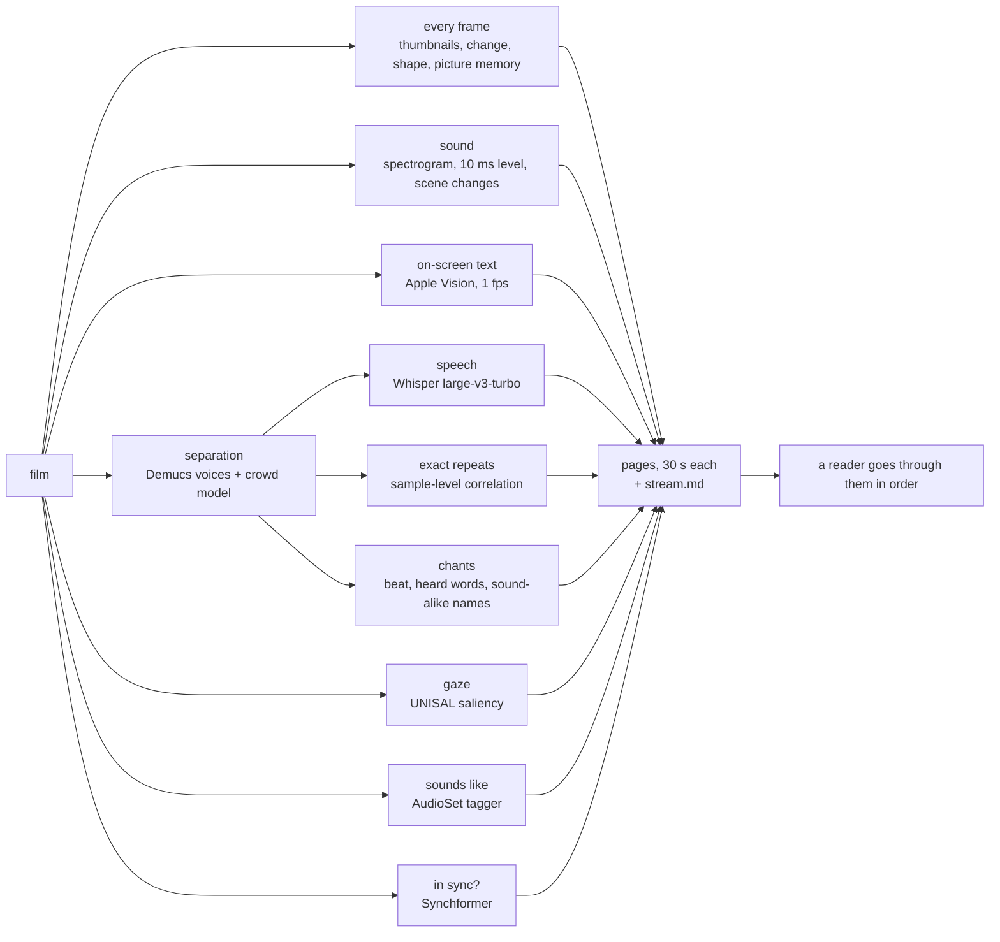

<div align="center">

# Reel

**Let a language model watch a film.**

Reel turns a video into pages that a model which only reads text and images can go through front to back,
and notice what a viewer would notice: the story jumping, a sound playing twice, a picture that froze,
subtitles drifting from the voice, a crowd chanting a name.


[한국어](README.ko.md)


</div>

## The problem

Language models now write edit decision lists, motion graphics and whole video pipelines. They still cannot watch
the result. They see a few stills and some numbers, so the faults people complain about slip through: the one second
of commentary that plays twice, the hard cut to silence, the subtitle that is eight seconds ahead of the voice, the
looped crowd bed that is chanting the wrong team's name.

The usual fixes do not close the gap. Sampling a frame every few seconds misses everything in between. Adding one
check per known fault only catches faults you already know about. A person watching does neither: they go through
the film in order and something feels wrong.

## The idea

A reader that only reads still lives through time: reading order is its time. So give it the whole film in reading
order, with nothing left out.

- **Gapless.** Every frame and every 10 ms of sound leaves a mark on a page. Values are max-pooled per pixel column,
  never sampled, so a one-frame flash or a one-second repeat survives.
- **One time axis.** Picture, on-screen text, sound, loudness, crowd and speech sit on the same axis, so you can see
  whether a voice belongs to its picture or a cut lands with its sound.
- **Memory.** A viewer thinks "I just heard that" and "I have seen this before". The reel marks both: a sample-exact
  replay of the same recording in red, similar footage and voices coming back from earlier with the time they first played.
- **Read before judging.** Pages run strictly forward, 30 seconds each, and are read in order with a short log after
  each page, before any summary. Nothing on a page is a verdict.

## What a page shows


| Lane | What it is | What a viewer notices there |
|---|---|---|
| picture | every shot at its real length; strips for frame shape and picture quality | what is on screen; black bars, a boxed picture, soft or upscaled footage |
| subject | where the person the film is about appears, and whether the eye is predicted to land on them | the film losing its subject |
| on screen | titles, captions and banners large enough to read | the story: dates, places, scores |
| change | frame-to-frame change, brightness, freeze marks | cuts, flashes, blackouts, a frozen picture |
| seen again | pictures that already appeared | reused footage |
| sound | spectrogram with sound-scene changes | music, voices, silence; whether sound changes where the picture cuts |
| sounds like | what each second sounds like, as AudioSet labels | an impact that sounds like a slap, a cheap synth bed, a crowd |
| level | loudness in 10 ms steps, with red marks where sound cuts dead, snaps back or jumps in volume | a cliff to silence, a fader slammed up |
| in sync? | where the sound sits against the picture, from 2 s early to 2 s late, moment by moment | lips moving before the words, a ball struck before its sound |
| crowd | the crowd separated from music and commentary; chants detected by their beat, heard, and matched by sound to names on screen | a crowd chanting, and what |
| said | words of commentary and interviews | what is said; whether it matches the subtitles |
| heard again | the very same recording played again, in red (an echo within 3 s or a stretch pasted from far back), or a similar voice from earlier | an edit echo, a recycled crowd recording |

## Does it work?

Fresh readers (a model given only the [reading guide](docs/READING.md) and the reel, never told what was wrong)
watched real fan edits that a person had already reviewed:

| Film | What the person complained about | Noticed by the blind reader |
|---|---|---|
| 10-minute esports documentary, first cut | the order of years jumps around; abrupt blackouts; a second of commentary plays twice; subtitles drift from the voice; a frozen picture | 4 of 5 in the first round; **5 of 5** after exact-repeat hearing was added |
| 6-minute player tribute, first cut | a team chant looped under the title cards; choppy joins; rushed second half; letterboxed game footage that loses the scoreboard; the player not in focus | **4 of 5**: the chant (named **T1** by sound alone, in 4 of 4 chant windows), the holes of dead silence, the pile of still cards, the game footage cropped to 74-79% height with the score bar gone. Focus was only touched on ("the later wins are called through other players") |
| 2-minute hype trailer, **never used while building Reel** | thunder effects that sound like a hand slap; scenes that mean nothing; cheap-sounding music | **3 of 3**: "2 of the 9 hits sound like a slap", impacts heard as a splash, a car, a quack; a 13 s strobe of years over the same two stills and a black cold open; the bed taken for "free stock music" (that verdict leaned on the credits as much as on the sound) |
| 1.5-minute hype trailer, **never used while building Reel** | plays with no impact; a glitch effect that fights the shot; kill banners naming the wrong player; poor picture quality | **4 of 4**: "it feels like the film ran out of moments"; a 5 s glitch strobe of one press-conference shot; a Faker kill banner in Zeus's debut; soft, upscaled-looking footage |
| the same documentary, revised | nothing yet | found faults the editor's own checks had missed: commentary over quote cards, sound dropping at chapter turns, an unreadable results grid |

### Random videos from the web

26 videos picked at random from searches across genres: talk shows, local TV news, animation, skate and drum videos,
cooking, drone footage, football, tennis and F1 highlights, a TED talk, trailers, a podcast, live music, a crash-test
compilation, a chess stream, vlogs. A script planted editing faults at random times (repeats, echoes, blackouts,
freezes, flashes, letterboxing, low-resolution stretches, dropouts, volume jumps, sound running early or late against
the picture) and kept the answer key away from the reader. One video per round was left untouched.

| Round | Planted faults noticed | On the untouched video |
|---|---|---|
| 1 | 9 of 15 | called the original editor's fade a hard cut |
| 2 | 14 of 15 | "nothing wrong" |
| 3 | 10 of 15 | "nothing wrong" |
| 4 | 10 of 14 | "nothing wrong" |
| **5: code frozen, nothing changed after** | **12 of 17** (14 counting a slip in sync noticed by the stutter it leaves) | **"nothing wrong"** |

Senses were added between rounds 1 and 4, after looking at what the reader missed: sound that cuts dead or jumps in
volume, flashes of a few frames, footage suddenly softer than around it, picture-sound sync, and the very same recording
replayed. Round 5 is the honest number: new videos, code untouched.

In round 5, by kind: letterboxing 3 of 3, blackouts 3 of 3, echoes 3 of 3, a pasted repeat 1 of 1, dropouts 1 of 2,
sound early or late 1 of 3, a freeze 0 of 1, a volume jump 0 of 1. One false alarm: a hum in a chess stream marked as a
sudden volume jump. Across all five rounds the reader never invented a fault in an untouched video.

## Quickstart

Reel is built for macOS on Apple Silicon (it uses Apple Vision for text and MLX for speech). It needs `ffmpeg`.

```bash
git clone <this repo> reel && cd reel
python3 -m venv .venv && source .venv/bin/activate
pip install -e ".[all]"           # or pick extras: separate, crowd, mlx, speech, ocr, gaze
reel setup --sync                  # fetch the gaze model and the sync model (1.1 GB)
reel doctor                        # what this machine can see and hear

reel watch film.mp4 --out reels/film --subject Zeus --genre lol --lang ko
reel zoom reels/film --t0 72 --t1 80          # re-watch a stretch closer
```

Then read `reels/film/pages/` in order, following [docs/READING.md](docs/READING.md). About ten minutes of work
per ten minutes of film on an M4 Pro, sync included.

Want to see it first? `python examples/make_demo.py examples/out/demo.mp4 --music any-track-you-may-use.wav` builds
the 70-second demo above, with six faults planted in it.

If a separator needs its own environment, point Reel at it: `REEL_SEP_PYTHON`, `REEL_CROWD_PYTHON`,
`REEL_ASR_PYTHON`, `REEL_GAZE_PYTHON`. Models and caches live in `~/.cache/reel` (`REEL_HOME`).

## How it works



## Limits

- Commentary shouted over a roaring crowd is often still not transcribed. The repeat is marked; the words may not be.
- A chant's word is inferred by sound from names the film shows and the genre's usual names; a name never shown can
  be misheard.
- Gaze is predicted by a saliency model trained on eye tracking, not measured, and it does not know who the star is.
- Sync is read from what the picture shows: lips, hits, steps. Over a voice-over, music under scenery, a small webcam
  face or a fast montage there is little to read, and in animation the reading is weaker ("likely" rather than "sure").
- A freeze on a shot that hardly moves anyway, a dropout over an already quiet stretch, and a volume jump inside lively
  speech are still missed often.
- Sound labels name what a sound is like (a slap, a siren, a car), not whether music is good. Judging a track as cheap
  still rests on the reader.
- A careless reader can peek at `meta.json` or `stream.md` ahead of the page; two of the blind readers above admitted
  a glimpse and said they kept it out.
- Reel shows; it does not decide taste.

## Credits

Reel stands on open work: [UNISAL](https://github.com/rdroste/unisal) (Apache-2.0) for gaze,
[Demucs](https://github.com/facebookresearch/demucs) (MIT) and
[audio-separator](https://github.com/nomadkaraoke/python-audio-separator) (MIT) with the Mel-Band Roformer crowd
model by aufr33 and viperx for separation, [Whisper](https://github.com/openai/whisper) (MIT) through
[mlx-whisper](https://github.com/ml-explore/mlx-examples) and [faster-whisper](https://github.com/SYSTRAN/faster-whisper)
for speech, [ocrmac](https://github.com/straussmaximilian/ocrmac) for Apple Vision text, the
[Synchformer](https://github.com/v-iashin/Synchformer) (MIT) for picture-sound sync, the [AST AudioSet model](https://huggingface.co/MIT/ast-finetuned-audioset-10-10-0.4593) (BSD-3) for sound labels, librosa, OpenCV and PyTorch.
Check each model's own licence before commercial use.

The demo images use the track "Crypto" by Kevin MacLeod (incompetech.com), licensed under Creative Commons
Attribution 4.0, and narration made with macOS `say`.

## License

MIT
