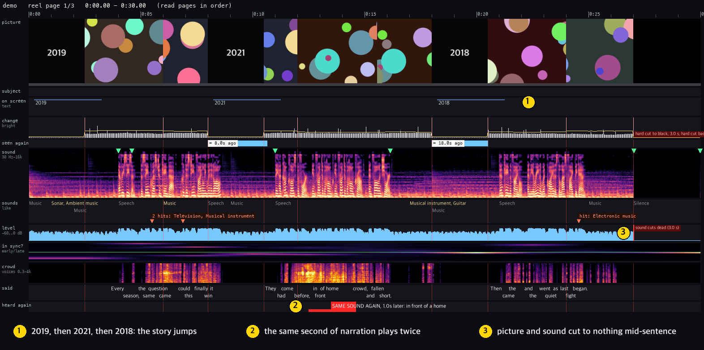
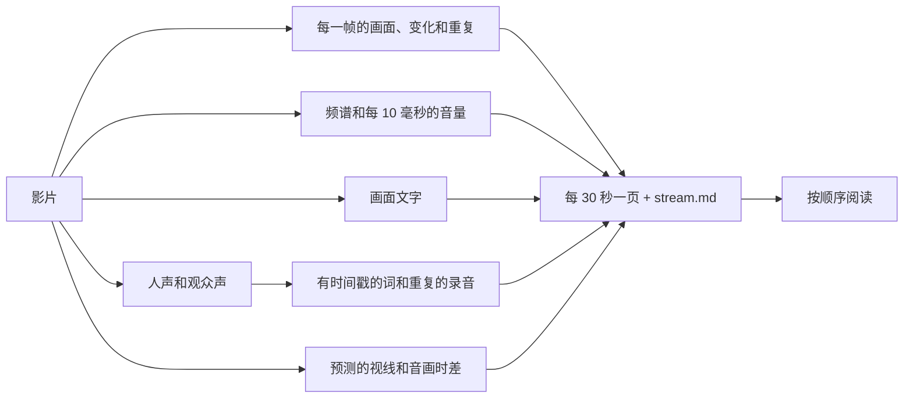

<a href="https://cdn.jsdelivr.net/gh/Dradradre/Reel@e9b9a19225546c9d1658f7309d7abe28f8673212/assets/door-demo.mp4">
<picture>
  <source media="(prefers-reduced-motion: reduce)" srcset="assets/door-at-cutoff.png">
  
</picture>
</a>

**[▶ 先听 A，再听 B（18 秒）](https://cdn.jsdelivr.net/gh/Dradradre/Reel@e9b9a19225546c9d1658f7309d7abe28f8673212/assets/door-demo.mp4)**

[English](README.md) | [한국어](README.ko.md) | **简体中文** | [繁體中文](README.zh-TW.md) | [日本語](README.ja.md) | [Español](README.es.md)

[用自己的视频试试](#快速开始) | [查看测试结果](#测试结果) | [阅读指南（英语）](docs/READING.md)

# 让语言模型看见画面，听见声音

把一段视频交给模型。它可以接着看，凑近看清一个细节，也可以重听刚才引起它注意的声音。Reel 通过 MCP 把同一时刻的画面和录音一起交给模型。设定 `--until 8.5` 后，即使回放，模型也只能接触到前 8.5 秒的内容。

## 开门之前

**相同的 204 帧画面，两段不同的录音。** 两段视频都停在 8.5 秒，门还关着。下面是 GPT 当时的回答，译自英语。

| A：录音中有钥匙声 | B：只有房间底噪 |
|---|---|
| “从音频分析来看，好像有一阵短促的叮当声或轻微的碰撞声，不过我没法直接听到。” | “我分辨不出那点微弱的背景声是什么发出来的。” |

这次实验中，本地 Codex 里的 GPT 看到了画面，也读到了本地音频模型听过原声后写下的描述。演示视频以相同的增益依次播放 A 和 B，各 8.5 秒，并显示回答原文。A 在 4.0 到 6.73 秒之间加入了钥匙声。GPT 描述了响声，没有断定声源。[回答原文](docs/benchmarks/short-listening-turns.json) · [复现实验（韩语）](docs/door-trial.md#재현) · [Joao_Janz 的钥匙录音（CC0）](https://freesound.org/people/Joao_Janz/sounds/485110/)

## 用一段剪辑试试

> 看看这段剪辑。有没有画面停住、声音还在继续的地方？告诉我起止时间，再回放那一段。

演示片在 **00:38 到 00:41** 之间画面静止，录音继续。下面四帧分别取自 37.5、38、40 和 41 秒，可以看到画面何时停住，又何时恢复运动。


看完这个区间，模型就能调用 `observe(start_s=38, end_s=41)`，逐帧对照当时的原声。也可以问它字幕何时出现、哪段声音重复了，或两个镜头之间有什么动作。[生成演示片的代码和时间点](examples/make_demo.py) · [回放工具（英语）](docs/READING.md#watching-a-little-at-a-time)

## 快速开始

需要配备 Apple 芯片的 Mac、FFmpeg 和 Python 3.11 或更高版本。将 `film.mp4` 换成自己的视频路径。

```bash
git clone https://github.com/Dradradre/Reel.git && cd Reel
python3 -m venv .venv && source .venv/bin/activate
python -m pip install -e '.[mcp]'
reel play film.mp4 --out reels/first-view --until 8.5
```

播放器每次暂停时都会输出刚刚播放的区间所对应的目录。输入 `next` 继续，输入 `quit` 退出。重新观看时请使用新的输出目录。

**和模型一起看。** Reel 通过模型上下文协议（MCP）提供视频。如果已经登录 Codex CLI，在已激活的虚拟环境中注册本地服务器，然后新开一个会话。

```bash
codex mcp add reel -- "$(command -v reel)" mcp "$PWD/film.mp4" --until 8.5 --image-client
```

> 用 Reel 看看这段视频。你看见了什么，又听见了什么？

其他 MCP 客户端可以用 `reel mcp /absolute/path/to/film.mp4 --until 8.5` 启动 stdio 服务器。支持音频输入的客户端可以通过 WAV 接收原始声道。接收图像和文本的客户端可以读取画面、音量和频谱。安装可选的本地模型后，还能获得声音描述和带时间戳的转写。用于描述原始波形的模型约为 39 GB。[播放选项](#播放选项)

## 画面和声音共用一条时间轴

| 观看时 | 模型可以做什么 |
|---|---|
| 往后看 | 依次调用 `view(turn=1)` 和 `view(turn=2)`，每次获得下一个区间。 |
| 看清细节 | 用 `look` 指定时间和矩形区域，查看原始像素，读招牌上的字，或看看某人手里拿着什么。 |
| 再听一次 | 播放到第 6 秒后，调用 `observe(start_s=4, end_s=6)`，一起回看这两秒的连续画面和同期录音。 |

Reel 也能把视频按每页 30 秒排开，从左往右读。沿任意时刻画一条竖线，就能对上当时的画面、动作、声响和台词。画面变化曲线用到了每一帧，音量曲线每 10 毫秒记录一次。[放大第一页](assets/reel_page_1.png) · [看接下来的 30 秒](assets/reel_page_2.png)

[](assets/reel_page_1.png)

<details>
<summary>如何读各行数据</summary>

| 页面或回放中的标签 | 看什么 |
|---|---|
| `frames over time`、`change` | 某一刻实际显示的画面，以及相邻画面的颜色变化、闪烁、黑场和停顿。 |
| `motion point`、`follow` | 数一数物体经过指定位置的次数和方向，或沿着以前选定的细节逐帧追踪。 |
| `subject`、`on screen` | 主体出现在哪里，哪里可能吸引视线，当时屏幕上有哪些字。 |
| `seen again` | 找回先前的画面。绿色表示保留的彩色预览逐像素相同，蓝色表示构图相似。 |
| `sound`、`level`、`L level`、`R level` | 频谱按固定的 −80 至 0 dBFS 显示。分别查看各声道的电平，可以发现渐弱或突然响起的声音。 |
| `sounds like`、`heard again` | 查看可能的声源，或把一段声音与先前的录音比较，听听是重复、回声，还是仅仅相似。 |
| `1 early`、`2 early` | 两个声道接收到相似波形的先后顺序。即使音量相同，到达时间也可能不同。 |
| `film time`、`pixel change`、`ch peak`、`ch bands Hz` | 对齐画面变化、各声道的峰值和频带，核对动作与声音发生的时间。 |
| `joint`、`in sync?` | 同时查看动作和声音，检查口型、脚步或击球是否对得上。 |
| `crowd stem`、`said` | 对照估计的观众声与原混音。引述台词时，查看两次转写中一致的词。 |

[完整的各行说明（英语）](docs/READING.md)

</details>

## 测试结果

| 测试 | 本地 GPT 的结果 |
|---|---|
| OVO-Bench 全部 644 段视频中的定时视觉问答 | 官方三项平均分 **66.08**。仅根据提问前出现的画面，在 3,035 个提问时点答对 2,002 个。[分数和测试方法](docs/benchmarks/ovo-full.json) |
| 看完 12 段陌生视频后，分别描述记得的画面和声音 | 以人的描述为基准，**画面 78.8%，声音 43.8%**。两者等权得到 61.3%，95% 区间为 43.3% 至 91.1%。[逐片回答和评分](docs/benchmarks/track-recall.json) |

回忆测试看的是一段描述能在多大程度上把它所属的视频与其他视频区分开来。在一个聚会场景中，四位听众有三位提到了歌声。GPT 记住了掌声和说话声，漏掉了歌声。[逐片分析（韩语）](docs/perception-check.md#화면과-녹음을-바꿔-끼운-뒤의-자유-회상)

<details>
<summary>盲测、漏检和误报</summary>

研究者在 26 段不同题材的视频里植入剪辑问题，每轮留一段原片作对照。模型事先看不到答案。第五轮固定了代码，模型发现 17 处问题中的 12 处。3 处黑场和 3 处回声都被发现，唯一一处画面冻结却漏掉了。模型还曾把国际象棋视频里的一阵嗡嗡声误判为音量骤升。[各轮实验与原始记录（英语）](README.md#does-it-work)

</details>

## 播放选项

要启用本地声音描述和语音识别，可在已激活的虚拟环境中运行以下命令。

```bash
python -m pip install -e '.[speech]'
reel setup --speech --describe-sounds
```

终端播放器默认在收到语音识别请求时才等待结果，开启 `--speech` 后每个区间都会等待。在一次包含 32 个区间的测试中，测试用 Mac 上每次识别请求的耗时中位数为 9.5 秒。[测试记录（韩语）](docs/listening-check.md#같은-사진에서-화자가-설명하는-곳이-달라질-때)

<details>
<summary>只听声音、生成页面或检查某一秒</summary>

下面的页面命令以英语视频为例。请把 `--lang en` 换成片中使用的语言。

```bash
reel play film.mp4 --out reels/sound-only --until 8.5 --tracks sound
reel watch film.mp4 --out reels/pages --until 8.5 --lang en
reel frame reels/pages --at 5
reel listen reels/pages --t0 4 --t1 7
reel observe reels/pages --t0 4 --t1 4.5
```

在同一文件上分别启动新会话，用 `--tracks picture`、`--tracks sound` 或默认的 `--tracks both` 比较仅看画面、仅听声音和视听结合时能发现什么。三种模式都保留原始时间戳和截止时间。

`reel watch` 生成可按顺序阅读的页面。`reel frame` 可以取出某一刻的画面，`reel observe` 将指定区间的画面与各帧显示时播放的音频样本配对。用 `reel doctor` 查看当前机器上可用的功能。[所有命令及可选模型（英语）](README.md#playback-options)

</details>

<details>
<summary>客户端收到的是哪种音频</summary>

可以接收视频的客户端可调用 `view_media(turn=1, continuous_seconds=5)`，按顺序读取返回的片段。片段保留了画面时序和录音声道。用 `--image-client` 启动时，普通的 `view` 返回画面和可用的本地声音描述。需要 WAV 时再请求。如果要对照原始测量，可设置 `sound_estimates=false` 关闭声音解释。

</details>

<details>
<summary>一页是怎样生成的</summary>



</details>

首次用 MCP 播放时，`audio.rapid_rises` 会标出短时间内接连出现的起音。详细视图和 `play` 的 `audio.attacks` 会列出各声道检测到的所有起音时刻。钥匙响一次，就可能留下好几个标记。在 56 段测试录音中，人工标出了 431 个音符的起音时刻。按 50 毫秒的容差计算，Reel 找到了 359 个，原先根据各频段音量上升的标记能找到 215 个。[逐段测试结果](docs/benchmarks/attack-timing.json)

运行 `reel setup --sound-examples` 后，首次播放就会把听到的声音与 116 类声源的 942 段真实录音及 531 个声音名称比对，无需提供选项。在 244 段留作测试的录音中，71 段识别正确，8 段识别错误，165 段未给出名称。[逐段结果](docs/benchmarks/reference-sources.json)

遇到与背景明显不同的声音，Reel 会重听那一小段原始录音。只在短片段里出现的声源名称还需由另一个音频模型核对。即使认不出声源，回放时也能查看时间、声道、电平和频段。

在这 244 段录音中，已有候选名称包含正确声源的录音从 84 段增至 121 段，另增了 6 个错误名称。让 GPT 自由回答时，22 段录音在改动前后各答对 10 段。[逐条回答与对照实验](docs/benchmarks/reference-source-listeners.json)

运行 `reel setup --identify-sounds` 后，PE-AV 和 CLAP 会分别用同一声道的原始录音比对候选声源。在 99 段环境录音中，PE-AV 答对了 94 段，CLAP 答对了 85 段。去掉正确选项后，两者有 40 次选中了同一个错误声源。在另外 49 段录音中，同时比对选项之外的声音后，这类误报从 16 次降到 0 次。放回正确选项时，原有的 39 次一致答对中保留了 21 次。[移除正确选项的实验](docs/benchmarks/source-outside-choices.json)，[逐段结果](docs/benchmarks/source-identity-agreement.json)

## 局限

听得出某个时刻有响声，并不一定能找出是什么发出的。人群盖住说话声时容易漏词。画面变化很小时，短暂的冻结也容易漏掉。对画外音、风景配乐或快速蒙太奇，画面里可用于判断音画同步的线索很少。视线位置来自模型预测。[更多实例（英语）](README.md#limits)

## 致谢

钥匙录音由 Joao_Janz 以 CC0 发布。页面示例使用 Kevin MacLeod 的《Crypto》（CC BY 4.0）和 macOS `say` 生成的旁白。Reel 使用 Whisper 识别语音、Demucs 分离音轨、UNISAL 预测视线、Synchformer 比较音画时差。模型权重、数据集和源视频各有许可。[作者、数据来源及完整许可清单（英语）](README.md#credits)

<details>
<summary>本页用到的模型和数据</summary>

- 录音描述 — [Qwen3-Omni](https://huggingface.co/Qwen/Qwen3-Omni-30B-A3B-Instruct)
- 音画同步 — [Synchformer](https://github.com/v-iashin/Synchformer)
- 定时视觉问答 — [OVO-Bench](https://github.com/JoeLeelyf/OVO-Bench#license)
- 人的视听描述 — [AVCaps](https://huggingface.co/datasets/TUT-ARG/AVCaps)

</details>

## 许可证

[MIT](LICENSE)
