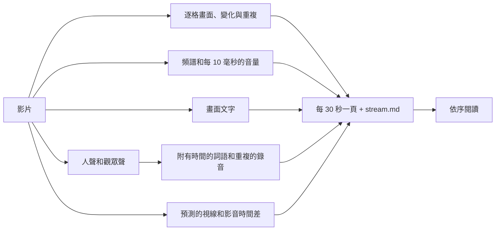

<a href="https://cdn.jsdelivr.net/gh/Dradradre/Reel@e9b9a19225546c9d1658f7309d7abe28f8673212/assets/door-demo.mp4">
<picture>
  <source media="(prefers-reduced-motion: reduce)" srcset="assets/door-at-cutoff.png">
  
</picture>
</a>

**[▶ 先聽 A，再聽 B（18 秒）](https://cdn.jsdelivr.net/gh/Dradradre/Reel@e9b9a19225546c9d1658f7309d7abe28f8673212/assets/door-demo.mp4)**

[English](README.md) | [한국어](README.ko.md) | [简体中文](README.zh-CN.md) | **繁體中文** | [日本語](README.ja.md) | [Español](README.es.md)

[用自己的影片試試](#快速開始) | [查看測試結果](#測試結果) | [閱讀指南（英語）](docs/READING.md)

# 讓語言模型看見畫面，聽見聲音

把一段影片交給模型。它可以接著看，湊近看清楚一個細節，也可以重聽剛剛聽到的聲音。Reel 透過 MCP 把同一時刻的畫面和錄音一起交給模型。設定 `--until 8.5` 後，即使重播，模型也只能接觸到前 8.5 秒的內容。

## 開門之前

**相同的 204 幀畫面，兩段不同的錄音。** 兩段影片都停在 8.5 秒，門還關著。下面是 GPT 當時的回答，譯自英語。

| A：錄音中有鑰匙聲 | B：只有房間環境底噪 |
|---|---|
| 「從音訊分析來看，好像有一陣短促的叮噹聲或輕微的碰撞聲，不過我無法直接聽到。」 | 「我分辨不出那點微弱的背景聲是從哪裡來的。」 |

這次實驗中，本機 Codex 裡的 GPT 看到了畫面，也讀到了本機音訊模型聽過原聲後寫下的描述。示範影片以相同的增益依次播放 A 和 B，各 8.5 秒，並顯示回答原文。A 在 4.0 到 6.73 秒之間加入了鑰匙聲。GPT 描述了響聲，沒有斷定聲源。[回答原文](docs/benchmarks/short-listening-turns.json) · [重現實驗（韓語）](docs/door-trial.md#재현) · [Joao_Janz 的鑰匙錄音（CC0）](https://freesound.org/people/Joao_Janz/sounds/485110/)

## 用一段剪輯試試

> 看看這段剪輯。有沒有畫面停住、聲音還在繼續的地方？告訴我開始和結束的時間，再重播那一段。

示範片在 **00:38 到 00:41** 之間畫面靜止，錄音繼續。下面四幀分別取自 37.5、38、40 和 41 秒，可以看到畫面何時停住，又何時恢復運動。


看完這個區間，模型就可以呼叫 `observe(start_s=38, end_s=41)`，逐幀對照當時的原聲。也可以問它字幕何時出現、哪段聲音重複了，或兩個鏡頭之間有什麼動作。[示範影片的程式碼與時間點](examples/make_demo.py) · [重播工具（英語）](docs/READING.md#watching-a-little-at-a-time)

## 快速開始

需要配備 Apple 晶片的 Mac、FFmpeg 和 Python 3.11 或更高版本。將 `film.mp4` 換成自己的影片路徑。

```bash
git clone https://github.com/Dradradre/Reel.git && cd Reel
python3 -m venv .venv && source .venv/bin/activate
python -m pip install -e '.[mcp]'
reel play film.mp4 --out reels/first-view --until 8.5
```

播放器每次暫停時都會輸出剛剛播放的區間所對應的目錄。輸入 `next` 繼續，輸入 `quit` 離開。重新觀看時請使用新的輸出目錄。

**和模型一起看。** Reel 透過模型上下文協定（MCP）提供影片。如果已經登入 Codex CLI，在已啟用的虛擬環境中註冊本機伺服器，然後開啟新的對話。

```bash
codex mcp add reel -- "$(command -v reel)" mcp "$PWD/film.mp4" --until 8.5 --image-client
```

> 用 Reel 看看這段影片。你看見了什麼，又聽見了什麼？

其他 MCP 用戶端可以用 `reel mcp /absolute/path/to/film.mp4 --until 8.5` 啟動 stdio 伺服器。支援音訊輸入的用戶端可以透過 WAV 接收原始聲道。接收影像和文字的用戶端可以讀取畫面、音量和頻譜。安裝選用的本機模型後，還能獲得聲音描述和帶時間戳記的轉錄。用於描述原始波形的模型約為 39 GB。[播放選項](#播放選項)

## 畫面和聲音共用一條時間軸

| 觀看時 | 模型可以做什麼 |
|---|---|
| 往後看 | 依次呼叫 `view(turn=1)` 和 `view(turn=2)`，每次獲得下一個區間。 |
| 看清細節 | 用 `look` 指定時間和矩形區域，查看原始像素，讀招牌上的字，或看看某人手裡拿著什麼。 |
| 再聽一次 | 播放到第 6 秒後，呼叫 `observe(start_s=4, end_s=6)`，一起回看這兩秒的連續畫面和同步錄音。 |

Reel 也能把影片按每頁 30 秒排開，從左往右讀。沿任意時刻畫一條直線，就能對上當時的畫面、動作、聲響和台詞。畫面變化曲線用到了每一幀，音量曲線每 10 毫秒記錄一次。[放大第一頁](assets/reel_page_1.png) · [看接下來的 30 秒](assets/reel_page_2.png)

[](assets/reel_page_1.png)

<details>
<summary>如何閱讀各列資料</summary>

| 頁面或重播中的標籤 | 看什麼 |
|---|---|
| `frames over time`、`change` | 某一刻實際顯示的畫面，以及相鄰畫面的顏色變化、閃爍、黑畫面和停頓。 |
| `motion point`、`follow` | 數一數物體經過指定位置的次數和方向，或沿著以前選定的細節逐幀追蹤。 |
| `subject`、`on screen` | 主體出現在哪裡，哪裡可能吸引視線，當時螢幕上有哪些字。 |
| `seen again` | 找回先前的畫面。綠色表示保留的彩色預覽逐像素相同，藍色表示構圖相似。 |
| `sound`、`level`、`L level`、`R level` | 頻譜按固定的 −80 至 0 dBFS 顯示。分別查看各聲道的音量，可以發現漸弱或突然響起的聲音。 |
| `sounds like`、`heard again` | 查看可能的聲源，或把一段聲音與先前的錄音比較，聽聽是重複、回聲，還是僅僅相似。 |
| `1 early`、`2 early` | 兩個聲道接收到相似波形的先後順序。即使音量相同，到達時間也可能不同。 |
| `film time`、`pixel change`、`ch peak`、`ch bands Hz` | 對齊畫面變化、各聲道的峰值和頻帶，核對動作與聲音發生的時間。 |
| `joint`、`in sync?` | 同時查看動作和聲音，檢查口型、腳步或擊球是否對得上。 |
| `crowd stem`、`said` | 對照估計的觀眾聲與原混音。引述台詞時，查看兩次轉錄中一致的詞。 |

[完整的各列說明（英語）](docs/READING.md)

</details>

## 測試結果

| 測試 | 本機 GPT 的結果 |
|---|---|
| OVO-Bench 全部 644 段影片中的定時視覺問答 | 官方三項平均分 **66.08**。僅根據提問前出現的畫面，在 3,035 個提問時點答對 2,002 個。[分數和測試方法](docs/benchmarks/ovo-full.json) |
| 看完 12 段陌生影片後，分別描述記得的畫面和聲音 | 以人的描述為基準，**畫面 78.8%，聲音 43.8%**。兩項各占一半，合計為 61.3%，95% 區間為 43.3% 至 91.1%。[逐片回答和評分](docs/benchmarks/track-recall.json) |

回憶測試看的是一段描述能在多大程度上把它所屬的影片與其他影片區分開來。在一個聚會場景中，四位聽眾有三位提到了歌聲。GPT 記住了掌聲和說話聲，漏掉了歌聲。[逐片分析（韓語）](docs/perception-check.md#화면과-녹음을-바꿔-끼운-뒤의-자유-회상)

<details>
<summary>盲測、漏檢和誤報</summary>

研究者在 26 段不同題材的影片裡植入剪輯問題，每輪留一段原片作對照。模型事先看不到答案。第五輪固定了程式碼，模型發現 17 處問題中的 12 處。3 處黑畫面和 3 處回聲都被發現，唯一一處畫面凍結卻漏掉了。模型還曾把西洋棋影片裡的一陣嗡嗡聲誤判為音量驟升。[各輪實驗與原始記錄（英語）](README.md#does-it-work)

</details>

## 播放選項

要啟用本機聲音描述和語音辨識，可在已啟用的虛擬環境中執行以下指令。

```bash
python -m pip install -e '.[speech]'
reel setup --speech --describe-sounds
```

終端播放器預設在收到語音辨識請求時才等待結果，開啟 `--speech` 後每個區間都會等待。在一次包含 32 個區間的測試中，測試用 Mac 上每次辨識請求的耗時中位數為 9.5 秒。[測試記錄（韓語）](docs/listening-check.md#같은-사진에서-화자가-설명하는-곳이-달라질-때)

<details>
<summary>只聽聲音、產生頁面或檢查某一秒</summary>

以下範例使用英語影片。請將 `--lang en` 改為片中使用的語言。

```bash
reel play film.mp4 --out reels/sound-only --until 8.5 --tracks sound
reel watch film.mp4 --out reels/pages --until 8.5 --lang en
reel frame reels/pages --at 5
reel listen reels/pages --t0 4 --t1 7
reel observe reels/pages --t0 4 --t1 4.5
```

用同一個檔案分別啟動新工作階段，用 `--tracks picture`、`--tracks sound` 或預設的 `--tracks both` 比較僅看畫面、僅聽聲音和視聽結合時能發現什麼。三種模式都保留原始時間戳記和截止時間。

`reel watch` 產生可按順序閱讀的頁面。`reel frame` 可以取出某一刻的畫面，`reel observe` 將指定區間的畫面與各幀顯示時播放的音訊樣本配對。用 `reel doctor` 查看這台電腦上可用的功能。[所有指令和選用模型（英語）](README.md#playback-options)

</details>

<details>
<summary>用戶端收到哪種音訊</summary>

支援影片的用戶端可以呼叫 `view_media(turn=1, continuous_seconds=5)`，依序讀取傳回的片段。影片保留各格畫面的顯示時間和原始聲道。以 `--image-client` 啟動時，一般的 `view` 會傳回畫面和可用的本機聲音描述，需要 WAV 時再提出要求。要核對原始測量值，可以設定 `sound_estimates=false` 關閉聲音解讀。

</details>

<details>
<summary>每一頁怎麼產生</summary>



</details>

一般播放時，`audio.attacks` 會標出各聲道中聲音突然變強的時刻。鑰匙響一次，就可能留下好幾個標記。在 56 段測試錄音中，人工標出了 431 個音符的起音時間。以 50 毫秒為容許誤差，Reel 找到其中 359 個，原本依各頻段音量上升的標記能找到 215 個。[逐段測試結果](docs/benchmarks/attack-timing.json)

執行 `reel setup --identify-sounds` 後，PE-AV 與 CLAP 會各自以同一聲道的原始錄音比對候選聲源。在 99 段環境錄音中，PE-AV 答對 94 段，CLAP 答對 85 段。移除正確選項後，兩者有 40 次選了同一個錯誤聲源。在另外 49 段錄音中，加入選項以外的聲音比對後，這類誤報從 16 次降到 0 次。放回正確選項時，原本兩者都答對的 39 次保留了 21 次。[移除正確選項的實驗](docs/benchmarks/source-outside-choices.json)，[逐段結果](docs/benchmarks/source-identity-agreement.json)

## 使用限制

聽得出某個時刻有響聲，並不一定能找出是什麼發出的。人群蓋住說話聲時容易漏詞。畫面變化很小時，短暫的凍結也容易漏掉。對畫外音、風景配樂或快速蒙太奇，畫面裡可用於判斷音畫同步的線索很少。視線位置來自模型預測。[更多範例（英語）](README.md#limits)

## 致謝

鑰匙錄音由 Joao_Janz 以 CC0 發佈。頁面範例使用 Kevin MacLeod 的《Crypto》（CC BY 4.0）和 macOS `say` 產生的旁白。Reel 使用 Whisper 辨識語音、Demucs 分離音軌、UNISAL 預測視線、Synchformer 比較音畫時差。模型權重、資料集和原始影片各有授權條款。[作者、資料來源及完整授權清單（英語）](README.md#credits)

<details>
<summary>本頁提及的模型與資料來源</summary>

- 錄音描述 — [Qwen3-Omni](https://huggingface.co/Qwen/Qwen3-Omni-30B-A3B-Instruct)
- 影音同步 — [Synchformer](https://github.com/v-iashin/Synchformer)
- 定時影像問答 — [OVO-Bench](https://github.com/JoeLeelyf/OVO-Bench#license)
- 真人觀看與聆聽後的描述 — [AVCaps](https://huggingface.co/datasets/TUT-ARG/AVCaps)

</details>

## 授權條款

[MIT](LICENSE)
