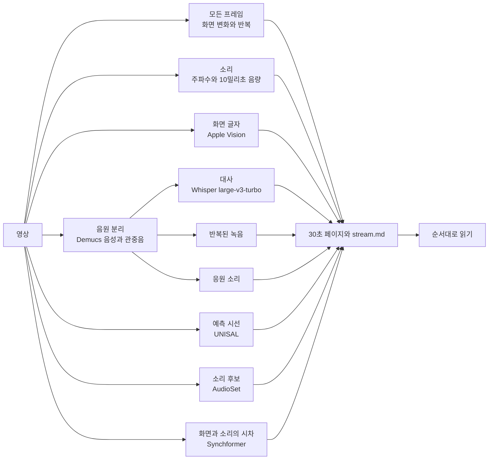

# Reel 재생 옵션

[← README로 돌아가기](../README.ko.md)

PyPI로 설치했다면 이 문서의 `pip install -e '.[추가기능]'` 대신 `pipx install --force 'reel-mcp[추가기능]'`을 쓴다.

원음을 듣는 모델과 받아쓰기를 설치하려면 아래 명령을 쓴다.

```bash
python -m pip install -e '.[speech]'
reel setup --speech --describe-sounds
```

<details>
<summary>명령어 예시, 선택 모델, 클라이언트 설정</summary>

```bash
pip install -e ".[all]"           # 필요한 것만: separate, crowd, mlx, speech, ocr, gaze
reel setup --sync                  # 시선 모델과 싱크 모델(1.1GB) 받기
reel doctor                        # 이 맥에서 무엇을 보고 들을 수 있는지

reel play film.mp4 --out reels/first-view --until 8.5
reel play film.mp4 --out reels/sound-only --until 8.5 --tracks sound
reel watch film.mp4 --out reels/film --subject Zeus --genre lol --lang ko
reel watch film.mp4 --until 8.5 --out reels/view-01
reel zoom reels/film --t0 72 --t1 80          # 한 구간을 자세히 다시 보기
reel frame reels/film --at 73.25              # 73.25초에 보이던 원본 화면 꺼내기
reel frame reels/film --t0 73 --t1 74         # 이 1초 동안 표시된 모든 프레임 보기
reel listen reels/view-01 --t0 4 --t1 7       # 4초부터 7초까지 채널별 음량과 변화 시각 확인
reel observe reels/view-01 --t0 4 --t1 4.5    # 각 화면이 떠 있던 동안 재생된 소리 확인
```

모델이 무엇을 보고 무엇을 들었는지 비교하려면 같은 파일을 새 세션에서 세 번 연다. `--tracks picture`는 화면만, `--tracks sound`는 소리만 재생한다. 기본값 `--tracks both`는 둘을 함께 재생한다. `play`와 `mcp` 모두 원본의 시각과 `--until`을 지킨다. 지나간 장면을 다시 확인할 때도 처음에 고른 트랙만 쓴다. [영상 여덟 편에서 사람과 GPT가 알아차린 것](perception-check.md#같은-영상을-보거나-듣거나-둘-다-했을-때)

영상이나 소리 트랙이 여러 개면 각 종류에서 기본 표시가 붙은 첫 트랙을 고른다. 기본 표시가 없으면 재생 가능한 첫 트랙을 쓰고 앨범 표지와 미리보기용 썸네일은 영상에서 제외한다. 다시 보기와 받아쓰기에서도 같은 트랙을 쓴다.

MCP 첫 화면의 `audio.rapid_rises`에는 북을 빠르게 두드릴 때처럼 짧게 몰린 시각이 나온다. 열쇠가 한 번 짤랑여도 표시가 여럿 찍힐 수 있어 횟수를 읽을 때는 원음과 함께 봐야 한다. 채널별로 측정한 전체 시각은 `play`에 기본으로 기록되고 MCP에서는 같은 구간을 `full_detail=true`로 다시 보면 `audio.attacks`에 나온다.

음높이를 가늠할 수 있는 구간에서는 각 채널의 추정 주파수를 `audio.pitch_contour`로 보낸다. 무엇이 낸 소리인지 몰라도 음이 올라갔는지 내려갔는지 살펴볼 수 있다.

MCP를 쓰는 모델은 Reel에서 화면과 녹음을 바로 받을 수 있다. `pip install -e '.[mcp]'`로 설치하고 로컬 stdio 서버의 실행 명령을 `reel mcp /path/to/film.mp4 --until 8.5`로 지정한다. Codex CLI에서는 Reel 환경을 활성화한 상태에서 다음과 같이 등록할 수 있다.

```bash
codex mcp add reel -- "$(command -v reel)" mcp /path/to/film.mp4 --until 8.5 --image-client
```

모델에 동영상을 건네려면 클라이언트에서 `view_media(turn=1, continuous_seconds=5)`를 호출한다. 응답의 MCP 링크를 순서대로 읽으면 당시 소리가 담긴 첫 5초를 사람도 재생해 볼 수 있다. 다음 턴에 `view`로 바꿔도 같은 시각부터 이어진다. 로컬 Codex CLI 시험에서 GPT에는 MOV의 인코딩된 바이트가 텍스트로 들어와 이 환경에서는 `view`를 쓴다. [재생 방법과 파일 형식](READING.md#watching-a-little-at-a-time)

기본 `view(turn=1)`은 그 구간의 원음 WAV와 함께, 설치된 청취기가 녹음에서 들은 내용과 두 번의 받아쓰기에서 일치한 단어를 보낸다. 그림과 텍스트를 받는 모델도 같은 청취 기록을 읽을 수 있다. `--image-client`로 시작하거나 `native_audio=false`를 쓰면 WAV는 요청할 때만 붙는다. 원음과 측정값만 받으려면 기본 서버에서 `sound_estimates=false`로 호출한다.

재생을 짧게 끊으면 한 소리가 두 구간에 걸칠 수 있다. 주 청취기를 사용할 수 없을 때는 `view(turn=N, full_detail=true)`를 요청하면 보조 청취기가 직전 구간부터 들은 내용이 `sound_in_context`에 나온다. 설명에 적힌 시작 시각과 `current_start_s`를 비교하면 앞 구간에서 얼마나 들었는지 알 수 있다. 그때 들린 소리는 이미 멎었을 수 있다. [짧게 멈췄을 때 GPT가 들었다고 한 소리](benchmarks/short-listening-turns.json)

클라이언트가 WAV를 생략해도 원음에서 잰 값과 로컬 청취 기록은 남는다. 이 경우 GPT는 무엇을 근거로 소리를 설명했는지 밝힐 수 있다. [목소리와 주변 소리 실험](perception-check.md#목소리와-그-목소리가-가리키는-소리)

그림과 텍스트로 볼 때는 구간별 청취 결과가 먼저 나온다. 각 채널의 원음에서 잰 음량, 주파수별 에너지의 가운데 80%가 걸친 범위, 에너지가 가장 많이 모인 좁은 대역의 비율도 볼 수 있다. 음량이 같아도 한 음이 이어지는지, 잡음이 넓은 대역에 퍼졌는지 구별할 단서다.

스테레오에서는 어느 채널이 더 컸는지와 같은 파형이 어느 채널에 먼저 도착했는지를 첫 재생에서 볼 수 있다. 양쪽 음량이 같아도 도착 시각은 다를 수 있다. 같은 `view`에 `full_detail=true`를 붙이면 개별 측정값과 인코더에 들어간 프레임 시각이 나온다. [사람과 GPT의 첫 시청 결과](perception-check.md#원래-녹음의-주파수와-첫-설명)

두 청취기는 `pip install -e ".[speech]"`와 `reel setup --speech --describe-sounds`로 준비한다. [같은 화면에 다른 녹음을 붙인 결과](perception-check.md#wav를-첨부했을-때-gpt가-실제로-받아들인-소리)

모델에 영상을 봐 달라고 하면 `view`를 호출해 한 구간씩 받고 WAV 첨부를 선택한 클라이언트에는 그 구간의 원음도 전달된다. 소리가 뚜렷하게 달라진 순간에는 그 전후의 화면도 받는다. 서버에 `--describe-sounds`를 붙이면 재생이 멈출 때마다 로컬 청취기가 원음을 듣고 설명한다. `--gaze`를 붙이면 시선 모델이 고른 화면 일부도 시간순으로 볼 수 있다. 지나간 장면은 `observe(start_s, end_s)`로 원하는 시각을 골라 그때 뜬 프레임과 같은 구간의 녹음을 함께 확인한다. 그림과 텍스트를 받는 모델은 화면과 주파수 그림을 읽고 로컬 청취기에 소리를 묻거나 발화 기록을 확인할 수 있다. [도구 사용법](READING.md#watching-a-little-at-a-time), [Codex MCP 설정](https://developers.openai.com/codex/mcp/)

재생 화면의 `at_s`는 각 칸을 관찰한 시각이고 `picture_pts_us`는 그때 화면에 떠 있던 프레임의 원본 시각이다. 한 프레임이 오래 떠 있으면 여러 칸에서 같은 원본 시각이 나온다. 소리 트랙을 꺼도 두 시각을 함께 받는다.

기본 재생에서도 대표 화면이 놓친 변화가 있고 그 구간의 모습을 열두 칸 안에 다 담을 수 있으면 시간순으로 보여준다. 축소했을 때 같은 모습이 이어지면 한 칸에 담는다. 계속 움직이는 장면에서 빠른 동작을 따라보려면 `view(turn=1, max_frames=12)`를 호출한다. 그 구간에 뜬 모든 화면이 시간순으로 나오고 녹음도 같은 시각에 멈춘다. 한 번에 볼 프레임 수는 1~12장 사이에서 고를 수 있다. 터미널에서는 `reel play film.mp4 --out reels/frames --continuous --max-frames 12`를 쓴다. [빠른 동작과 순서가 뒤바뀐 장면을 본 결과](perception-check.md#빠른-동작을-프레임-순서대로-본-경우)

계속 움직이는 화면에서도 손이나 물체가 대표 화면 사이에 잠깐 다른 모습을 보이면 원본 프레임을 최대 12장까지 시간순으로 더 보여준다. `selected_picture_pts_us`에 그 시각이 담긴다. [사람이 행동 시각을 표시한 촬영 영상으로 확인한 결과](perception-check.md#움직이는-장면에서-대표-화면-사이에-보인-모습)

각 화면이 보이는 동안 녹음된 소리의 크기도 확인할 수 있다. `audio.during_pictures`에는 그 프레임에 해당하는 원음 구간과 채널별 피크, RMS 레벨이 들어 있다. 두 프레임 사이에 빠진 구간의 소리는 원음에 남는다.

대화나 동작을 장면 전환 너머까지 보려면 `view(turn=1, continuous_seconds=8)`을 쓴다. 지나간 화면과 같은 구간의 녹음을 함께 받고, 다음 호출에서 다시 짧게 볼 수 있다. 터미널에서는 `reel play film.mp4 --out reels/view --step 8 --continuous`로 8초씩 이어 본다. [사람과 GPT가 시청 후 기억한 내용](perception-check.md#한-장면을-이어-본-뒤-기억한-내용)

동작이 지난번 멈추기 전부터 이어졌다면 `view(turn=N, joint_seconds=6)`으로 직전 6초를 살핀다. 로컬 청취기가 그동안 들린 원음을 먼저 듣고 같은 구간의 화면과 소리를 함께 본다. 그림과 텍스트를 받는 모델은 `joint`에서 두 설명을 읽을 수 있다. N번째 구간이 끝난 시각까지만 되짚으며 터미널에서 재생 중일 때는 `joint 6`을 입력한다. [사람이 표시한 동작과 소리로 비교한 결과](perception-check.md#여러-번-멈춘-장면의-화면과-소리를-이어-볼-때)

이미 본 2.4~3.7초에 무엇이 움직였는지 궁금하면 `ask_scene(start_s=2.4, end_s=3.7, question="소리가 바뀔 때 무엇이 움직였어?")`로 그 구간만 다시 볼 수 있다. 질문을 주면 원음을 들은 로컬 모델이 답하고 시작과 끝 시각만 주면 화면과 채널별 음량, 주파수 대역이 바뀐 시각을 받는다. 원음도 받으려면 `native_audio=true`를 붙인다.

어떤 소리가 언제 났는지 다시 확인하려면 `reel setup --locate-sounds`로 모델을 설치한다. 가중치는 1.76GB다. 예를 들어 `listen(turn=2, start_s=2, end_s=7, describe=false, locate_sounds=["water running"])`은 이미 들은 구간에서 물 흐르는 소리와 가장 비슷한 1초를 돌려준다. 터미널에서는 `reel match DIR --t0 2 --t1 7 --locate "water running"`을 쓴다. 물소리가 없어도 최고점은 나올 수 있으므로 해당 구간을 다시 들어 확인한다.

물이 흐르는 소리와 말소리가 각각 언제 들리는지 살필 때는 `ask_scene(start_s=2, end_s=7, alternatives=["water running", "a person speaking"])`로 같은 구간을 다시 본다. 채널별로 초마다 나온 소리 후보와 구간 전체를 이어서 들었을 때의 후보를 함께 보여 준다. 초 단위 비교는 모델 입력을 채우려고 짧은 소리를 반복한다. 연속 비교는 원음을 한 번만 쓰고 남은 입력을 0으로 채운다.

터미널에서는 재생을 멈추고 `match 2 7 --per-second`로 같은 구간을 확인할 수 있다. 소리 이름을 떠올리기 어려우면 `alternatives=[]`로 비슷한 소리 후보를 볼 수 있다. [촬영 영상과 환경음으로 확인한 결과](perception-check.md#원음에서-소리-두-가지의-순서-짚기)

두 곳에서 보이는 움직임이 소리와 맞는지 궁금하면 `ask_scene(start_s=2, end_s=5, sync_regions=[[0.1,0.3,0.4,0.8],[0.6,0.3,0.9,0.8]])`로 비교한다. 번호가 붙은 사각형은 움직임을 재는 범위다. 가장자리까지 포함해 픽셀이 변한 시각을 아래 그래프에서 채널별 음량과 나란히 볼 수 있다. `reel setup --sync`로 동기화 모델을 설치하면 영역마다 움직임과 녹음의 타이밍이 얼마나 맞는지도 볼 수 있다.

화면의 한 부분을 고정해서 확대하려면 `view(turn=2, focus=[0.7, 0.4], max_seconds=0.3)`처럼 다음에 볼 위치와 시간을 고른다. 0.3초 안에 다시 멈추고, 그동안 해당 위치에서 일어난 움직임을 전체 화면과 소리와 함께 받는다. 마지막 화면에서는 전체에서 고른 위치와 해당 부분을 확대한 그림을 나란히 본다. 다음 구간에서 위치나 시간을 바꿀 수 있다. 이미 본 순간의 원본 픽셀은 `look(turn=2, at_s=0.15, box=[0.5, 0.2, 0.9, 0.6])`로 확인한다.

화면과 소리가 함께 바뀐 이유가 궁금하면 `view(turn=2, question="소리가 날 때 화면에서 무엇이 움직여?")`처럼 묻는다. 로컬 모델은 원음을 먼저 따로 듣고, 같은 구간을 소리와 화면으로 다시 보면서 질문에 답한다. 직전에 본 장면까지 필요하면 `joint_seconds=6`을 붙인다. `reel mcp FILM --joint --image-client`로 시작하면 연속 재생을 처음 볼 때부터 시청각 설명을 받는다. [영상 여덟 편을 본 사람과 GPT의 설명](perception-check.md#사람들이-같은-영상을-설명한-문장)

화면 안에서 움직이는 물체도 따라볼 수 있다. 1.25초에 본 손잡이의 위치가 `[0.7,0.4]`였다면 `view(turn=2, focus=[0.7,0.4], follow_from_s=1.25)`를 호출한다. 원본 영상에서 처음 짚은 곳과 마지막으로 찾은 곳을 확대해 각각 시각을 표시한다. 원본을 다시 열 수 없으면 저장된 사진을 쓴다. 한 번에 최대 8초까지 따라가며 놓친 프레임에는 위치를 비워 둔다. 기본 설치에서는 인접한 프레임의 무늬를 따라간다. `reel setup --follow`로 BootsTAPIR를 설치하면 가려졌다 나타난 점도 다시 찾을 수 있다. [사람이 표시한 위치와 비교한 결과](perception-check.md#움직이는-점을-따라본-결과)

모델이 소리 이름이나 대사에 대한 힌트 없이 먼저 보게 하려면 `view(turn=1, sound_estimates=false)`를 쓴다. 7초까지 본 뒤 `listen(turn=N, start_s=2, end_s=7, native_audio=true, describe=false)`를 호출하면 중간에 몇 번 멈췄든 2~7초의 녹음과 채널별 주파수 그림을 받는다. 들린 소리를 식별하기 어려우면 같은 구간에서 `describe=true`로 로컬 청취기의 의견을 들을 수 있다.

소리를 듣고 두 가지가 떠오르면 원음에 대조할 수 있다. 예를 들어 `listen(turn=3, start_s=2, end_s=5, describe=false, alternatives=["a voice humming", "an electric motor running"])`은 각 채널에서 두 설명이 녹음과 얼마나 비슷한지 돌려준다. `alternatives=[]`이면 비슷하게 들리는 소리 후보를 찾는다. 모델은 `reel setup --compare-sounds`로 준비한다. 점수가 높아도 실제 출처는 다를 수 있다.

여러 소리가 겹쳤을 때 `listen(turn=N, start_s=2, end_s=7, component="percussive")`를 쓰면 여러 주파수에 걸쳐 짧게 난 소리가 두드러진다. 일정한 주파수에서 이어진 소리를 들으려면 `"harmonic"`을 고른다. 주파수 그림과 요청한 WAV에는 고른 성분이 담기고 로컬 청취기는 그 성분을 원음과 함께 듣는다. 한 소리가 양쪽 성분에 모두 남을 수 있다. [겹친 소리 청취 결과](listening-check.md#겹쳐-들리는-소리를-원음과-대조)

스테레오 녹음에서 `listen(turn=N, start_s=2, end_s=7, component="side", describe=false, alternatives=["footsteps", "speech"])`를 쓰면 원음과 좌우 채널의 차이음에서 각각 발걸음과 말소리가 얼마나 비슷한지 비교한다. `"mid"`를 고르면 좌우 채널의 평균을 듣는다. 어느 쪽에도 여러 소리가 함께 남을 수 있다.

처음 보는 영상은 `play`로 바로 열 수 있다. 출력된 `view.json`을 열면 그동안 지나간 프레임, 소리의 주파수 그림, 마지막 화면과 원래 채널의 WAV를 볼 수 있다. `next`를 입력하면 이어서 보고, `next 0.4`를 입력하면 최대 0.4초 뒤에 다시 멈춘다. 끝낼 때는 `quit`을 쓴다. 모델을 연결할 때도 표준 입력으로 같은 명령을 보내면 된다. 화면이나 음량이 급변하면 조금 일찍 멈추고 조용한 구간도 순서대로 보여준다. `play`나 `mcp`에 `--pause-on-sound-change`를 붙이면 전체 음량이 비슷해도 주파수 대역별 세기가 급변할 때 멈춘다. 평소 재생에서도 같은 변화의 시각을 확인할 수 있다. 이미 받은 구간을 로컬에서 다시 들으려면 `reel listen reels/first-view/turn_00001`을 쓴다.

짧은 소리를 확인하려면 `pip install -e ".[events]"`와 `reel setup --sound-events`를 실행한다. 설치하면 YAMNet이 채널마다 0.48초 간격으로 0.975초 분량을 듣고 `audio.sound_events`에 소리 후보와 시각을 남긴다. `listen(turn=3, start_s=2, end_s=4, describe=false, sound_events=true)`로 지나간 구간을 다시 열어 말소리나 개 짖는 소리 같은 후보를 원음과 대조할 수 있다.

이미 들은 구간의 볼륨을 바꾸려면 `gain_db`를 지정한다. 예를 들어 `listen(turn=3, start_s=2, end_s=4, gain_db=12, native_audio=true, sound_events=true, describe=false)`는 조절한 WAV와 두 음량에서 나온 소리 후보를 돌려준다. 가장 큰 샘플이 잘리지 않는 범위에서 모든 채널에 같은 게인을 적용한다. 명령줄에서는 `reel listen DIR --t0 2 --t1 4 --gain-db 12`로 실행한다. [현장 녹음에서 볼륨을 바꿔 들은 결과](listening-check.md#이미-들은-구간의-볼륨을-바꿨을-때)

멈출 때마다 `audio.signal`을 보면 원음에 0이 아닌 샘플이 있었는지 알 수 있다. `reel setup --sound-labels`로 가중치를 받아 두면 `audio.source_estimates`에 직전 최대 4초의 소리 후보가 채널별로 나온다. 소리는 있어도 후보가 비어 있을 수 있다.

`reel setup --captions`를 한 번 실행하면 다음 재생부터 `audio.scene`에 방금 들린 소리를 묘사한 짧은 문장이 나온다. 처음 2초가 모이면 시작하고 직전 최대 10초까지 함께 듣는다. 소리가 바뀌었다면 `windows`와 `recent_windows`의 시각을 보고 어느 설명이 방금 들은 부분에 해당하는지 확인한다. uv나 Python 3.10이 설치돼 있으면 setup이 소리 묘사에 쓸 환경을 따로 만든다. 잡음을 빗소리로, 일정한 음을 기계음으로 추측할 수 있으니 채널별 실측값과 함께 읽는다. [현장 녹음을 들은 사람들과 비교한 결과](listening-check.md#선택지-없이-현장-녹음을-들었을-때)

애매한 소리를 다시 들으려면 `reel setup --captions --compare-sounds`로 모델을 준비하고 `reel listen TURN --t0 2 --t1 5 --verify-sounds`를 실행한다. CoNeTTE가 낸 설명 최대 여섯 개를 CLAP이 같은 채널의 원음과 대조해서 하나를 고른다. `play`나 `mcp`에 `--verify-sounds`를 붙이면 재생할 때마다 대조한다. 처음 보는 영상 12편에서 사람의 설명을 100점으로 잡았을 때 로컬 GPT의 소리 설명은 54.6점에서 68.2점으로 올랐다. 개선 폭의 신뢰구간에는 0이 들어갔다. [영상별 답변과 채점 결과](benchmarks/verified-hearing.json)

`reel setup --sound-examples`를 실행하면 첫 재생부터 소리의 출처를 짚을 수 있다. 채널마다 방금 들은 소리를 116종의 실제 녹음 942개, 소리 이름 531개와 각각 비교한다. 두 결과가 같은 출처를 가리키면 이름과 시각을 보여 준다. 더 짧게 다시 들으려면 `listen(turn=2, start_s=1, end_s=2.5, source_examples=true, describe=false)`로 구간을 고른다. 처음 설치할 때 PE-AV 가중치가 없으면 8.3 GiB를 받는다. CC0 녹음 약 665 MiB를 처리해 색인을 만든 뒤에는 오프라인으로 듣는다.

주변과 소리가 달라진 구간을 원음으로 다시 듣고 짧게 들었을 때 처음 나온 이름은 다른 청각 모델(CLAP)로 한 번 더 확인한다. CLAP 가중치가 없으면 설치할 때 약 586 MiB를 받는다. 출처를 몰라도 다시 들으면 어느 채널에서 언제 얼마나 크게 울렸는지, 어떤 주파수 대역에 소리가 모였는지 알 수 있다.

현장 녹음 24개를 화면 없이 들려줬더니 96개 질문에서 로컬 GPT가 사람 다수와 같은 답을 한 횟수는 58회에서 64회로 늘었고 반대로 답한 횟수도 7회에서 11회로 늘었다. 질문을 그대로 두고 녹음을 바꾸면 사람 다수와 같은 답은 33회였다. 한편 장면을 자유롭게 묘사한 점수는 사람 대비 51.9%에서 51.4%가 됐다(95% 구간 36.4~65.3%). 배경에 짧은 소리를 섞은 별도 실험에서는 48개 중 출처를 정확히 맞힌 소리가 1개에서 6개로 늘었고 오답도 1개에서 2개로 늘었다. 배경만 들려준 12개에서는 두 버전 모두 새 소리를 지목하지 않았다. [녹음별 답과 채점 방법](benchmarks/focused-listening.json)

판별 기준을 정할 때 쓰지 않은 녹음 244개에서 출처를 79번 짚었다. 사람이 붙인 이름과 일치한 건 71개였고 8개는 틀렸다. 나머지 165개는 이름을 붙이지 않았다. 참조 녹음이 없는 종류에 속한 49개도 모두 여기에 들어간다. 녹음마다 처음 4초만 들려줬고 정답은 녹음 전체에 붙은 이름이다. [녹음별 결과와 측정 방법](benchmarks/reference-sources.json)

같은 244개에서 기존 재생이 보여 준 소리 후보에 정답이 들어 있던 녹음은 84개였다. 새 인식을 더하자 121개가 됐고 틀린 이름도 6개 더 나왔다. 별도로 녹음 22개를 처음부터 끝까지 들려줬을 때 GPT의 정답은 전후 모두 10개였다. 전에는 모르겠다고 했던 딸랑이는 맞혔고 타자기는 여전히 컴퓨터 키보드로 들었다. 실사 영상 8편에서 GPT와 사람이 소리를 묘사한 문장의 유사도 변화는 +0.011이었다(95% 구간 −0.020~+0.048). [GPT의 실제 답과 대조 실험](benchmarks/reference-source-listeners.json)

`reel setup --identify-sounds`를 한 번 실행하면 소리 이름을 두 개 이상 주고 다시 들을 때 Meta의 PE-AV와 LAION의 CLAP이 원음의 같은 채널을 각각 듣는다. 두 모델의 답이 갈리거나 둘 다 보기 밖의 소리를 더 가깝게 평가하면 `unresolved`로 표시한다. 예를 들어 `reel match TURN --t0 2 --t1 5 --identify "metal rattling" "fabric rubbing"`으로 금속이 달그락거리는 소리와 천이 스치는 소리를 대조할 수 있다. `play`나 `mcp`에 `--identify-sounds`를 붙이면 재생 중에도 AudioSet에서 후보를 찾는다. PE-AV 모델을 받을 때 8.9GB가 필요하다.

생활음 50종을 담은 녹음 99개에서 소리의 정체를 맞힌 횟수는 기존 CLAP이 85번, PE-AV가 94번이었다. 두 모델이 같은 답을 고른 81개는 모두 맞았다. 다만 보기에서 정답을 빼자 99개 중 40개에서는 두 모델이 같은 오답을 골랐다. 새 녹음 49개에서 보기 밖의 소리까지 대조하자 이런 오답이 16개에서 0개로 줄었다. 정답을 보기에 돌려놓으면 원래 둘 다 맞히던 39개 중 21개에서 답을 유지했다. [녹음별 순위](benchmarks/source-identity-agreement.json), [정답을 뺀 실험](benchmarks/source-outside-choices.json)

실제 촬영한 영상 16편에서 두 번째 소리를 맞힌 경우는 긴 설명만 받았을 때 5편, 최근 설명도 받았을 때 7편이었다. [소리가 바뀐 구간의 청취 결과](listening-check.md#방금-들린-소리와-앞서-들은-소리)

여러 소리가 겹칠 때는 `reel setup --layers`로 MixIT를 준비한다. 재생을 멈추고 `layer 2 5 2`를 입력하면 2~5초에 녹음된 원음과 그 구간에서 두 번째로 큰 추정 성분을 받는다.

질문에 소리 이름을 넣은 탓에 모델이 그 소리를 들었다고 하는지 확인할 수 있다. `listen(turn=2, question="What starts clicking?", question_control=true)`를 호출하면 모델이 원음과 같은 길이의 무음에 각각 답한다.

두 답이 같으면 해당 채널에 `answer_on_silence="unchanged"`를 표시하고 답을 숨긴다. 답이 달라도 소리의 정체를 잘못 짚을 수 있다.

비슷한 소리를 사람들이 어떤 말로 묘사했는지 찾아볼 수 있다. `reel setup --caption-matches`로 녹음 설명 19,178개를 준비하고 `listen(turn=2, start_s=2, end_s=5, reference_captions=true)`를 호출한다. PE-AV를 준비한 뒤 `verify_sounds=true`를 함께 주면 그 문장이 원음과 얼마나 잘 맞는지 한 번 더 확인한다. 다른 녹음에서 가져온 설명이라 소리의 출처를 잘못 짚을 수도 있다. 새 녹음 32개에서 로컬 GPT가 쓴 설명을 같은 소리를 들은 사람들의 설명과 비교했다. 녹음마다 특징을 얼마나 잘 구별했는지 사람을 기준으로 환산한 점수는 43.0%에서 57.5%로 올랐다. 상승 폭은 14.5%p였고 95% 구간은 7.4~21.8%p였다. 다른 녹음의 검색 결과로 바꾸면 22.6%였다. 생활 현장 녹음 51개에서 사람이 표시한 소리를 하나라도 맞힌 횟수는 3회에서 5회로 늘었다. [녹음별 응답과 대조 실험](benchmarks/caption-matches.json)

검색 자료와 녹음자가 겹치지 않게 32개를 골라 다시 들으니 원래 점수는 51.2%, 검색 결과를 더했을 때는 54.7%, PE-AV로 원음과 대조했을 때는 57.6%였다. 마지막 점수의 95% 구간은 46.0~68.5%였고 기존 방식과의 차이는 −3.4~+15.9%p여서 이 표본만으로 향상 폭을 확정하기 어렵다.

예 또는 아니요로 답하는 기존 질문 64개에서는 검색 전후 모두 42개에서 사람 다수의 답과 일치했다. 새 녹음 32개는 Clotho-AQA 학습용 22개, 검증용 9개, 시험용 1개에 해당한다.

이 녹음에 딸린 질문 128개에 PE-AV 검증을 쓰자 정답이 55개에서 77개로 늘었다. 모른다는 답은 66개에서 42개로 줄었고 오답은 7개에서 9개로 늘었다. [점수 계산 코드](../examples/check_caption_matches.py)

Clotho-AQA 공식 시험용 녹음에서 16개를 따로 골랐다. 예 또는 아니요로 답하는 질문 64개에서 로컬 GPT는 첫 설명과 스펙트럼을 보고 30개를 맞혔다. 원음과 대조한 검색 결과를 더하면 36개, 질문마다 원음을 다시 들려주면 50개를 맞혔다.

양쪽에 짧게 답하라고 지시하고 무음 대조를 켜자 오답은 11개에서 5개로 줄었다. 정답도 48개에서 42개로 줄고 모른다는 답은 5개에서 17개로 늘었다. [질문별 응답과 사람 세 명의 답](benchmarks/caption-matches.json)

Apple Silicon에서는 비상업적 연구용 원음 모델인 Audio Flamingo Next를 쓸 수 있다. `reel setup --audio-flamingo`로 가중치 5.1 GiB를 설치하고 다음처럼 실행한다.

```bash
REEL_AUDIO_READER=flamingo reel mcp film.mp4 --tracks sound --image-client --until 8.5
```

8.5초까지 재생한 뒤 `listen(turn=N, start_s=0, end_s=8.5)`를 호출하면 모델이 각 채널의 원음을 듣는다. 같은 구간을 짧게 나눠 듣는 모델도 쓰려면 `reel setup --captions`로 설치하고 `listen`에 `independent_caption=true`를 준다. 여기에 질문을 덧붙이면 원음 모델이 질문을 받기 전에 들은 내용도 `before_question`에 남아 두 답을 비교할 수 있다.

기본 모델은 Qwen이며 화면과 소리를 함께 읽거나 말을 받아쓸 때도 Qwen을 쓴다.

겹친 소리의 정체가 궁금할 때 `listen_layer(turn=N, start_s=2, end_s=5)`를 호출하면 원음, 가장 크게 잡힌 성분, 그 성분을 빼고 남은 소리를 차례로 들을 수 있다. 뒤의 둘을 더하면 16 kHz로 변환한 원음이 된다. 한 물체에서 난 소리가 양쪽에 걸릴 수도 있으니 원음과 대조해 듣는다.

다른 성분을 골라 같은 방식으로 비교하려면 `remainder=true`를 붙인다.

MCP에서는 5초까지 재생한 뒤 `listen_layer(turn=3, start_s=2, end_s=5, layer=2)`로 들을 수 있다. 기본 채널은 1이며 오른쪽 채널을 따로 들으려면 스테레오 녹음에서 `channel=2`를 지정한다. 원음은 녹음 당시의 샘플레이트로 받고 분리본은 16 kHz로 듣는다. 한 소리가 여러 성분에 나뉘거나 다른 소리와 섞여 나올 수 있다.

찾고 싶은 소리를 말로 지정할 수도 있다. `reel setup --compare-sounds`로 CLAP를 준비한 뒤 MCP에서 번호 대신 `focus="a distant voice"`를 주면 원음과 여덟 성분 중 그 설명에 가장 가까운 녹음을 고른다. 원음이 선택될 수도 있다. 파형을 듣고 묘사하는 모델에는 검색어를 주지 않는다. 오디오를 받는 클라이언트는 WAV를, 이미지를 받는 클라이언트는 스펙트럼과 녹음별 설명을 받을 수 있다. [생활음을 겹쳐서 들은 결과](listening-check.md#겹친-생활음을-하나씩-다시-들었을-때)

앞서 들은 배경음에 어떤 소리가 더해졌는지 궁금하면 재생을 멈추고 `compare-heard 0 2 4 6`을 입력한다. 로컬 모델이 0~2초와 4~6초의 원음을 따로 듣고 구간마다 답한다. MCP에서는 3번째 턴이 6초에 도달했다면 `compare_heard(turn=3, reference=[0,2], target=[4,6])`으로 같은 구간을 들을 수 있다. 이미 재생된 구간을 각각 최대 8초까지 지정한다. 오디오를 받는 클라이언트는 두 WAV를 받을 수 있고 이미지를 받는 클라이언트는 두 스펙트럼과 각 구간의 설명을 받는다. 이름을 모르지만 전에 들은 소리와 비슷하다면 `similarity=true`로 두 녹음을 직접 비교할 수 있다. CLI에서는 `--similarity`를 쓴다. 비슷한 배경음도 점수에 영향을 준다.

물 흐르는 소리나 금속 두드리는 소리가 더 뚜렷해졌는지 살피려면 `compare_heard`에 `alternatives=["running water","metal tapping"]`를 준다. Reel은 채널마다 두 녹음을 보기와 대조하고 보기 밖에서 원음과 비슷하게 들릴 수 있는 소리도 보여준다.

두 녹음의 특징이 같거나 한쪽에서 신호를 얻지 못하면 소리 변화에 이름을 붙일 근거가 없다고 알려준다. 재생 중에는 `compare-heard --alternatives 0 2 4 6 "running water" "metal tapping"`으로 비교할 수 있다.

짧은 소리의 앞뒤를 함께 들으려면 `ask_scene(start_s=2, end_s=4, mark_sound=[2.91,3.14])`로 최대 8초를 다시 재생한다. 채널별 스펙트로그램에서 표시한 구간과 양옆의 소리를 함께 볼 수 있다. CLI에서는 `reel listen DIR --t0 2 --t1 4 --mark-sound 2.91 3.14`를 쓴다.

4초까지 재생한 뒤 `match 2 4`를 입력하면 로컬 CLAP이 2~4초의 녹음과 비슷한 소리를 찾는다. `match 2 4 "fabric rubbing" "water running"`처럼 궁금한 소리를 덧붙이면 두 설명의 점수를 다른 소리 후보와 함께 볼 수 있다. 가중치를 `reel setup --compare-sounds`로 받아 두면 별도 창에서도 `reel match TURN --t0 2 --t1 4`로 같은 결과를 얻을 수 있다. [녹음만 바꿔 본 결과](listening-check.md#화면을-두고-녹음만-바꿨을-때)

멈춘 자리에서 `listen`을 입력하면 로컬 오디오 모델이 직전 소리를 최대 30초까지 다시 듣고 설명한다. `listen Does the rhythm speed up?`처럼 궁금한 점을 물으면 답과 함께 녹음 당시 채널을 담은 WAV를 받는다.

별도 창에서는 `reel listen reels/first-view/turn_00005 --question "Does the rhythm speed up?"`로 물을 수 있다. [현장 녹음을 들은 사람들의 답과 비교한 결과](listening-check.md#현장-녹음에서-궁금한-소리-다시-듣기)

재생을 멈추고 `speech`를 보내면 지금까지 들린 목소리를 확인할 수 있다. 발화로 추정한 구간과 두 번 받아썼을 때 일치한 단어를 따로 돌려주므로 목소리가 잡혀도 단어는 비어 있을 수 있다.

별도 창에서는 `reel speech reels/first-view/turn_00001`을 쓴다. 멈출 때마다 자동으로 받아쓰려면 `play`에 `--speech`를 붙인다. 언어를 알면 `--lang ko`처럼 지정할 수 있다.

동작이 보인 순간에 목소리도 들렸는지 확인하려면 `heard_words(turn=3, start_s=2.1, end_s=4.8)`을 호출한다. 재생 중에는 `speech 2.1 4.8`, 별도 창에서는 `reel speech TURN --t0 2.1 --t1 4.8`을 쓴다. 중간에 몇 번 멈췄든 그 구간의 원음만 들어 말소리로 추정한 시간과 알아들은 단어를 따로 돌려준다. `ask_scene`에서 질문을 하거나 소리 보기를 주면 같은 구간의 발화 기록도 함께 나온다.

어떤 언어인지 알면 멈춘 자리에서 그 언어로 다시 들을 수 있다. 예를 들어 벵골어는 재생 중에 `speech bn`을 입력하거나 MCP에서 `heard_words(turn=1, lang="bn")`을 호출한다. 지정한 언어는 그 요청에만 쓰인다. [여섯 언어의 낭독으로 확인한 결과](perception-check.md#여섯-언어에서-실제로-인용할-수-있었던-말)

원음 청취기는 화면과 단어 후보를 가린 채 같은 채널의 소리를 듣는다. 같은 발화 구간에서 두 모델이 기존 단어를 하나 이상 함께 알아들으면 주변에서 놓친 말도 대조한다. 철자와 어순이 맞는 후보는 `possible_words`에서 볼 수 있다. 대사를 인용할 때는 `words`를 쓰고 후보를 언급할 때는 불확실하다고 밝힌다. 저장한 구간을 다시 들으려면 `reel speech TURN --verify`를 실행한다.

재생 중에 모델이 `look 0.2 0.1 0.6 0.5`를 보내면 그 자리에서 화면 일부를 원본 크기로 볼 수 있다. 네 숫자는 왼쪽 위를 기준으로 0부터 1까지 표시한 값이며 순서대로 왼쪽, 위, 오른쪽, 아래 경계를 뜻한다.

별도 창에서도 `reel look reels/first-view/turn_00001 --box 0.2 0.1 0.6 0.5`로 같은 PNG와 영상 시각을 얻을 수 있다. 사람들이 볼 만한 지점을 시선 모델에 맡기려면 `play`에 `--gaze`를 붙인다. [사람 시선과 비교한 결과](perception-check.md#같은-화면에서-처음-눈에-띈-곳)

지나간 장면도 재생 중에 `look --at 1.25 0.2 0.1 0.6 0.5`로 다시 볼 수 있다. 1.25초에 떠 있던 화면에서 지정한 부분을 원본 해상도로 잘라 준다.

`--gaze`를 켜면 직전 1초 동안 시선 모델이 어느 부분을 짚었는지 `gaze.recent_details.file`에서 볼 수 있다. [사람이 실제로 본 곳과 비교한 결과](perception-check.md#소리가-달라지기-전후의-시선)

재생 중 멈춘 상태에서 `observe 2 4 --focus 0.1 0.3 0.5 0.8`을 입력하면 2~4초 사이에 지정한 영역이 어떻게 움직였는지 다시 본다. `action_view.pages`의 그림에서는 주황색 선이 해당 영역의 변화량을, 파란색 선이 원래 채널의 음량 피크를 보여준다.

뒤에 `--question Does the sound repeat?`를 붙이면 로컬 오디오 모델이 같은 구간을 듣고 답한다. 짧은 동작은 `action_view.frame_pages`에서 지정한 부분의 모든 프레임을 펼쳐 볼 수 있다. 다음 재생은 멈췄던 시각에서 이어진다.

멈춘 자리에서 `observe 2 4 --joint`를 입력하면 로컬 모델이 2~4초의 원음을 먼저 귀로만 듣고 같은 소리를 화면과 함께 다시 살핀다. 두 설명은 `joint.windows`에서 읽을 수 있다. 특정 동작이 궁금하면 명령 뒤에 `--question 소리가 시작될 때 무엇이 움직였어?`를 붙인다.

화면이 먼저 끝나거나 프레임이 많아 장면을 나눠 봐도 `joint.recording`에서 그 구간의 소리를 이어서 들은 설명을 읽을 수 있다. 질문을 하면 원음만 들은 답도 함께 온다. 화면이 없는 녹음에도 같은 명령을 쓸 수 있다.

매번 멈출 때 이 결과를 받으려면 `reel play film.mp4 --out reels/view --until 8.5 --joint`를 쓴다. 설치 방법은 아래 Qwen3-Omni 항목에 있다. [같은 화면에서 녹음만 바꿨을 때 GPT의 답](perception-check.md#같은-화면에-다른-영상의-녹음을-붙인-실험)

스테레오 녹음에서는 `play`, `observe`, `listen`이 두 채널의 음량과 도착 시간 차이를 `stereo_cues`에 담는다. 서라운드 녹음에서도 좌우 스피커를 짝지을 수 있으면 같은 값을 읽을 수 있다. 화면 밖 소리도 한쪽 귀에서 들릴 수 있으므로 소리를 낸 물체를 찾을 때는 화면의 동작을 함께 본다.

`play`와 `observe`는 녹음에 뚜렷한 변화가 있으면 그 직전과 직후의 화면을 `sound_views`에 모아 준다. 마지막 칸을 보면 화면 어디가 달라졌는지 알 수 있다. 소리를 낸 물체가 화면에 보이지 않을 수도 있다. 두 명령에 `--media`를 붙이면 움직이는 화면과 원래 채널의 PCM 소리를 파일 하나로 재생할 수 있다. [구간별 출력 읽는 법](READING.md)

`--until 8.5`를 주면 처음 8.5초만 잘라 분석하고 화면을 확대하거나 원음과 프레임을 꺼낼 때도 그 구간에서 읽는다.
각 시점의 결과는 새 폴더나 빈 폴더에 저장한다.

화면과 소리를 함께 살피는 `reel observe`는 프레임 시트, 원래 채널을 보존한 WAV, 프레임별 JSON을 돌려준다. JSON에는 각 화면이 떠 있던 동안 재생된 오디오 샘플의 범위와 채널별 음량이 들어간다. 소리 분류 모델이 없어도 쓸 수 있다.

첫 반응을 보려면 페이지와 `stream.md`를 순서대로 건네고 마지막에 `now.png`가 있으면 함께 보여준다.
이 그림에는 멈추기 직전의 화면이 원본 크기로 담기며, 영상이 끝나고 소리만 이어지면 생략된다.
"방금 무엇을 알아차렸어요?"라고 묻고 첫 답을 들은 뒤에 궁금한 장면을 짚는다. [닫힌 문으로 시험한 결과](door-trial.md)

빠른 동작은 `reel frame`에 시작과 끝 시각을 주면 프레임마다 볼 수 있다. JSON에 적힌 PNG를 순서대로 열면 각 칸 아래에 그 화면이 처음 뜬 시각이 나온다. 시작 시각에 이미 보이던 프레임도 들어가며 같은 프레임이 오래 떠 있으면 한 번만 나온다. 끝 시각에 새로 뜬 프레임은 다음 구간에 속한다. 특정 시각의 화면을 원본 해상도로 볼 때는 `--at`을 쓴다.

이미지와 텍스트를 읽을 수 있는 모델에는 같은 페이지 PNG와 `stream.md`의 해당 부분, `reel listen`이 출력한 JSON을 건네면 된다. 셸을 쓸 수 있는 모델은 궁금한 구간을 직접 지정할 수 있고, 오디오를 입력받는 모델에는 그 구간의 WAV 파일도 건넬 수 있다. JSON에는 형식 이름 `reel.listen.v1`, 로컬 WAV 경로, 채널별 음량과 소리가 커진 시각이 들어간다. AudioSet 가중치가 있으면 소리의 후보도 나온다.

소리의 출처를 더 알아보려면 `reel setup --compare-sounds`를 한 번 실행하고 `reel listen`에 `--compare-sounds`를 붙인다. 로컬 CLAP 모델이 527개 소리 설명과 비교해 구간마다 가장 가까운 세 후보를 돌려준다. 이 점수는 소리의 유사도를 나타내므로 생소한 소리는 세 후보 모두 빗나갈 수 있다. 대사를 받아쓸 근거는 별도로 필요하다. 별도 파이썬 환경에 `tags`를 설치했다면 `REEL_COMPARE_PYTHON`으로 지정한다.

원음을 듣거나 화면과 함께 읽으려면 `reel setup --describe-sounds`를 실행한다. 필요한 경우 별도 파이썬 환경을 만들고 Qwen3-Omni 8비트 가중치(약 39GB)를 받는다. 64GB Apple Silicon Mac에서 실행했다.

이미 `hearing`을 설치한 환경이 있으면 `REEL_HEAR_PYTHON`으로 그 환경의 파이썬을 지정할 수 있다.

`reel play`나 `reel listen`에 `--describe-sounds`를 붙이면 모델이 WAV를 듣고 적은 묘사와 채널별 측정값이 JSON에 들어간다. 모델이 소리의 출처를 잘못 짚기도 하므로 대사를 인용할 때는 발화 기록을 확인한다.

Synchformer를 설치하면 `reel observe`에 `--sync-region LEFT TOP RIGHT BOTTOM`을 붙여 지정한 영역의 움직임과 소리의 시점을 비교할 수 있다. 좌표는 왼쪽 위 (0, 0)에서 오른쪽 아래 (1, 1)까지이며 영역마다 같은 녹음에 대한 점수가 나온다. 화면 밖에서 난 소리도 동작과 우연히 때가 맞으면 높은 점수를 받을 수 있다. [측정값 읽는 법](READING.md)

그다음 `reels/film/pages/`를 [docs/READING.md](READING.md)에 따라 순서대로 읽는다. M4 Pro 기준 10분 영상에 싱크 측정을 포함해 10분쯤 걸린다.

먼저 보고 싶으면 `python examples/make_demo.py examples/out/demo.mp4 --music 쓸-수-있는-음악.wav`로
위 그림의 70초 예시 영상을 만들 수 있다. 문제 여섯 개가 일부러 심어져 있다.

분리 모델이 따로 가상환경을 써야 하면 `REEL_SEP_PYTHON`, `REEL_CROWD_PYTHON`, `REEL_ASR_PYTHON`, `REEL_GAZE_PYTHON`으로
지정한다. 모델과 캐시는 `~/.cache/reel`(`REEL_HOME`)에 둔다.

</details>

<details>
<summary>30초 페이지를 만드는 과정</summary>



</details>
