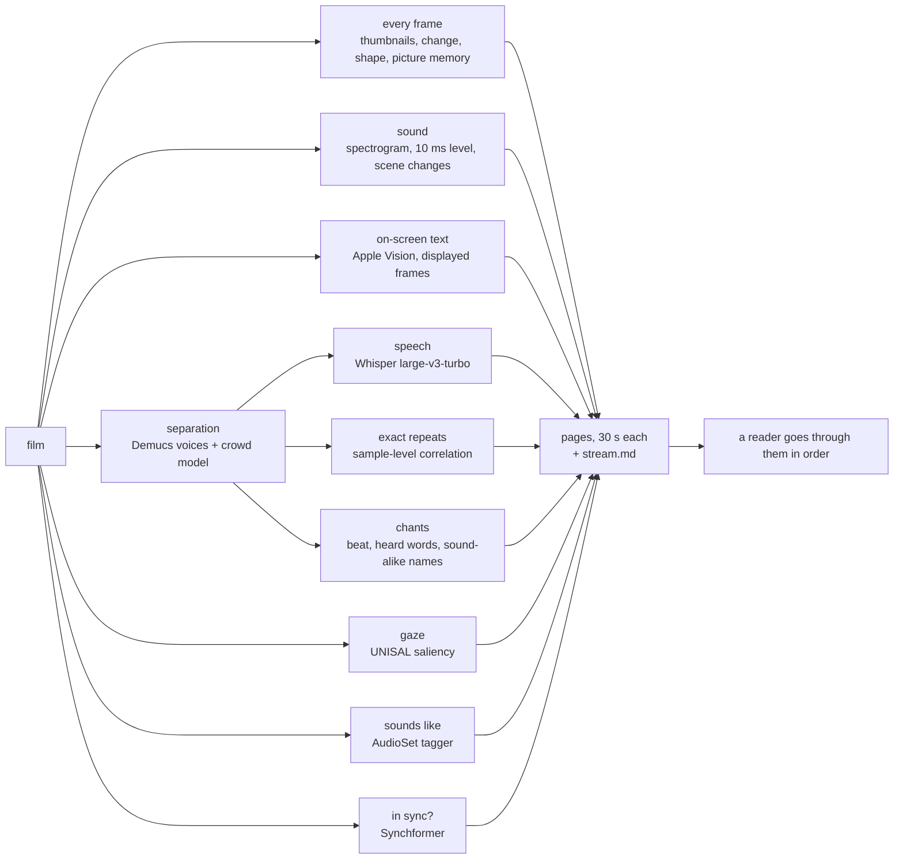

# Reel: playback options

[← Back to the README](../README.md)

Installed from PyPI? Wherever this page says `pip install -e '.[EXTRA]'`, use `pipx install --force 'reel-mcp[EXTRA]'`.

Run these commands to enable local listening and speech recognition.

```bash
python -m pip install -e '.[speech]'
reel setup --speech --describe-sounds
```

<details>
<summary>Commands, optional models and client configuration</summary>

```bash
pip install -e ".[all]"           # or pick extras: separate, crowd, mlx, speech, ocr, gaze
reel setup --sync                  # fetch the gaze model and the sync model (1.1 GB)
reel doctor                        # what this machine can see and hear

reel play film.mp4 --out reels/first-view --until 8.5
reel play film.mp4 --out reels/sound-only --until 8.5 --tracks sound
reel watch film.mp4 --out reels/film --subject Zeus --genre lol --lang ko
reel watch film.mp4 --until 8.5 --out reels/view-01
reel zoom reels/film --t0 72 --t1 80          # re-watch a stretch closer
reel frame reels/film --at 73.25              # inspect the full frame on display here
reel frame reels/film --t0 73 --t1 74         # read every displayed frame in this second
reel listen reels/view-01 --t0 4 --t1 7       # inspect channel levels and changes on the film's clock
reel observe reels/view-01 --t0 4 --t1 4.5    # see each frame with the audio that played during it
```

To find out what a viewer picked up from the picture or the soundtrack, start fresh sessions on the same file with `--tracks picture`, `--tracks sound` and the default `--tracks both`. Both `play` and `mcp` keep the original film clock and cutoff. Later looks and listens in each session use the selected tracks. [What people and GPT noticed in eight films](perception-check.md#같은-영상을-보거나-듣거나-둘-다-했을-때)

When a file has several picture or sound tracks, Reel uses the first track marked default within each type. With no marked default it takes the first eligible track. Attached cover art and thumbnail tracks are excluded from the moving picture. The same selection supplies the pictures, recording and transcript.

On a first MCP view, `audio.rapid_rises` gives the film times of closely spaced attacks, such as a short drum roll. A single jingle can leave several marks. Replay the same turn with `full_detail=true` for the complete `audio.attacks` trace from each channel. The trace is also saved during ordinary `play`.

Reel measures pitch changes in each recorded channel. A clear repeating sound leaves a series of frequency estimates in `audio.pitch_contour`, so a reader can follow a rise or fall even when the source is unclear.

An MCP client can receive the pictures and recorded sound directly. Install `pip install -e '.[mcp]'` and configure a local stdio server with the command `reel mcp /path/to/film.mp4 --until 8.5`. For Codex CLI, run this command from the active Reel environment.

```bash
codex mcp add reel -- "$(command -v reel)" mcp /path/to/film.mp4 --until 8.5 --image-client
```

A host that accepts video can call `view_media(turn=1, continuous_seconds=5)` and pass the returned movie to its model or player. The movie keeps the picture timing and recorded channels together. It shares the cutoff and turn numbers with `view`. The host reads the MCP resource links in order. In our Codex CLI test GPT received encoded bytes, so use `view` there. [Playback and file format](READING.md#watching-a-little-at-a-time)

A normal `view(turn=1)` includes the original WAV, the prepared local listener’s description of that turn and any timed words supported by two transcriptions. This lets clients use the same listening evidence when their model accepts only pictures and text. With `--image-client` or `native_audio=false`, the WAV stays available on request. Use `sound_estimates=false` to get the recording and measurements without interpretations. Install the speech extra and run `reel setup --speech --describe-sounds` to prepare the local readers. [Test with the same pictures and different recordings](perception-check.md#wav를-첨부했을-때-gpt가-실제로-받아들인-소리)

At a short pause the local captioner may have heard a phrase that began in the previous turn. If the primary listener is unavailable, request `view(turn=N, full_detail=true)` to read that phrase and its time range in `sound_in_context`. `current_start_s` shows how much was heard earlier. A sound in the description may already have stopped. [What GPT heard across short pauses](benchmarks/short-listening-turns.json)

If a client omits the WAV, it can still report indirect observations from the channel measurements and local readings. The first-impression viewer uses the same guidance. [Speech and surrounding sounds](perception-check.md#목소리와-그-목소리가-가리키는-소리)

For a picture-and-text viewer the timed readings come first. Each channel also carries measurements from the original recording, including its level, the frequency range containing the middle 80% of its spectral power, and the share in its strongest narrow band. These can distinguish a steady tone from broadband noise even at the same level.

The first view also shows when one channel was louder or received the same waveform earlier, even when the levels were equal. Replay with `full_detail=true` for the individual measurements and encoder timings. [Blind listening and viewing results](perception-check.md#원래-녹음의-주파수와-첫-설명)

Ask the model to view the film. When the sound changes sharply, the model also receives the pictures displayed around that instant. Start the server with `--describe-sounds` to include the local waveform reader’s impression at each pause. Add `--gaze` for a sequence of details selected by the visual gaze model. Each `view` call returns one interval. To inspect a moment you have passed, use `observe(start_s, end_s)` to get the successive pictures and the matching recording together. Audio-capable clients get its WAV. An image-and-text client can inspect the pictures and spectrum, ask the local listener about a sound, or check spoken words. [Tool usage](READING.md#watching-a-little-at-a-time) · [Codex MCP configuration](https://developers.openai.com/codex/mcp/)

In each playback overview, `at_s` gives the time of each observation and `picture_pts_us` gives the timestamp of the picture on screen then, including when viewing only the picture track. A held frame can appear at several observation times.

An ordinary turn also includes a chronological sheet when the overview skips a visible change and every successive picture fits on one sheet. Repeated identical previews can share one cell. To see a quick action unfold on a busy screen, call `view(turn=1, max_frames=12)`. Reel shows every displayed picture in that turn, in time order, and stops the recording at the same boundary. Choose 1–12 pictures on any advance. On the command line use `reel play film.mp4 --out reels/frames --continuous --max-frames 12`. [Brief actions and reversed visual cues](perception-check.md#빠른-동작을-프레임-순서대로-본-경우)

In a busy scene, a normal turn can also show up to twelve original pictures of brief local changes that the overview skipped. Their timestamps appear in `selected_picture_pts_us`. [Camera footage with human action timings](perception-check.md#움직이는-장면에서-대표-화면-사이에-보인-모습)

For the pictures shown on a turn, `audio.during_pictures` gives the peak and RMS level in each channel while that exposure was on screen. Each row identifies the samples in the turn’s WAV. Sounds can also fall between the pictured exposures.

To follow an exchange or movement through a cut, use `view(turn=1, continuous_seconds=8)`. Reel returns the pictures in order and the recording from the same interval. The next turn can continue at that pace or stop on changes again. On the command line, `reel play film.mp4 --out reels/view --step 8 --continuous` uses eight-second intervals. [What human viewers and GPT recalled](perception-check.md#한-장면을-이어-본-뒤-기억한-내용)

For a question about the sound and action together, call `view(turn=2, question="What changes when the sound begins?")`. The local reader sees the moving pictures and hears the same interval. Add `joint_seconds=6` to look back through earlier pauses. With `reel mcp FILM --joint --image-client`, a continuous view includes that audiovisual reading on the first watch. [First descriptions of eight films](perception-check.md#사람들이-같은-영상을-설명한-문장)

To see how a sound relates to a movement that began before the last pause, use `view(turn=N, joint_seconds=6)`. The local reader hears the last six seconds and then sees the same interval with its sound. It uses only frames and samples released by turn N. An image-and-text client receives both descriptions in `joint`. To ask about a shorter event inside a turn, use `ask_scene(start_s=2.4, end_s=3.7, question="What moved when the sound changed?")`. The pictures, measured channel levels, local reading and optional WAV cover that same interval. With just the two times, Reel returns the pictures, channel levels and times of frequency-band changes without loading a model. At a terminal playback pause, enter `joint 6`. [Comparison with human event annotations](perception-check.md#여러-번-멈춘-장면의-화면과-소리를-이어-볼-때)

To revisit a sound you have in mind, install the optional local model with `reel setup --locate-sounds` (1.76 GB of weights). Call `listen(turn=2, start_s=2, end_s=7, describe=false, locate_sounds=["water running"])` or use `reel match DIR --t0 2 --t1 7 --locate "water running"`. Replay the returned second. An absent sound can also have a highest-scoring second.

To follow changes in the sound alongside the pictures, call `ask_scene(start_s=2, end_s=7, alternatives=["water running", "a person speaking"])`. Each channel has a comparison for each second and a second reading of the uninterrupted recording. The first uses short clips repeated inside the encoder. The second plays the original sequence once and pads the unused encoder input with zeros. At a playback pause use `match 2 7 --per-second`. Use `alternatives=[]` to see nearby catalogue sounds when you have no name in mind. [Tests on sound order](perception-check.md#원음에서-소리-두-가지의-순서-짚기)

To check two visible movements against the sound, call `ask_scene(start_s=2, end_s=5, sync_regions=[[0.1,0.3,0.4,0.8],[0.6,0.3,0.9,0.8]])`. Each numbered box outlines the full area measured, including movement at the edges. Each trace shares its clock with the recorded channel peaks. With `reel setup --sync`, the local sync reader also measures how closely each region moves in time with each channel.

To magnify a fixed part of the picture, use `view(turn=2, focus=[0.7, 0.4], max_seconds=0.3)`. This pauses within 0.3 s and shows the chosen part of the scene through time, the whole picture and the same sound. The final picture also shows the exact region enlarged next to its location. You can choose another point or pace on the next turn. To inspect original pixels from an earlier moment, use `look(turn=2, at_s=0.15, box=[0.5, 0.2, 0.9, 0.6])`.

To follow something that moves across the screen, select a point in a picture you have seen. For example, if the point was at `[0.7,0.4]` in the picture at 1.25 seconds, use `view(turn=2, focus=[0.7,0.4], follow_from_s=1.25)`. Reel follows it through the end of turn 2, up to eight seconds. The two close-ups show the point you selected and its most recent match. Reel uses the original picture when available. If the tracker loses the point, the second close-up gives the time of the last match. Basic tracking uses optical flow. Run `reel setup --follow` to prepare the local online BootsTAPIR model, which can pick up a point again after it was hidden. [Tracking checks](perception-check.md#움직이는-점을-따라본-결과)

For a first look without suggested sound names or speech, use `view(turn=1, sound_estimates=false)`. Once playback has reached the time you want, `listen(turn=N, start_s=2, end_s=7, native_audio=true, describe=false)` returns the recorded channels and their spectrum from 2 to 7 seconds, even across pauses. A reader that needs help identifying the sound can set `describe=true` to ask the local waveform reader about that same interval.

When you have two explanations for a sound, compare them with the original recording. For example, `listen(turn=3, start_s=2, end_s=5, describe=false, alternatives=["a voice humming", "an electric motor running"])` returns a similarity score for each description on each channel. Use `alternatives=[]` to ask for nearby catalogue sounds. Prepare the local model with `reel setup --compare-sounds`. A close match can still misidentify the source.

To check whether a question suggests its own answer, call `listen(turn=2, question="What starts clicking?", question_control=true)`. Reel asks the waveform reader twice with the same timing. One input carries the recording, the other digital silence. If the text repeats, the channel reports `answer_on_silence="unchanged"` and withholds the answer. Different wording can still describe the wrong sound.

With `reel setup --caption-matches`, an audio-only replay can search 19,178 human descriptions of other recordings. Try `listen(turn=2, start_s=2, end_s=5, reference_captions=true)`. Add `verify_sounds=true` with the PE-AV model installed to check each sentence on the original channel. The matches describe other recordings and can suggest the wrong source. On 32 additional recordings, adding matches raised local GPT’s human-relative sound recall from 43.0% to 57.5% (paired gain 14.5 percentage points, 95% interval 7.4–21.8). Swapping in matches from other clips gave 22.6%. In outdoor and domestic field excerpts GPT named an annotated source in 5 of 51, up from 3. [Blind replies, controls and human comparison](benchmarks/caption-matches.json)

In a separate set of 32 recordings from uploaders outside the library, recall was 51.2% without matches, 54.7% with matches and 57.6% after PE-AV checked them. The 95% interval for the checked score was 46.0–68.5%. Its paired gain over baseline ranged from −3.4 to +15.9 percentage points.

On 64 existing yes/no questions, adding matches kept agreement with the human majority at 42/64. The 32 uploaders were held out of Reel’s retrieval library. In Clotho-AQA, 22 of the recordings belong to its training set, nine to validation and one to test. On their 128 binary questions, the independently checked matches raised agreement from 55 to 77, with abstentions falling from 66 to 42 and wrong answers rising from 7 to 9. [Scoring code](../examples/check_caption_matches.py)

On 16 additional recordings drawn solely from the official Clotho-AQA test split, GPT matched the human majority on 30/64 binary questions with the initial description, 36/64 with verified matches and 50/64 when the waveform reader also heard each question. With identical short prompts, the silence check reduced wrong answers from 11 to 5. Correct answers also fell from 48 to 42 as GPT answered unknown more often. [Questions, votes and responses](benchmarks/caption-matches.json)

For noncommercial research on Apple Silicon, `reel setup --audio-flamingo` installs Audio Flamingo Next (5.1 GiB of weights). It listens to each distinct released channel and can answer questions about an exact replay. Use `REEL_AUDIO_READER=flamingo reel mcp film.mp4 --tracks sound --image-client --until 8.5`, then `listen(turn=N, start_s=0, end_s=8.5)` once that interval has played. The model sees only audio. Qwen remains the default reader. With `reel setup --captions`, add `independent_caption=true` to `listen` for a second description of the same channel in shorter windows. Each local model hears the audio independently. When you ask a question in this mode, `before_question` preserves what the waveform reader heard before it saw your question. Joint picture/sound reading and transcription use Qwen.

To examine a mixture without guessing what the second sound is, use `listen_layer(turn=N, start_s=2, end_s=5)`. You receive the original channel, its strongest estimated layer and the signal left after subtracting that layer. The estimate and remainder sum to the 16 kHz version of the original. Listen for the sound on both sides of the split. One object can produce both. Set `remainder=true` with another rank or a focus phrase for the same comparison.

When sounds overlap, try `listen(turn=N, start_s=2, end_s=7, component="percussive")` to bring out brief, broadband sounds. Use `"harmonic"` for frequency bands that persist. The spectrum and optional WAV follow that choice. The local listener hears the selected component and the original recording together. A single source can appear in both components. [Listening comparison](listening-check.md#겹쳐-들리는-소리를-원음과-대조)

For a stereo recording, `listen(turn=N, start_s=2, end_s=7, component="side", describe=false, alternatives=["footsteps", "speech"])` compares the same descriptions with the original and with the difference between the channels. Use `"mid"` to hear their average. Either component can contain several sounds.

For a first viewing, `play` works directly from the film. Open the printed `view.json` and its frame sheets, sound image and final still. The WAV plays the same interval on its original channels. Type `next` when ready, `next 0.4` for a closer look at the next part, or `quit`. An agent can write these commands to standard input. A change in the picture or recorded level can bring the next pause forward. Add `--pause-on-sound-change` to `play` or `mcp` to pause on a sharp shift between frequency bands, even at steady volume. Each turn reports those shifts at either pace. Quiet stretches continue in order. Use `reel listen reels/first-view/turn_00001` for local sound estimates from a delivered interval.

For shorter sounds, install `pip install -e ".[events]"` and run `reel setup --sound-events`. YAMNet reads each recorded channel in 0.975-second windows starting 0.48 seconds apart. Playback exposes the candidate categories in `audio.sound_events`. To recheck a released interval, call `listen(turn=3, start_s=2, end_s=4, describe=false, sound_events=true)`. A category such as speech or barking points to an interval to listen to again.

Use `gain_db` when you want to hear an already released interval louder or quieter. For example, `listen(turn=3, start_s=2, end_s=4, gain_db=12, native_audio=true, sound_events=true, describe=false)` returns the adjusted WAV and candidate sources at both levels. Each channel gets the same gain. The loudest sample limits how far it can rise. From the command line use `reel listen DIR --t0 2 --t1 4 --gain-db 12`. [Replays at different volumes](listening-check.md#이미-들은-구간의-볼륨을-바꿨을-때)

At each pause, `audio.signal` says whether any recorded sample was nonzero. With cached AudioSet weights, `audio.source_estimates` also gives possible sources per channel over the past four seconds. Use `reel setup --sound-labels` to prepare the weights. A channel can carry sound with no identifiable source.

Run `reel setup --captions` once to enable first-listen descriptions. The next `play` writes a short impression under `audio.scene` as the recording unfolds. It starts with two seconds of sound and can draw on the last ten seconds. When the sound changes, compare the times in `windows` and `recent_windows` to see which words describe the latest passage. The model runs locally in a separate Python 3.10 environment, which setup creates with uv or an installed Python 3.10. Read the description with the channel measurements. The model can mistake a hiss for rain or infer a machine from a steady tone. [Comparison with human listeners](listening-check.md#선택지-없이-현장-녹음을-들었을-때)

For a second opinion on a sound, prepare `reel setup --captions --compare-sounds` and use `reel listen TURN --t0 2 --t1 5 --verify-sounds`. CoNeTTE proposes up to six descriptions. CLAP hears the same channel and selects the closest one. Add `--verify-sounds` to `play` or `mcp` to do this at every pause. On 12 unfamiliar videos the local GPT sound-description score rose from 54.6 to 68.2 on a scale where human descriptions scored 100. The interval for the paired change included zero. [Recordings, responses and scoring](benchmarks/verified-hearing.json)

With `reel setup --sound-examples`, Reel can name a sound on first playback without a suggested answer. It compares each released channel with 942 recordings of 116 sources and 531 text labels. If the best source agrees across both comparisons, the reader sees the name and its time window. To check a shorter interval, use `listen(turn=2, start_s=1, end_s=2.5, source_examples=true, describe=false)`. The first setup downloads the PE-AV checkpoint (8.3 GiB if uncached), processes about 665 MiB of CC0 audio and keeps a local index. Playback runs offline.

Reel also listens again to the original samples where the sound differs most from its surroundings. The short excerpt can reveal something masked by the rest of the scene. A new source name needs support from a second audio encoder, CLAP. The setup downloads its weights once (about 586 MiB) if they are missing. On replay, even an unidentified sound has a time, channel, level and frequency range.

On 24 audio-only field recordings, the local GPT agreed with the human majority on 64 of 96 questions, up from 58. Answers opposing the majority rose from 7 to 11 as unknown answers fell from 31 to 21. With the wrong recording it matched 33. Its free descriptions scored 51.4% of the held-out human caption score (95% interval 36.4–65.3%, previously 51.9%). In a separate blind test with 48 short foreground sounds, it named 6 exactly, up from 1, and gave 2 wrong names, up from 1. It claimed no foreground on any of 12 background-only controls. [Recordings, answers and scoring](benchmarks/focused-listening.json)

On 244 held-out recordings, this reader named 79 sources. It matched the human label on 71, gave a different name on 8 and left 165 open. The 49 clips from classes with no reference recordings all stayed open. This trial uses the first four seconds of each file and a label for the whole clip. [Recordings, protocol and results](benchmarks/reference-sources.json)

The first-playback tags contained the human source label on 84 of those 244 clips. Adding the reference matches raised that to 121 and introduced six distinct wrong names. On 22 full recordings, a fresh GPT reader gave 10 exact answers with either version. It recognized a rattle it had left unknown, but still mistook a typewriter for a computer keyboard. On eight moving films, the change in similarity to human sound descriptions was +0.011 (paired 95% interval −0.020 to +0.048). [Blind answers and controls](benchmarks/reference-source-listeners.json)

To distinguish possible sources, run `reel setup --identify-sounds` once. From then on, `match` and MCP `listen` with two or more alternatives also report how Meta PE-AV and LAION CLAP ranked the same original channels. Reel also checks descriptions outside the proposed list. It returns `unresolved` if the encoders disagree or if both prefer an outside description. Use `reel match TURN --t0 2 --t1 5 --identify "metal rattling" "fabric rubbing"` for the two-model report alone. With `--identify-sounds` on `play` or `mcp`, both encoders can search AudioSet at each pause. The PE-AV checkpoint download is 8.9 GB.

Across 99 environmental recordings from 50 source categories, CLAP picked the labelled source 85 times and PE-AV picked it 94 times. Both picked it on all 81 recordings where they agreed. Removing the correct choice made them agree on a different source 40 times. On a fresh set of 49 recordings with the correct option removed, checking outside the list reduced false shared choices from 16 to 0. With the correct option restored, it retained 21 of the 39 correct agreements. [Source rankings](benchmarks/source-identity-agreement.json) and [omitted-source trials](benchmarks/source-outside-choices.json)

Across 16 original filmed transitions GPT identified the second sound in 5 with the wider reading and 7 when it also received the recent one. [Listening trial](listening-check.md#방금-들린-소리와-앞서-들은-소리)

When sounds overlap, `reel setup --layers` prepares a local MixIT separator. At a pause, `layer 2 5 2` plays back the chosen channel’s mix from 2–5 seconds and its second-loudest estimate. In MCP, use `listen_layer(turn=3, start_s=2, end_s=5, layer=2)` after the fifth second has played. Pass `channel=2` for the second recorded channel. The mix keeps the channel’s original sample rate, while the estimate uses 16 kHz. Estimates are ranked afresh for each interval and can split one event or contain several.

To seek a sound by ear, prepare CLAP with `reel setup --compare-sounds` and pass `focus="a distant voice"` in place of the layer number. CLAP compares the description with the mix and all eight estimates. The waveform reader hears its inputs without that description. Audio clients can receive both WAVs. Image clients get the spectra and independent readings. [Overlapping sound checks](listening-check.md#겹친-생활음을-하나씩-다시-들었을-때)

To hear what changed against an earlier background, type `compare-heard 0 2 4 6` at a playback pause. It replays the original channels from 0–2 and 4–6 seconds and reads each excerpt independently, so a sound in the second cannot affect the first description. In MCP, call `compare_heard(turn=3, reference=[0,2], target=[4,6])` once that turn has reached six seconds. Both ranges must already have played. Each can be up to eight seconds long. Audio clients can receive both WAVs. Image clients receive the spectra and a separate description for each recording. If you recognize a sound from earlier but cannot name it, set `similarity=true` (CLI `--similarity`) to compare both recordings with the local CLAP audio encoder. A similar background can also raise the score.

To check whether a sound became more like running water or metal tapping, pass `alternatives=["running water","metal tapping"]` to `compare_heard`. For distinct active recordings it reports each channel’s matches, the change between the two recordings, and nearby catalogue sounds. Identical encoder features or missing signal give no basis for naming a change. At a playback pause use `compare-heard --alternatives 0 2 4 6 "running water" "metal tapping"`.

To hear a moment in its surroundings, replay up to eight seconds with `ask_scene(start_s=2, end_s=4, mark_sound=[2.91,3.14])`. A spectrogram of the original channels shows the marked interval and the sound on either side. The same window is available from `reel listen DIR --t0 2 --t1 4 --mark-sound 2.91 3.14`.

For a second listen, type `match 2 4` once playback has reached four seconds. Local CLAP returns similar sounds from a general catalogue. Add your own descriptions, for example `match 2 4 "fabric rubbing" "water running"`, to see how well each fits alongside the catalogue matches. Use `reel match TURN --t0 2 --t1 4` from another process. Set up CLAP with `reel setup --compare-sounds`. [Listening checks](listening-check.md#화면을-두고-녹음만-바꿨을-때)

At a pause, type `listen` for an open description or ask your own question, such as `listen Does the rhythm speed up?`. The local audio model listens to up to 30 seconds leading up to the pause. The reply includes that stretch as a WAV with its recorded channels. Another process can ask the same question with `reel listen reels/first-view/turn_00005 --question "Does the rhythm speed up?"`. [Field recordings compared with human answers](listening-check.md#현장-녹음에서-궁금한-소리-다시-듣기)

When a voice draws attention, type `speech` into the player. It returns possible speech intervals and the words that survived two transcriptions of the recorded audio up to this pause. A detected voice can have no clear words. The same request works from another process with `reel speech reels/first-view/turn_00001`. Add `--speech` to `play` for words at every pause. Give `--lang en` or another language code if you know the language.

To check whether a voice was audible during a particular action, pass the film times to `heard_words(turn=3, start_s=2.1, end_s=4.8)` or use `reel speech TURN --t0 2.1 --t1 4.8`. In the player, type `speech 2.1 4.8`. The selected recording can cross pauses. Voice activity and recognized words are reported separately. An `ask_scene` question or sound comparison also includes this reading.

If you know which language someone is speaking, type `speech bn` for Bengali, for example, or call `heard_words(turn=1, lang="bn")` over MCP. This rereads the sound available through that turn. The result records the supplied language. [Read speech in six languages](perception-check.md#여섯-언어에서-실제로-인용할-수-있었던-말)

When the local waveform reader is active, it can fill gaps in the timed words. It listens to the same channel without seeing pictures or proposed words. The two readers must first agree on an existing word within the same speech interval. When another word matches in spelling and order, it appears under `possible_words`. A reader can mention that word as uncertain. Use `words` for quotations. To request this on a saved turn, use `reel speech TURN --verify`.

At any pause, an image-capable reader can choose a detail from the current frame. Type `look 0.2 0.1 0.6 0.5` into the running player to get the cropped PNG and stay at the same moment. From another process, `reel look reels/first-view/turn_00001 --box 0.2 0.1 0.6 0.5` returns those original pixels and their film timestamp. Coordinates run from 0 to 1, measured from the top left. Add `--gaze` to `play` for an optional crop around the point where UNISAL predicts a viewer would look. [Comparison with recorded human fixations](perception-check.md#같은-화면에서-처음-눈에-띈-곳)

To inspect a detail that has already gone by, type `look --at 1.25 0.2 0.1 0.6 0.5` in the running player. This returns the original pixels from the picture on display at 1.25 seconds. With `--gaze`, each pause can also show the predicted point moving across the preceding second in `gaze.recent_details.file`. [Gaze over time compared with human viewers](perception-check.md#소리가-달라지기-전후의-시선)

At a playback pause, `observe 2 4 --focus 0.1 0.3 0.5 0.8` revisits the chosen rectangle from 2 to 4 seconds. Open the PNGs in `action_view.pages`. The orange marks follow changes in that part of the picture. The blue trace below follows the peaks of the whole recorded channel. Append `--question Does the sound repeat?` to have the local audio reader listen to that exact interval. For a motion between thumbnails, `action_view.frame_pages` contains every displayed frame of the selected region. Playback resumes at the same pause.

To compare hearing a sound with seeing its possible source, type `observe 2 4 --joint`. A local model hears the waveform alone, then receives the same waveform together with the full scene. Read both descriptions in `joint.windows`. You can append `--question What moves when that sound begins?` or use `reel play film.mp4 --out reels/view --until 8.5 --joint` for every pause. Both commands use the hearing environment described below. If the recording continues past the last frame or a movement needs several windows, `joint.recording` describes the sound across the requested interval. A question also gets a separate answer from the waveform alone, including on audio-only files. [What GPT said when the same pictures had different soundtracks](perception-check.md#같은-화면에-다른-영상의-녹음을-붙인-실험)

In a stereo recording, `play`, `observe` and `listen` report the level and arrival-time difference between channels in `stereo_cues`. This also works for named pairs in surround mixes. A soundtrack can put an offscreen sound to one side. To locate a visible source, look for the action that produced it.

When the recorded sound changes sharply, `play` and `observe` also show the full picture just before, during and after the change in `sound_views`. The last panel highlights pixels that changed. A reader can inspect any part of the scene and can leave the sound's source open. Add `--media` to either command for a playable excerpt with the pictures and original-channel PCM together. [Reading an interval](READING.md)

With `--until 8.5`, Reel analyses the first 8.5 seconds and uses the clipped media for zoom, frame inspection and audio excerpts.
Use a new or empty output directory for each snapshot. Give the reader the pages in order with
`stream.md`, then `now.png` if present. This is the full frame on screen immediately before the stop.
When only audio is still playing, there is no current picture. Ask “What did you notice?” before asking about a particular event. [Door trial and reader responses (Korean)](door-trial.md)

For a quick action, the range form of `reel frame` returns JSON pointing to PNG sheets in reading order. Each cell has its presentation time on the film clock. The first frame may already be on screen at the start. A held frame appears once and the end of the requested interval is exclusive. Use `--at` for the full-resolution picture.

Give any reader with image and text input the same page PNG, the matching part of `stream.md`, and the JSON from `reel listen`. A reader with shell access can request its own interval. The JSON identifies its format as `reel.listen.v1` and includes a local WAV path, measured channel levels, times of louder stretches, and possible sources when the local AudioSet model is available. A reader with native audio input can also take the WAV itself.

For a closer look and listen together, `reel observe` returns frame sheets, the native-channel WAV and a JSON entry for each displayed frame. Each entry pairs its image with the exact sample span that played while it was on screen and the measured level in each channel. An agent can use this without any sound recognition model.

With Synchformer installed, add one or more `--sync-region LEFT TOP RIGHT BOTTOM` options to `reel observe`. Coordinates run from 0 to 1 across the displayed frame. Each box gets a timing score against the same sound for each distinct channel. Motion can coincide with sound from somewhere else. [How to read the scores](READING.md)

For an additional comparison, run `reel setup --compare-sounds` once and add `--compare-sounds` to `reel listen`. Local CLAP ranks 527 general sound descriptions and returns its three nearest matches per window. Even an unfamiliar sound can have three poor matches. The scores measure similarity and provide no transcript. Set `REEL_COMPARE_PYTHON` to use a separate Python with the `tags` extra installed.

Run `reel setup --describe-sounds` to prepare local listening and joint picture/sound reads. Setup creates a separate Python environment when needed and fetches the 8-bit Qwen3-Omni weights (about 39 GB, tested on a 64 GB Apple Silicon Mac). If you already have an environment with the `hearing` extra, point `REEL_HEAR_PYTHON` at its Python. Add `--describe-sounds` to `reel play` or `reel listen` for an audio-only interpretation and per-channel measurements. Use the speech track for quoted words.

Then read `reels/film/pages/` in order, following [docs/READING.md](READING.md). About ten minutes of work
per ten minutes of film on an M4 Pro, sync included.

Want to see it first? `python examples/make_demo.py examples/out/demo.mp4 --music any-track-you-may-use.wav` builds
the 70-second demo above, with six faults planted in it.

If a separator needs its own environment, point Reel at it: `REEL_SEP_PYTHON`, `REEL_CROWD_PYTHON`,
`REEL_ASR_PYTHON`, `REEL_GAZE_PYTHON`. Models and caches live in `~/.cache/reel` (`REEL_HOME`).

</details>

<details>
<summary>How Reel builds a page</summary>



</details>
